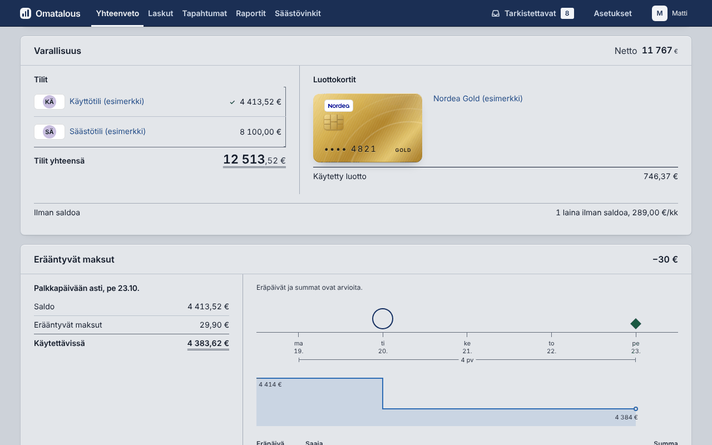
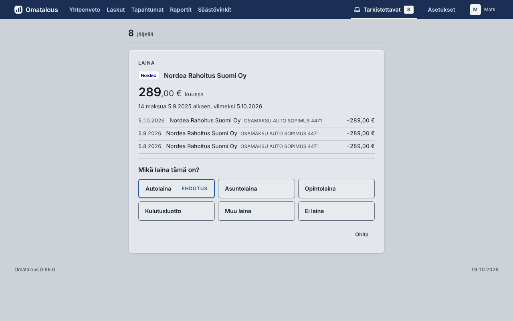
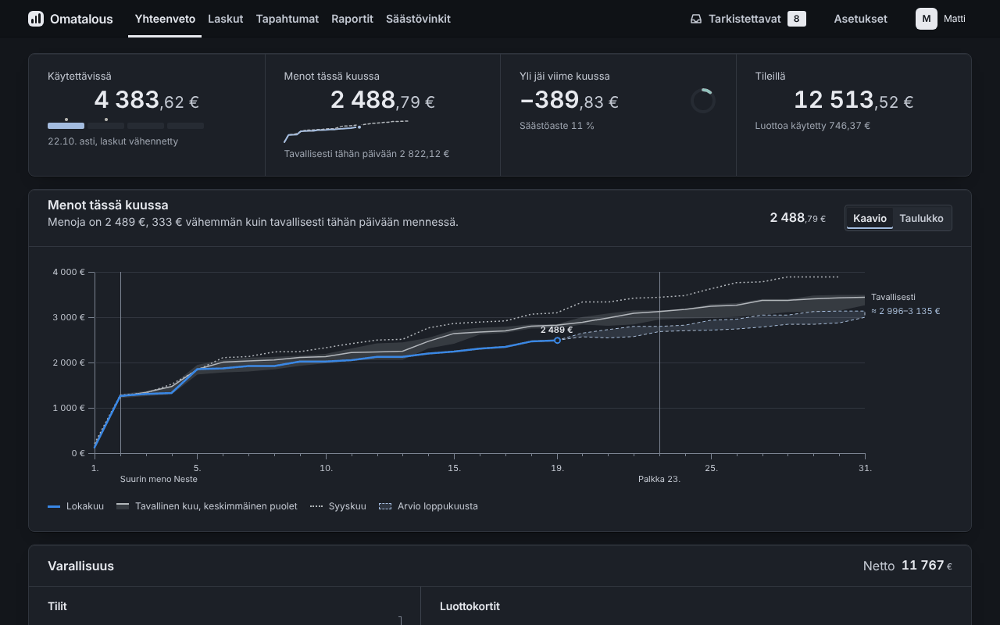
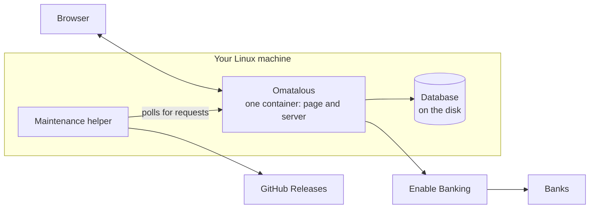

# Omatalous

[](https://buymeacoffee.com/jouni.mikkola)

Omatalous is a personal finance app for a Finnish household that runs in Docker on your own Linux machine and reads
your bank accounts through PSD2, by way of [Enable Banking](https://enablebanking.com).


## What it does

The app fetches the household's transactions from the bank at 6 and 18 by default, sorts each one and shows the result in
Finnish, in a browser on a computer or a phone. All figures above and below are from the example household that comes
with the code.

- Every money movement goes into one of five flows: spending, loan payments, saving, income and borrowing. A move
  between your own accounts counts in none of them, and neither does a card bill when the card's account is connected.
  [Money flows](docs/MONEY_FLOWS.md) explains each rule.
- Yhteenveto (the overview) shows what is available until the next payday after the bills due before it, and how this
  month's spending compares with a usual month on the same day.
- Accounts, credit cards and loans are listed with their balances. A card shows how much of its limit is used.
- Raportit (reports) has 18 reports, among them income against spending month by month, fixed and variable costs,
  price changes of recurring bills and a comparison with the same months a year earlier. A report's table downloads as CSV.
- The app finds subscriptions and bills that repeat, and warns about double charges and late fees. Säästövinkit
  (saving tips) shows where the household could spend less, with the calculation behind each figure.
- A joint account is split between its users by who paid into it, equally or by percentages, and each member sees
  their own part.
- A loan at a lender that is not connected is read from a screenshot, a PDF or pasted text. The reading runs in the
  browser.
- Tarkistettavat (to check) collects every question the app cannot settle itself, such as which kind of loan a
  repeating payment is, and asks them one at a time.
- The database is copied every day. If the database is damaged, the app starts from the newest intact copy. With the
  maintenance helper, updates and rollbacks run from the settings page, and an update that leaves the app not answering
  is taken back.

<table>
<tr>
<td width="50%"></td>
<td width="50%"></td>
</tr>
<tr>
<td>The accounts, the credit card and its used credit.</td>
<td>Transactions of one account with their categories.</td>
</tr>
<tr>
<td></td>
<td></td>
</tr>
<tr>
<td>Where twelve months of income went.</td>
<td>A question the app asks instead of guessing.</td>
</tr>
<tr>
<td> Tilit: how its costs are split, and a monthly table of what each member paid in and their share of the costs"></td>
<td></td>
</tr>
<tr>
<td>A joint account month by month.</td>
<td>The night look.</td>
</tr>
</table>


## Banks

New transactions come from the bank through [Enable Banking](https://enablebanking.com), which is free when you read
only your own accounts. The app only reads: the bank consent covers balances and transactions for at most 180 days, and
the app cannot make payments.

The bank list has 17 Finnish banks and card issuers. The app offers those that Enable Banking's live list has for your
application.

| Bank | Status |
|---|---|
| Nordea | Built and tested mainly with Nordea data, so it works best. |
| OP, Danske Bank, S-Pankki, Säästöpankki, Oma Säästöpankki, POP Pankki, Aktia, Ålandsbanken and the others on the list | Can be connected. Less tested: check the categories of the first month. |

[Connecting a bank](docs/ENABLE_BANKING.md) explains the setup.

## Your data

- Transactions, bank keys and database copies stay on your machine. Nothing is sent to the project.
- The app asks Enable Banking for your transactions. It can also look up business names in the Finnish trade register,
  never amounts, dates, account numbers or names of people, and an admin can turn the lookup off.
- Each household member has a login of their own and sees only their own accounts and those shared with them, read-only.
- Bank keys are stored encrypted with a secret that lives in a file outside the database.

[Security and privacy](docs/SECURITY.md) lists what is stored and what connects where.

## Install

You need Ubuntu Server 26.04 LTS on a machine that stays on at home (x86-64 or arm64, such as a Raspberry Pi), with
2 GB of memory and 20 GB of disk. Paste this into a terminal on that machine, as your normal user:

```bash
curl -fsSLo omatalous-install.sh https://jouni-mikkola.github.io/omatalous/install.sh && echo "b744b460e74dd1a65e9146c85541dcc6d291cd2d16929ac8ac930e4bd50aab38  omatalous-install.sh" | sha256sum -c && bash omatalous-install.sh
```

The command downloads a small script, checks its sha256 against the one in the command and runs it only when they
match. The script is [relay/install.sh](relay/install.sh) in this repository. It puts Omatalous in `~/omatalous` at the
newest release and starts the installer. On a new machine the installer installs Docker and `jq` and gives your user
the Docker right, asking once. If it says your user has no access to Docker, reconnect over SSH and paste the
command again, with the same options if you gave any. It then prints a link, also as a QR code when `qrencode`
is installed. Open it on a device in your home network, create the admin user and follow the setup for connecting your
bank. The [install guide](docs/INSTALL.md) has the same steps with a few more words.

## How it is built



One container holds the page and the server, and the database is a SQLite file on the machine's disk. The helper on
the host runs updates, backups and rollbacks, and takes updates from GitHub Releases.

The code is TypeScript in three packages. `packages/core` holds the rules and the figures with no input or output of
its own, so the same code runs on the server and in the browser. `apps/server` is a [Hono](https://hono.dev) server on
Node.js 22 with its built-in SQLite, and `apps/web` is a React page built with Vite, with charts drawn in SVG by the app
itself. Money is counted in whole cents. A change lands after the type checks, the Vitest suites, the shell suites and the
Playwright tests of the pages pass. See [Architecture](docs/ARCHITECTURE.md) and [Development](docs/DEVELOPMENT.md).

## Documentation

| Document | What is in it |
|---|---|
| [Install](docs/INSTALL.md) | The install step by step, and how to update later. |
| [Connecting a bank](docs/ENABLE_BANKING.md) | Choosing a bank, the two Nordea links, and what the error messages mean. |
| [Troubleshooting](docs/TROUBLESHOOTING.md) | Fixes for what does not work. |
| [Advanced setups](docs/ADVANCED.md) | Use away from home, a second copy for another household, backups and restore, starting over. |
| [Money flows](docs/MONEY_FLOWS.md) | How each transaction is counted. |
| [Security and privacy](docs/SECURITY.md) | What is stored, what connects where and who can see it. |
| [Architecture](docs/ARCHITECTURE.md) | The decisions and the structure of the code. |
| [Development](docs/DEVELOPMENT.md) | Running and testing the code. |
| [Releasing](docs/RELEASING.md) | How a release is made. |
| [Changes](CHANGELOG.md) | What changed in each version. |

To report a vulnerability, follow [SECURITY.md](SECURITY.md). For issues and pull requests, see
[CONTRIBUTING.md](CONTRIBUTING.md).

## Releases

Releases and their notes are on the [releases page](https://github.com/jouni-mikkola/omatalous/releases) and in
[CHANGELOG.md](CHANGELOG.md). Each release is a signed Docker image for linux/amd64 and linux/arm64, and an update checks the
signature before it starts the image. The app offers an update on its maintenance page when the helper is on.

## Support

If Omatalous is useful to you, you can [buy me a coffee](https://buymeacoffee.com/jouni.mikkola) to help cover its
development costs.

## Author

Built and maintained by [Jouni Mikkola](https://www.linkedin.com/in/jouni-mikkola).

## Credits

Omatalous stands on these projects and services.

| Project or service | Used for | Licence or terms |
|---|---|---|
| [Enable Banking](https://enablebanking.com) | the PSD2 connection to the banks | a service under its own terms |
| [PRH open data](https://avoindata.prh.fi) | business names and industries from the Finnish trade register | open data of the Finnish Patent and Registration Office |
| [Hono](https://hono.dev) | the server | MIT |
| [React](https://react.dev) | the page | MIT |
| [Vite](https://vite.dev) | building the page | MIT |
| [Node.js](https://nodejs.org) and its built-in [SQLite](https://sqlite.org) | running the server and the database | MIT, SQLite is in the public domain |
| [pdf.js](https://mozilla.github.io/pdf.js/) | reading a loan statement from a PDF | Apache-2.0 |
| [Tesseract](https://github.com/tesseract-ocr/tesseract) through [tesseract.js](https://github.com/naptha/tesseract.js), with its Finnish and English data | reading a loan statement from a picture | Apache-2.0 |
| [IBM Plex Sans](https://github.com/IBM/plex) | the font | OFL-1.1 |

The notices of every package in the build are in [THIRD_PARTY_NOTICES](THIRD_PARTY_NOTICES).

## Licence

Omatalous is open source under the [GNU Affero General Public License 3.0](LICENSE) (AGPL-3.0-only), with one
additional term under its section 7(b): every copy and every modified version keeps the attribution "Omatalous, Jouni
Mikkola" and a link to https://github.com/jouni-mikkola/omatalous in the app's Tietoja view (Asetukset > Tietoja).
Versions before 0.66.0 stay under the MIT licence, and 0.66.0 under the Omatalous Personal Use License 1.0.

The Nordea logo in `apps/web/public/banks/` is Nordea's trademark, and the licence does not cover it. The other banks'
logos are fetched from Enable Banking while the app runs and are not in this repository. The built app and the Docker
image also carry works under other licences, among them Apache-2.0 ones (pdf.js, Tesseract and its language data) for
the loan reader. The notices of all packages in the build are in `THIRD_PARTY_NOTICES`, also in the image. The
reader's licence texts are in `/THIRD-PARTY-LICENSES.txt`, which the app serves. That file covers the reader's parts
only: React and the IBM Plex fonts are not in it.
