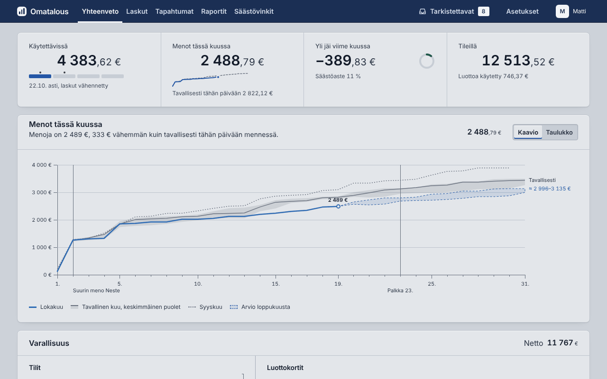
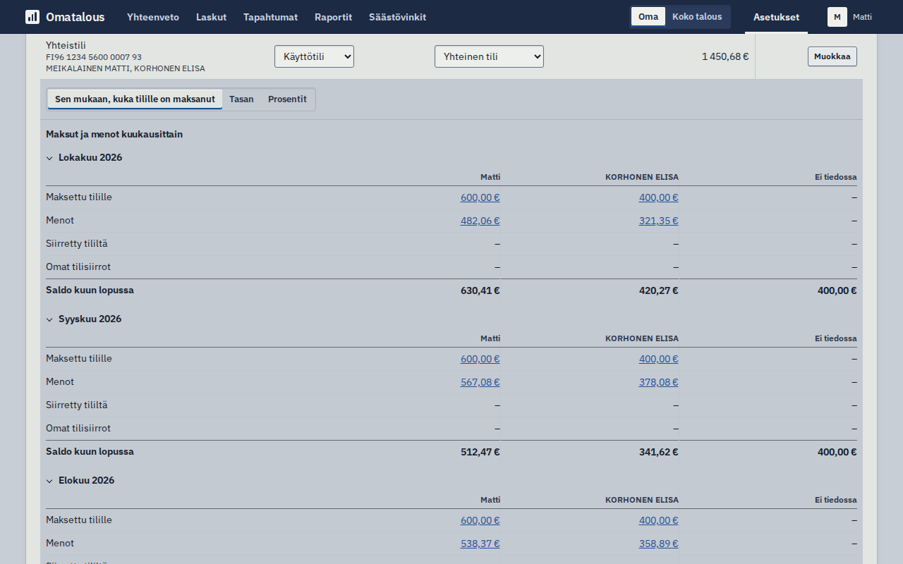
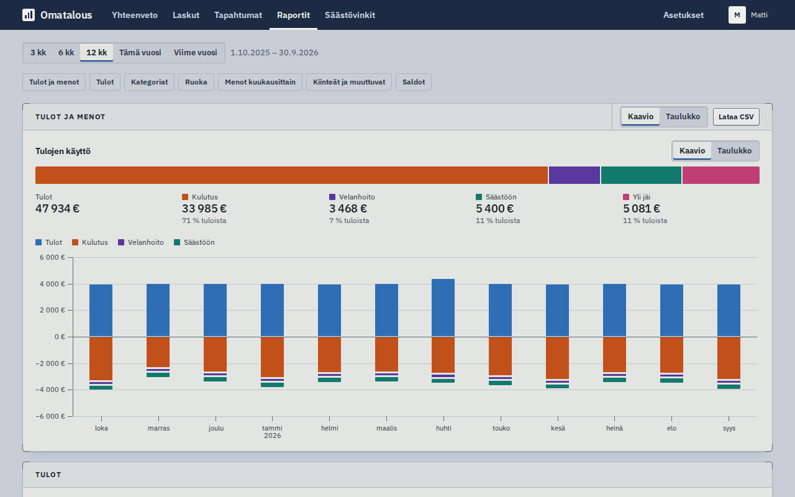
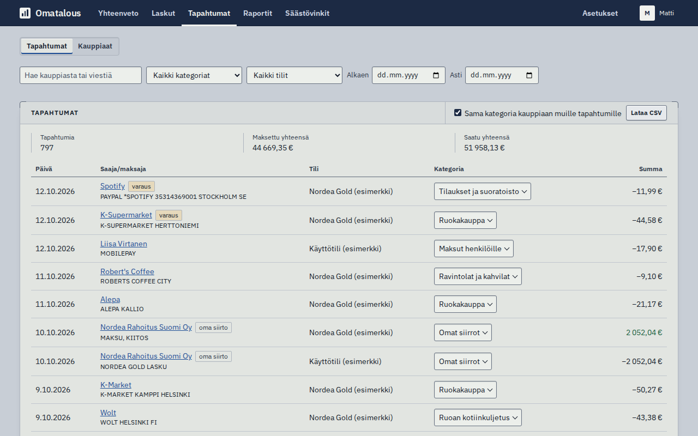
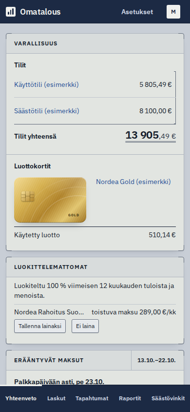
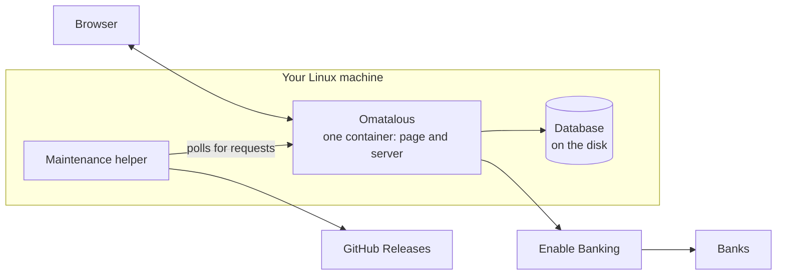

# Omatalous

Omatalous shows a Finnish household's bank accounts, cards and loans in one view, with who paid what and what is coming.
It runs on your own Linux machine at home and you use it in a browser, in Finnish. Your data stays on that machine.



## What it does

- **Accounts, cards and loans at a glance.** Yhteenveto (the overview) lists each account with its balance and each
  card with how much of its limit is used. Each loan shows what is left and the payment a month. A card compares the
  month's costs so far with the month before on the same day.
- **Where the money goes.** Transactions are sorted into spending, loan payments, saving and income, and into
  categories you can change by hand. Raportit (reports) shows spending by theme, food, income and the findings of
  Säästövinkit (saving tips).
- **Bills ahead and what is left.** Erääntyvät maksut (payments due) counts the days to your next payday and lists
  the bills before it. It adds your usual daily spending and shows what should be left the day before the pay.
  Without a regular pay it looks 30 days ahead and says why.
- **Joint accounts.** Each member's own view counts their part of a joint account. In Asetukset (settings) > Tilit
  you choose how the account is split: by who paid into it, equally or by percentages. A monthly table shows what
  each member paid in and their share of the costs.
- **Recurring bills and cost traps.** The app finds subscriptions and bills that repeat. It warns about double charges
  and late fees.
- **Loans from a statement.** A loan at a lender that is not connected is added from a pasted screenshot, a PDF or
  text. The browser reads it, and the loan counts in the reports.
- **Members and what each sees.** Each household member has a login of their own. Accounts can be shared read-only,
  and a member sees only what is shared with them.
- **Backups and updates.** The app copies its database every day and starts from the newest intact copy if the
  database is damaged. With the maintenance helper, Asetukset > Tekniset asetukset > Ylläpito updates
  the app or rolls it back, and an update that leaves the app not answering is taken back by itself.

<table>
<tr>
<td></td>
<td></td>
</tr>
<tr>
<td>Tilit: a joint account, month by month: what each member paid in and their share of the costs.</td>
<td>Raportit: where the money went, month by month.</td>
</tr>
<tr>
<td></td>
<td></td>
</tr>
<tr>
<td>Tapahtumat: the transactions, each with its category.</td>
<td>Yhteenveto on a phone.</td>
</tr>
</table>

## Banks

New transactions come from the bank through [Enable Banking](https://enablebanking.com), which is free for your own
accounts. The app only reads: the bank consent covers transactions and balances for at most 180 days, and the app cannot
make payments.

| Bank | Status |
|---|---|
| Nordea | Built and tested mainly with Nordea data, so it works best. |
| OP, Danske Bank, S-Pankki, the savings banks, Aktia and other Finnish banks that Enable Banking offers | Can be connected. Less tested: check the categories of the first month. |

[Connecting a bank](docs/ENABLE_BANKING.md) lists the banks and explains the setup.

## Your data

- Transactions, bank keys and backups stay on your machine. Nothing is sent to the project.
- The app asks Enable Banking for your transactions. It can also look up business names in the Finnish trade register,
  and an admin can turn that off.
- Each member logs in separately. A member sees of another only the names of an account's users and the loans paid from
  an account they can see.
- The database is copied daily to the machine's disk.

[Security and privacy](docs/SECURITY.md) lists what is stored and what connects where.

## Install

You need Ubuntu Server 26.04 LTS on a machine that stays on at home, with 2 GB of memory and 20 GB of disk. Paste this
into a terminal on that machine, as your normal user:

```bash
curl -fsSLo omatalous-install.sh https://jouni-mikkola.github.io/omatalous/install.sh && echo "b744b460e74dd1a65e9146c85541dcc6d291cd2d16929ac8ac930e4bd50aab38  omatalous-install.sh" | sha256sum -c && bash omatalous-install.sh
```

The command downloads a small script, checks its sha256 against the one in the command and runs it only when they
match. The script is [relay/install.sh](relay/install.sh) in this repository. It puts Omatalous in `~/omatalous` at the
newest release and starts the installer. On a new machine the installer installs Docker and `jq` and gives your user
the Docker right, asking once. If it says your user has no access to Docker, reconnect over SSH and paste the
command again, with the same options if you gave any. It then prints a link, also as a QR code when `qrencode`
is installed. Open it on a device in your home network, create the admin user and follow the setup for connecting your
bank. The [install guide](docs/INSTALL.md) has the same steps with a few more words.

## How it is built



One container holds the page and the server, and the database is a file on the machine's disk. The helper on the host
runs updates, backups and rollbacks, and takes updates from GitHub Releases. See [Architecture](docs/ARCHITECTURE.md).

## Documentation

| Document | What is in it |
|---|---|
| [Install](docs/INSTALL.md) | The install step by step, and how to update later. |
| [Connecting a bank](docs/ENABLE_BANKING.md) | Choosing a bank, the two Nordea links, and what the error messages mean. |
| [Troubleshooting](docs/TROUBLESHOOTING.md) | Fixes for what does not work. |
| [Advanced setups](docs/ADVANCED.md) | Use away from home, a second copy for another household, backups and restore, starting over. |
| [Money flows](docs/MONEY_FLOWS.md) | How each transaction is counted. |
| [Security and privacy](docs/SECURITY.md) | What is stored, what connects where and who can see it. |
| [Architecture](docs/ARCHITECTURE.md) | The decisions and the structure of the code. |
| [Development](docs/DEVELOPMENT.md) | Running and testing the code. |
| [Releasing](docs/RELEASING.md) | How a release is made. |
| [Changes](CHANGELOG.md) | What changed in each version. |

To report a vulnerability, follow [SECURITY.md](SECURITY.md). For issues and pull requests, see
[CONTRIBUTING.md](CONTRIBUTING.md).

## Releases

Releases and the changelog are on the [releases page](https://github.com/jouni-mikkola/omatalous/releases) and in
[CHANGELOG.md](CHANGELOG.md). The app offers an update on its maintenance page when the helper is on.

## Author

Built and maintained by [Jouni Mikkola](https://www.linkedin.com/in/jouni-mikkola).

Omatalous is free and open source. If you find it useful, you can
[help cover its development costs](https://buymeacoffee.com/jouni.mikkola).

## Licence

MIT, see [LICENSE](LICENSE). The Nordea logo in `apps/web/public/banks/` is Nordea's trademark, and the licence does not
cover it. The other banks' logos are fetched from Enable Banking while the app runs and are not in this repository.
The built app and the Docker image also carry works under other licences, among them Apache-2.0 ones (pdf.js,
Tesseract and its language data) for the loan reader. Their licence texts are in `/THIRD-PARTY-LICENSES.txt`, which the
app serves. That file covers the reader's parts only: React and the IBM Plex fonts are not in it.
