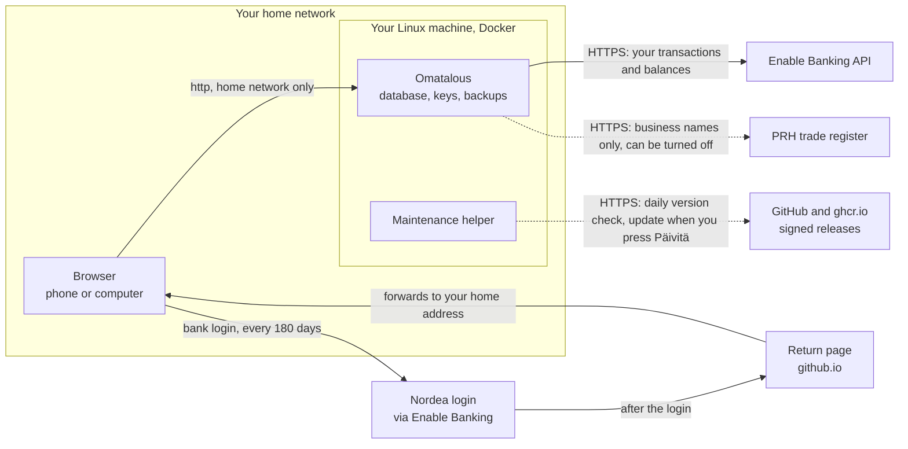

# Omatalous

Omatalous gathers a Finnish household's Nordea accounts and credit cards into one view and shows where the money goes.
It runs on your own Linux machine at home, and you use it in a browser, in Finnish.

<a href="#screenshots"></a>

- Fetches new Nordea transactions by itself through Enable Banking, which is free for your own accounts
- Sorts every purchase, loan payment, saving and income, and finds recurring bills and subscriptions
- Warns about double charges and late fees
- Gives each household member a login of their own, with accounts shared read-only when they want
- Updates from a button in the browser and goes back by itself if an update fails

## Install

You need Ubuntu Server 26.04 LTS on a machine that stays on at home, with 2 GB of memory and 20 GB of disk.

```bash
sudo apt update && sudo apt install -y git jq
curl -fsSL https://get.docker.com | sudo sh
sudo usermod -aG docker $USER        # then log out and back in

git clone https://github.com/jouni-mikkola/omatalous.git
cd omatalous
./scripts/install.sh
```

The installer prints a link. Open it on a device in your home network, create the admin user and follow the checklist
for connecting Nordea. The [install guide](docs/INSTALL.md) has the same steps with a few more words.

## Update

*Asetukset > Ylläpito* tells you when a new version is out. Press *Päivitä*.

## What connects where



- Nothing on the internet can reach the app. It listens only on your home network.
- The app itself talks to Enable Banking, which fetches your transactions from Nordea. The trade register gets only the
  names of businesses you paid, to tell a shop from a restaurant, never amounts, dates or account numbers.
- When you link a bank, your browser logs in on Nordea's page and comes back through the project's return page, which
  only forwards it to your home address and stores nothing.
- Your transactions, settings, bank keys and backups stay on your machine. Nothing is sent to the project.

Using the app away from home adds Cloudflare or an open port, see [Away from home](docs/ADVANCED.md#away-from-home). The
details are in [Security and privacy](docs/SECURITY.md).

## More

| When you want to | Read |
|---|---|
| Fix something that does not work | [Troubleshooting](docs/TROUBLESHOOTING.md) |
| Use the app away from home | [Away from home](docs/ADVANCED.md#away-from-home) |
| Give your parents or another household a copy of their own | [A second copy](docs/ADVANCED.md#a-second-copy-on-the-same-machine) |
| Back up to a NAS or move to a new machine | [Backups](docs/ADVANCED.md#backups) |
| Know how the money is counted | [Money flows](docs/MONEY_FLOWS.md) |
| Know what is stored and who can see it | [Security and privacy](docs/SECURITY.md) |

For developers: [development](docs/DEVELOPMENT.md), [architecture](docs/ARCHITECTURE.md), [releasing](docs/RELEASING.md)
and the [changes](CHANGELOG.md) in each version. Report a vulnerability as [SECURITY.md](SECURITY.md) says.

## Screenshots

The pictures use demo data.

<table>
  <tr>
    <td width="50%"><a href="#screenshots"></a><br>Yleiskatsaus</td>
    <td width="50%"><a href="#screenshots"></a><br>Raportit</td>
  </tr>
  <tr>
    <td><a href="#screenshots"></a><br>Tapahtumat</td>
    <td><a href="#screenshots"></a><br>Kategoriat, Kauppiaat</td>
  </tr>
  <tr>
    <td><a href="#screenshots"></a><br>Toistuvat</td>
    <td><a href="#screenshots"></a><br>Puhelimella</td>
  </tr>
</table>

## Licence

MIT, see [LICENSE](LICENSE). The bank logos in `apps/web/public/banks/` are the banks' trademarks, and the licence does
not cover them.
