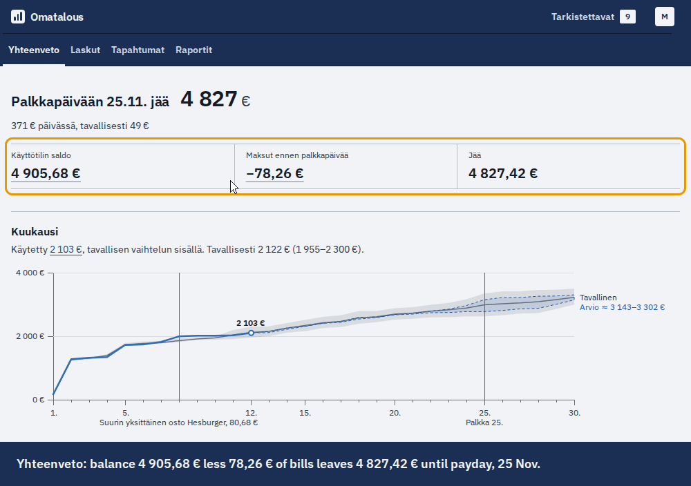
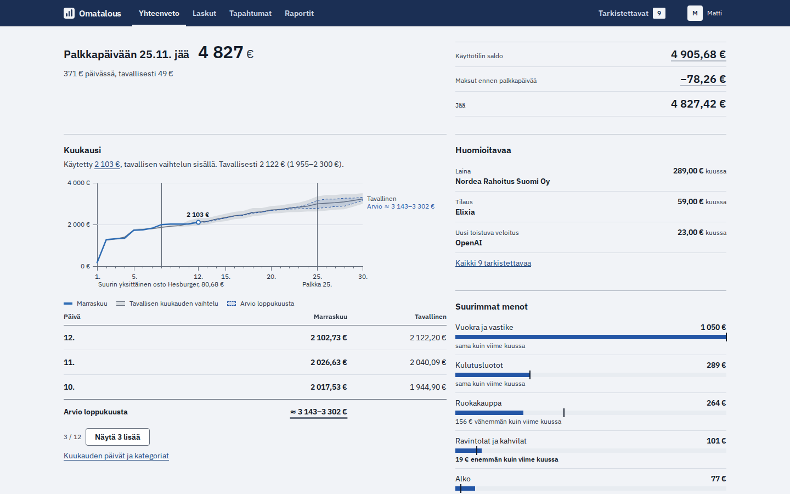
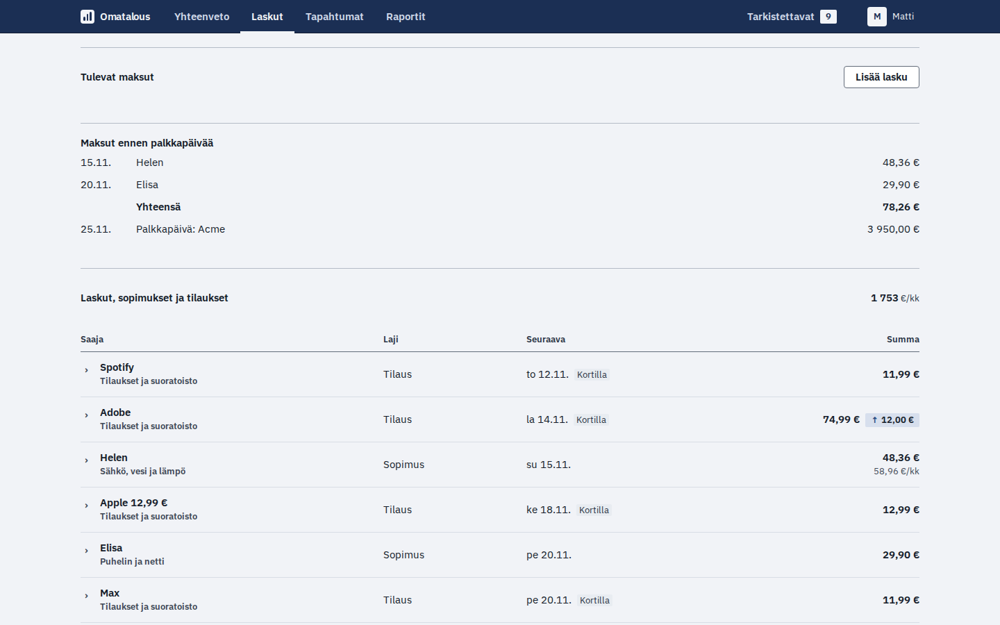
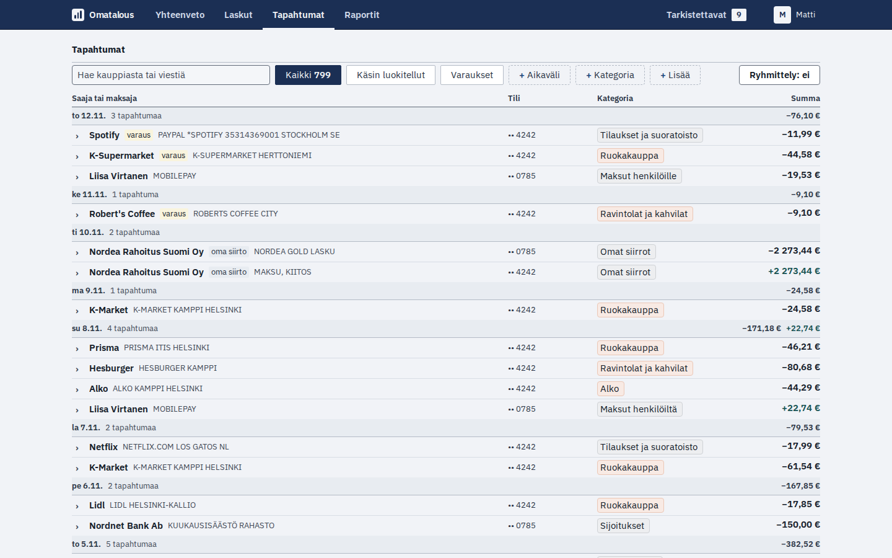
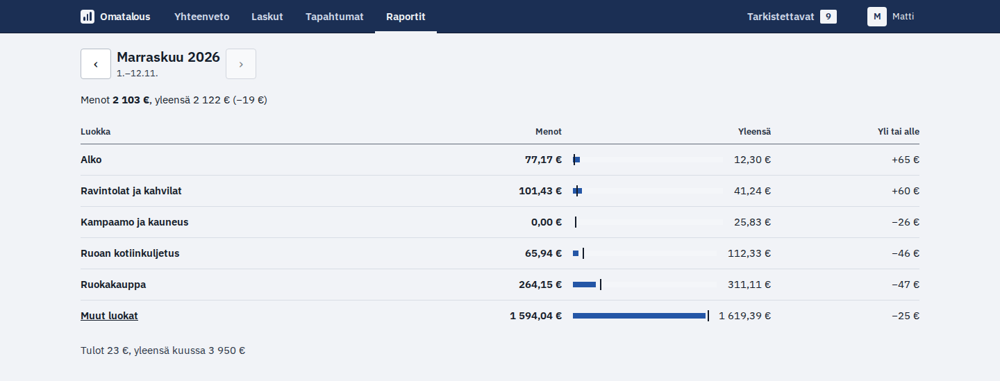
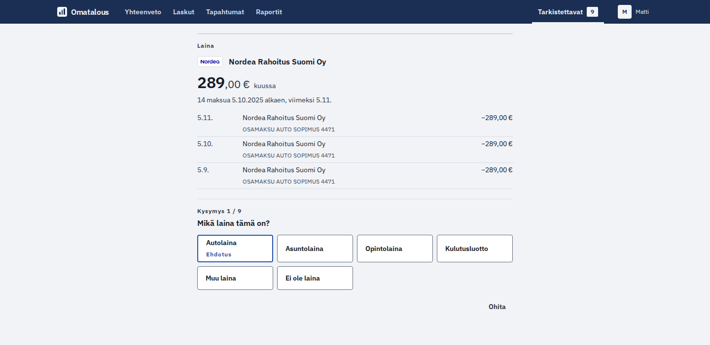
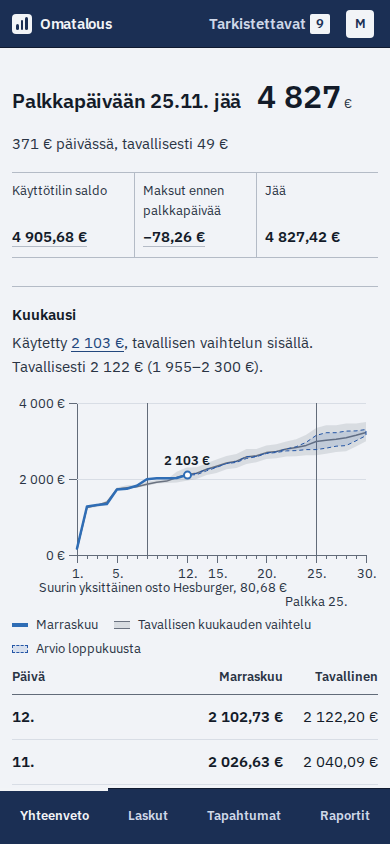

# Omatalous

Omatalous is a personal finance app for a Finnish household. It runs on a Linux machine in your home, reads your bank
accounts through [Enable Banking](https://enablebanking.com) and sorts every transaction into a category. It opens on
one sum: what is left until the next payday after the bills due before it.

A loop of about 40 seconds through the app with its example household, from the first transactions to the phone.

<picture>
  <source media="(prefers-reduced-motion: reduce)" srcset="docs/images/tour-still.png">
  
</picture>

## What it looks like

The pictures show the example household that comes with the app. The app is in Finnish or English, and the menu
under your name switches between them. These pages use the Finnish names.

Yhteenveto, the first page, shows the sum left until payday and the month's spending.



Laskut lists the bills due before payday and the payments that repeat.



Tapahtumat has every transaction with its category.



Raportit shows where the money went, against a usual month.



Tarkistettavat asks what the app cannot settle by itself, one question at a time.



Yhteenveto fits a phone.



## Install

You need Ubuntu Server 26.04 LTS on a machine that stays on at home (x86-64 or arm64, such as a Raspberry Pi), with
2 GB of memory and 20 GB of disk. Paste this into a terminal on that machine, as your normal user:

```bash
curl -fsSLo omatalous-install.sh https://jouni-mikkola.github.io/omatalous/install.sh && echo "481871f3ed740a5d2fdd91c30ca62253ccd32705f6ff6eeb60747694c77591db  omatalous-install.sh" | sha256sum -c && bash omatalous-install.sh
```

The command downloads [a small script](relay/install.sh) and runs it only when it matches the hash. After 5 to 10
minutes the installer prints the address of the app and a setup link. The [install guide](docs/INSTALL.md) has each
step.

## First steps

1. Open the setup link on a phone or computer in your home network and create the first user. That user is the admin.
   Bookmark the address the installer printed. The whole household uses it.
2. To look around before you connect a bank, press *Lataa esimerkkitiedot* on the empty first page. You can remove
   the example data later in *Asetukset*.
3. Connect your bank. You first register a free app at Enable Banking with your email, and the setup walks you
   through it. It takes about 15 minutes, see [Connecting a bank](docs/ENABLE_BANKING.md).
4. Add the other members of the household in *Asetukset*. Each has a login of their own and connects their own bank.

After that the app fetches new transactions twice a day. Check the categories of the first month and answer what
*Tarkistettavat* asks.

## Banks

The app can connect Nordea, OP, Danske Bank, S-Pankki, the savings banks, POP Pankki, Aktia, Ålandsbanken and some card
issuers. It was built and tested mainly with Nordea, so the categories of another bank need more checking in the first
month.

The connection only reads balances and transactions. The app cannot make payments. A consent lasts at most 180 days,
and then you log in at the bank again.

An account the bank does not give can be filled from a statement file: the bank's CSV export, a camt.053 statement or
a card statement. The file is read in your browser.

## Your data

Transactions, bank keys and database copies stay on your machine. The project runs no server and gets none of them.
The app calls Enable Banking for your transactions and GitHub for updates. It can also look up business names in the
Finnish trade register, never amounts, dates, account numbers or names of people, and an admin can turn the lookup
off. When the app has a plain http address, the browser comes back from the bank login through a static page of this
project on GitHub Pages. [Security and privacy](docs/SECURITY.md) lists what is stored and what connects where.

## Where to go next

| Using the app | |
|---|---|
| [Install](docs/INSTALL.md) | The install step by step, and updates. |
| [Connecting a bank](docs/ENABLE_BANKING.md) | The steps, renewing a connection and the error messages. |
| [Troubleshooting](docs/TROUBLESHOOTING.md) | What to do when something does not work. |
| [Advanced setups](docs/ADVANCED.md) | Use away from home, backups and restore, a second copy, starting over. |
| [Money flows](docs/MONEY_FLOWS.md) | How each transaction is counted. |
| [Security and privacy](docs/SECURITY.md) | What is stored, what connects where and who can see it. |
| [Changes](CHANGELOG.md) | What changed in each version. |

To work on the code, start from [Development](docs/DEVELOPMENT.md), [Architecture](docs/ARCHITECTURE.md),
[Releasing](docs/RELEASING.md) and [CONTRIBUTING.md](CONTRIBUTING.md). To report a vulnerability, follow
[SECURITY.md](SECURITY.md). `pnpm build && pnpm readme:film` makes the film at the top of this page again from the
example household.

## Licence

Omatalous is open source under the [GNU Affero General Public License 3.0](LICENSE) (AGPL-3.0-only). Every copy and
modified version keeps the attribution "Omatalous, Jouni Mikkola" and a link to this repository in the footer of the
app. [LICENSE](LICENSE) has the terms, also those of earlier versions.

The Nordea logo in `apps/web/public/banks/` is Nordea's trademark, and the licence does not cover it. The notices of
every package in the build are in [THIRD_PARTY_NOTICES](THIRD_PARTY_NOTICES).

Omatalous is built and maintained by [Jouni Mikkola](https://www.linkedin.com/in/jouni-mikkola). If it is useful to
you, you can [buy me a coffee](https://buymeacoffee.com/jouni.mikkola).
