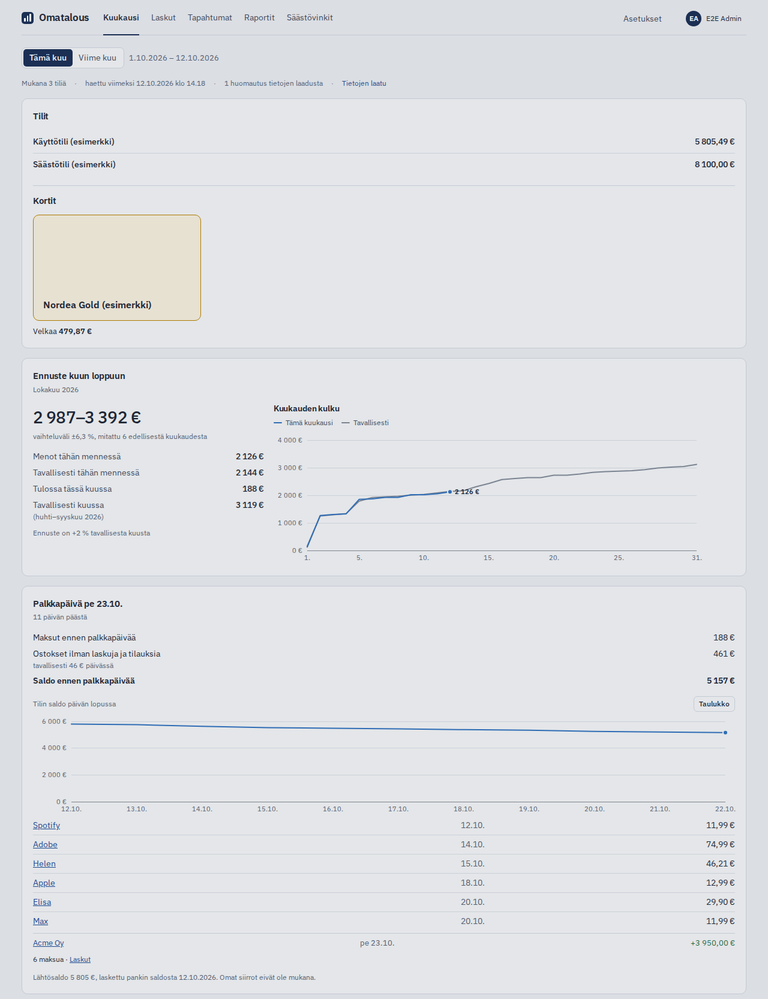

# Omatalous

Omatalous gathers a Finnish household's bank accounts and credit cards into one view and shows where the money goes.
It runs on your own Linux machine at home, and you use it in a browser, in Finnish.

New transactions come from the bank through Enable Banking, which is free for your own accounts. Nordea works best, and
OP, Danske Bank, S-Pankki, the savings banks, Aktia and the other Finnish banks that Enable Banking offers can be
connected too. Omatalous sorts the rows into spending, loan payments, saving and
income, finds recurring bills and warns about double charges and late fees. A loan at a lender that is not connected can
be added from a pasted screenshot, a PDF or text, which is read in the browser, and then counts in the reports. Each
household member has a login of their own, and accounts can be shared read-only. Your transactions, bank keys and
backups stay on your machine. Nothing is sent to the project. The app keeps daily copies of its database and starts on
the newest intact copy if the database is damaged, and with the maintenance helper an update that leaves the app not
answering is taken back by itself.



## Install

You need Ubuntu Server 26.04 LTS on a machine that stays on at home, with 2 GB of memory and 20 GB of disk. Paste this
into a terminal on that machine, as your normal user:

```bash
curl -fsSLo omatalous-install.sh https://jouni-mikkola.github.io/omatalous/install.sh && echo "b744b460e74dd1a65e9146c85541dcc6d291cd2d16929ac8ac930e4bd50aab38  omatalous-install.sh" | sha256sum -c && bash omatalous-install.sh
```

The command downloads a small script, checks its sha256 against the one in the command and runs it only when they
match. The script is [relay/install.sh](relay/install.sh) in this repository. It puts Omatalous in `~/omatalous` at the
newest release and starts the installer. On a new machine the installer installs Docker and `jq` and gives your user
the Docker right, asking once. If it says your user has no access to Docker, close the SSH connection, open it again and
paste the command again, with the same options if you gave any. It then prints a link, also as a QR code when `qrencode`
is installed. Open it on a device in your home network, create the admin user and follow the setup for connecting your
bank. The [install guide](docs/INSTALL.md) has the same steps with a few more words.

## More

| When you want to | Read |
|---|---|
| Install step by step, and update later | [Install](docs/INSTALL.md) |
| Choose a bank, understand the two Nordea links, or read an error message | [Connecting a bank](docs/ENABLE_BANKING.md) |
| Fix something that does not work | [Troubleshooting](docs/TROUBLESHOOTING.md) |
| Use the app away from home | [Away from home](docs/ADVANCED.md#away-from-home) |
| Give your parents or another household a copy of their own | [A second copy](docs/ADVANCED.md#a-second-copy-on-the-same-machine) |
| Back up to a NAS or move to a new machine | [Backups](docs/ADVANCED.md#backups) |
| Restore a backup, or empty the data and start over | [Restore a backup](docs/ADVANCED.md#restore-a-backup), [Start over](docs/ADVANCED.md#start-over) |
| Know how the money is counted | [Money flows](docs/MONEY_FLOWS.md) |
| Know what is stored, what connects where and who can see it | [Security and privacy](docs/SECURITY.md) |

For developers: [development](docs/DEVELOPMENT.md), [architecture](docs/ARCHITECTURE.md), [releasing](docs/RELEASING.md)
and the [changes](CHANGELOG.md) in each version. Report a vulnerability as [SECURITY.md](SECURITY.md) says. Issues and pull requests: [CONTRIBUTING.md](CONTRIBUTING.md).

## Licence

MIT, see [LICENSE](LICENSE). The Nordea logo in `apps/web/public/banks/` is Nordea's trademark, and the licence does not
cover it. The other banks' logos are fetched from Enable Banking while the app runs and are not in this repository.
The built app and the Docker image also carry works under other licences, among them Apache-2.0 ones (pdf.js,
Tesseract and its language data) for the loan reader. Their licence texts are in `/THIRD-PARTY-LICENSES.txt`, which the
app serves. That file covers the reader's parts only: React and the IBM Plex fonts are not in it.
