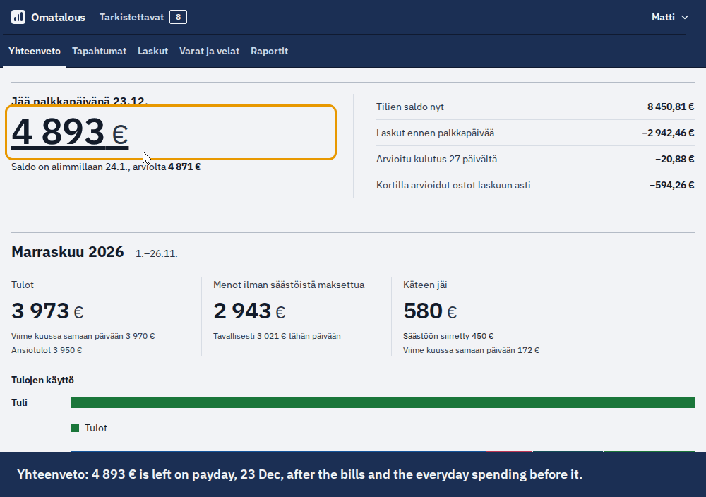

# Omatalous

Self-hosted personal finance app for Finnish households. It reads bank accounts through PSD2 and sorts the
transactions into money flows.

<picture>
  <source media="(prefers-reduced-motion: reduce)" srcset="docs/images/tour-still.png">
  
</picture>

## Features

- Reads balances and transactions through [Enable Banking](https://enablebanking.com). Read-only: the app cannot make payments.
- Works with Nordea, OP, Danske Bank, S-Pankki and the [other Finnish banks](docs/ENABLE_BANKING.md#which-banks)
  Enable Banking offers. It was built with Nordea's data. A bank connection lasts 180 days.
- Sorts each transaction into a category and a money flow (consumption, debt, saved, income, borrowed) or a transfer.
- Shows the sum left on the next payday after the bills due before it.
- Lists bills by day, and income and spending by month and category.
- Tracks accounts, cards and loans.
- Several users in one household, with optional read-only sharing of accounts.
- Loads a statement file (CSV or camt.053) in the browser when a bank gives no account.
- The interface is in Finnish.

## Install

Needs Ubuntu Server 26.04 LTS on a machine that stays on (x86-64 or arm64), with 2 GB of memory and 20 GB of disk.
Run this in a terminal on that machine, as your normal user:

```bash
curl -fsSLo omatalous-install.sh https://jouni-mikkola.github.io/omatalous/install.sh && echo "481871f3ed740a5d2fdd91c30ca62253ccd32705f6ff6eeb60747694c77591db  omatalous-install.sh" | sha256sum -c && bash omatalous-install.sh
```

The script is [relay/install.sh](relay/install.sh). The [install guide](docs/INSTALL.md) has each step.

## Documentation

- [Connecting a bank](docs/ENABLE_BANKING.md)
- [Security and privacy](docs/SECURITY.md)
- [Troubleshooting](docs/TROUBLESHOOTING.md)
- [Contributing](CONTRIBUTING.md) and [development](docs/DEVELOPMENT.md)

The app makes no backups: back up the data folder yourself.

## Licence

[AGPL-3.0-only](LICENSE). Every copy and modified version keeps the attribution "Omatalous, Jouni Mikkola" and a link
to this repository in Asetukset > Turvallisuus. The Nordea logo in `apps/web/public/banks/` is Nordea's trademark and
is not covered by the licence. [THIRD_PARTY_NOTICES](THIRD_PARTY_NOTICES) lists the notices of the packages in the build.
