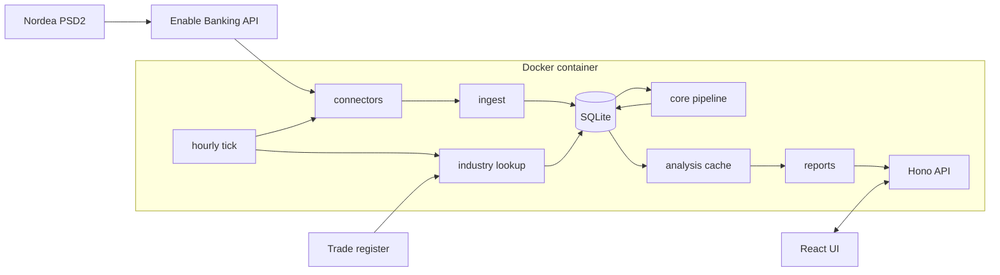

# Architecture

Omatalous fetches a household's Nordea transactions through PSD2, sorts them into money flows and builds an
overview and reports from them. Each member has their own login and views; accounts can be shared.

## Decisions

### Own Linux machine with Docker, not Cloudflare Workers

| | Linux + Docker (chosen) | Cloudflare Workers |
|---|---|---|
| Cost | free | the free plan is not enough, Workers Paid is $5/month |
| CPU limit | none | 10 ms per request on the free plan |
| Bank data | on your own disk | in Cloudflare's database |
| Upkeep | keep the VM on, backups are scripted | none |

With about 3 700 transactions (two years for a household), building the overview takes about 11 ms of CPU,
so the free Workers plan would run out as data grows. Omatalous runs only in Docker on Linux. The Workers
version was removed in 0.3.0.

### One container for the whole household

| | One container, many users (chosen) | One container per person |
|---|---|---|
| Upkeep | one install, update and backup | everything twice |
| Shared view | shared accounts and a household view | not possible |
| Isolation | `user_id` on every row, enforced by the repository, tested | by process |

Isolation does not rely on every query being written correctly. Financial data is reached only through
`FinanceRepo`, which is bound to one user. Another member's account is reached only through
`HouseholdRepo`, and only if the owner shared it, read-only.

### Enable Banking for bank data

| Option | Status |
|---|---|
| Enable Banking (Finnish) | chosen: free for your own accounts in restricted mode, supports Nordea FI |
| Nordea Open Banking directly | needs a PSD2 licence |
| GoCardless Bank Account Data | no new sign-ups |
| Tink, Plaid, Yapily | business pricing |
| CSV from Nordea's online bank | was the fallback and the source of older history; the import was removed in 0.9.0 |

PSD2 limits: consent for at most 180 days, banks may limit automatic fetches to four a day per account,
the bank decides how much history it gives (the first fetch asks for up to two years).

### One table for lists of rows

Every list of comparable rows uses `apps/web/src/components/table/Table.tsx` and `styles/table.css`.
Pages supply cells and the server's totals; the component never adds money. It owns captions, scoped headers,
opt-in sorting, groups, detail rows and pagination. When its container is narrow or its columns do not fit,
each row becomes a block; series columns open as a labelled list beneath it. No table scrolls sideways.
One subject's facts use `KeyValue` (`dl`); an empty list uses a sentence. A redundant view is deleted with its
styles, tests and texts (see [ADR 0018](adr/0018-one-table-delete-redundant-views.md)).

## Structure

- Domain logic in `@banking/core` is pure, so the server and the browser share it and tests need no mocks.
- A place transactions come from is a connector (`apps/server/src/connectors/`, listed in `registry.ts`): an `id`, an
  optional `sync` and an optional `revokeAll` (`connectors/types.ts`). It owns its link flow and settings and answers a
  pull with rows and a balance. `connectors/sync.ts` is the one loop around it: the lock, the run record, the ten day
  overlap, balances, reprocessing and the register lookup. The stored ids `enablebanking` and `csv` are connector ids,
  `demo` marks the demo data, and none of them ever changes.
- No route takes a file: the CSV import and its parser were removed in 0.9.0, and every request body is limited to
  256 KB. The id `csv` and `connectors/csv-import/index.ts` stay for the accounts and rows that earlier versions
  imported. They are counted like any others, and linking a bank folds a CSV account with the same IBAN into the bank's
  account (`connectors/fold-accounts.ts`), so the sync skips what it already has.
- All SQL is in `db/` (`*-repo.ts`, and `db/finance/` for the modules behind `FinanceRepo`) and goes through a small `Db`
  interface over node:sqlite.
- Bank data is stored as received. Categories and transfers are derived from it again whenever something
  changes, so a new rule applies to all history at once, and a category set by hand stays.
- A category comes from the first that applies: the user's rules, built-in rules, the card's merchant code
  (MCC), the category most of the same merchant's other rows got, the merchant's industry from the trade
  register. Otherwise a default.
- The row logic of core is a few files, each with one owner (the order of the steps: [MONEY_FLOWS.md](MONEY_FLOWS.md#how-a-row-is-read)).
  `merchant.ts` works out the merchant name. `categorize.ts` holds the rules and the order they are read in;
  `categorize-people.ts` holds the rules about people (the holders of the accounts, MobilePay, the bank's own words for a
  payment between people), and `categorize-bank-rows.ts` the lenders by the shape of their name, by their own payout and
  by the register, and the rows of the bank itself. `transfers.ts` pairs rows between own accounts and holds the
  issuer fallback. `card-channel.ts` learns each connected card's payment channel from the pairs and decides a payment to
  it. The channel is worked out on every run and stored nowhere (ADR 0015). `pipeline.ts` runs them in order.
  `categorize` takes the accounts, since the holders come from them (`accounts.holder`).
- Industry lookup (`services/industry.ts`, `providers/prh`): merchants nothing recognises, from business
  rows only and never under a name that may be a person's (`isLookupName`, `mayBePerson` in `payee-guard.ts`), are
  searched by name in the Finnish trade register. `askRegister` is the one door to it. Core `industry.ts` picks the matching
  company. Answers are kept per merchant name in `merchant_industry`, so a name is looked up once, and
  `merchant_industry_users` records which names each user's lookups asked about. A user gets answers only
  for those names. The category is worked out from the stored TOL code at every reprocess, so a change to
  the mapping needs no new lookup. What is sent: [SECURITY.md](SECURITY.md#trade-register-lookup).
- Loans (`packages/core/src/loans.ts`, ADR 0012): the loans a user confirmed are rows of `loans`, one list per user.
  Every figure of one loan (owed on a day, interest, payoff date, next payment, credit use) comes from that file, and the
  list of the household's debts behind every debt total (`householdDebts`) from `household-debts.ts`. A loan can name the
  connected card or loan account that is the same debt (`loans.account_id`, migration 0016, cleared when the account is
  removed). The server accepts only the owner's own card or loan account, and one loan for an account. A linked pair
  counts once, in `connected` of `householdDebts`: the bank's balance with the saved loan's rate and payments. The link
  holds only while the account's balance is at or below zero and is not older than the balance typed for the loan
  (`balanceDayOf`). Otherwise, and in the months of Saldot before the account's first known balance, the saved loan
  counts as typed, still once. The loan form reads the household's accounts and loans from the context `LoanLinks`
  (`components/loans/LoanEditor.tsx`), and `#/settings?linkLoan=<loan id>&linkAccount=<account id>#lainat` opens a
  loan's form with that account chosen, once.
  The page that makes them (`pages/settings/LoanIntake.tsx`) reads a pasted picture, a PDF or a text in the browser
  (`components/loans/`, Tesseract and pdf.js served from the app's own `/assets`) and core's `loan-intake/` turns the
  lines into a draft with a mark on each field; the server sees only what the household saves.
  `loan-detect.ts` proposes loans from payments, and `GET /api/loans/proposals` works them out for each request.
- Bank logos: `connectors/enable-banking/logos.ts` fetches the logo of a bank on the household's list from Enable
  Banking's website and `routes/bank-logos.ts` serves it from the app's own address, so the browser calls no third
  party. Nordea's is the one logo in the repository.
- Lookups also start without waiting for the tick: `startLookup` in `services/industry.ts` works through
  everything due in batches of 30 names in the background (`drainLookups`; a tick does at most ten
  batches), after a fetch that brought new rows
  and when an admin turns the lookup on. A failure is only logged.
- One hourly tick (`services/schedule.ts`, run by croner): the daily database copy, bank fetches in the
  chosen hours, register lookups, removal of expired sessions and abandoned bank authorisations.
- The daily copy is `VACUUM INTO` (`dailyBackup` in `db/open.ts`) to `<data>/backups/auto-YYYY-MM-DD.db`.
  The first tick of a local day writes it, a failed one is tried again at the next tick, and the seven
  newest stay. The copy made before a migration is separate (`pre-*.db`, five kept). Every copy counts only
  after the file and its folder are flushed to disk (`platform/durable.ts`) and the copy has been opened and checked.
  What keeps the copies safe is under [Keeping the data safe](#keeping-the-data-safe).
- The analysis context is built once per user data version; a request only filters and adds up.
- Themes are the main classes above the categories. `themes.ts` gives every row of spending one theme and one
  line in it; `analysis/themes-report.ts` sums them over the last twelve complete months, and the overview's
  answer carries the report as `themes`. What the user sees: [MONEY_FLOWS.md](MONEY_FLOWS.md#themes).
- Alerts (`analysis/alerts.ts`, shown above the insights on the overview) are cost traps found in the
  selected period: double charges, late fees, overlapping services, spending spikes, services to review,
  bank fees and small habits. At most six are shown, one of each kind first. What the user sees:
  [MONEY_FLOWS.md](MONEY_FLOWS.md#alerts).
- Reports are a registry (`reports/index.ts`): one file per report, a pure function of the context and
  the range. The keys of the registry are the list; the repo rules check that each report is shown by a section of the page.
- Feature modules (`packages/core/src/features/`): the scaffold is there and no module exists yet; each
  `features/<kind>/registry.gen.ts` is `export {}`, and `apps/web/src/features/view/` is not made. A feature is to be a folder
  `<kind>/<id>/` with `index.ts` (it exports `module`, written with `define` from `features/contract.ts`), `index.test.ts` and
  `fixture.ts`. `pnpm gen` writes the registry of each kind, one export line a module; the file is tracked and merges by
  union (`.gitattributes`), and `pnpm check` fails when its lines differ from the folders. A module imports its own folder,
  the contract and `features/kit/` only, and only a registry imports a module. The rules are 29 to 33 in
  `tools/repo-rules/modules.ts`.
- Säästövinkit (`packages/core/src/optimise/`) lists the household's decisions, each with euros a year or a deadline. One
  file per area in `areas/` returns findings (title, action, a euro range, calc lines, evidence
  rows) and the checks it ran. `buildOptimise` in `index.ts` applies the rules every finding follows: complete months
  only (under three only deadlines, under six no euros), the 120 € gate, certainty from weaknesses (`common.ts`), the
  user's states (`state.ts`), every finding of an area (the page opens three) and a headline that skips overlapping findings. An outside figure
  comes only from a dated row in `optimise/facts/`; an expired row hides its comparison. A typed input (`inputs.ts`)
  goes stale and then counts as missing. The price rise, renewal, fixed-cost share and debt share detectors are
  exported from the insights, so Säästövinkit and the overview tell the same numbers. Inputs and decisions are the user's
  own, read per request like marks, and saving one never bumps a data version.
  The follow-up (`outcome.ts`) judges a done decision from complete months after it: medians before and after for
  spending, cost per month at its cadence for a contract, CPI for a season. It proposes a switch the data shows and
  never marks one done itself. The first own-scope visit of a month stores a snapshot (`snapshot.ts`) of each finding's
  id, area, mid, certainty and status; the page lists what changed since the last one and draws found against
  confirmed euros a year once two snapshots exist. The flag `optimise` ships on (preview); an admin switches it off in
  Asetukset > Tekniset asetukset > Palvelin. `test/optimise/household.ts` joins every area's hit into one household: every area with a
  finding kind must hit on it, every near miss must stay quiet and the headline must be the overlap-free sum.
- Merchants (`routes/merchants.ts`): `GET /api/merchants` lists the user's merchants with their category,
  row count, total spent and the merchant's own rule if any. `PUT /api/merchants/category` sets a rule
  for one merchant name and `DELETE /api/merchants/rule` removes it, after which the other rules and the
  register decide again. Both reprocess the user's data. `GET /api/merchants/uncategorised` feeds
  *Luokittelematta*: `items` are the 50 merchants with the most money out, and `count` and `totalCents` are all of them,
  both counted in SQL. Rule limits live in `services/rules.ts` (at most 300 per user).
- The first page (Yhteenveto) reads and computes nothing of its own. `holdings.ts` in core answers what the household has
  and owes: each account with its balance, each card with what is used of its limit, each loan with what is left. A
  balance is the day walk's and a debt is `householdDebts`'. The sums it makes are the known figures of each group added
  together (`accountsCents`, `cardsCents`, `loansCents`), and the cards' use and the loans' balance add up to the debt
  total (`debtCents`).
  `BalanceReport.holdings` (Saldot) and `DashboardData.holdings` are the same answer (`buildHoldings`), and
  `components/holdings/Holdings.tsx` shows it as given. The card *Menot* shows `DashboardData.pace` from `monthPace` in
  `analysis/forecast.ts`: the month's spending so far and the month before's on the same day, both sums of rows with
  nothing estimated (`SpendingCard` in `pages/Overview.tsx`, the chart in `charts/PaceChart.tsx`). The block *Erääntyvät maksut* gets
  `AheadData` from `analysis/ahead.ts`, and `components/next-days.ts` words the line under its heading, its three figures, its warning and the rows of its two
  tables (the rules
  are in [MONEY_FLOWS.md](MONEY_FLOWS.md#the-days-to-the-payday)).

## Settings and secrets

Environment variables (`.env`) describe infrastructure only: how the app is reached and whether a proxy
is in front. Everything else is set in the browser and stored in the database (`services/instance.ts`,
`connectors/enable-banking/app-setup.ts`); the environment only gives defaults. The only file the app writes is
`app_secret`, created on first start in its own volume.

## Upgrades

On start the app checks its migrations against the database. Each applied file is checksummed, a
database from a newer version is refused unless every migration this build lacks declared a compatibility
floor (`-- migrate: compat <version>`, stored in `_migrations.compat`) that this build meets, and a copy
is taken before anything changes. After a version
change the derived data (merchant names, categories, transfers) is computed again for every member. The names are
renamed once, at the first start of a build (`services/upgrade.ts`). What the household attached to an old name (a rule,
a mark, a loan's series, an Optimoi decision) follows it when every row of that name gets one new name that no other old
name gets. When old names merge, a rule is written onto their rows as the household's own choice and the marks stay on
the old names ([MONEY_FLOWS.md](MONEY_FLOWS.md#merchant-names)).
`scripts/update.sh` adds a backup, a health check and a rollback around this. Releases are signed images from
`ghcr.io` ([RELEASING.md](RELEASING.md)).

`node dist/node.js migrate-check <database file>` (`db/migrate-check.ts`) tries the pending migrations on a copy of
any database file. It opens the file read-only, copies it with `VACUUM INTO` (so a live WAL is included), applies the
migrations to the copy, runs `integrity_check` and `foreign_key_check`, compares the row count of every table and
prints one JSON line with the time it took. A table that loses rows or a failing check gives exit code 1. The
original is never written. The copy goes into a dot-named folder next to the file (the compose service has only a
16 MB tmpfs on `/tmp`, and the copy with its WAL needs about twice the database size on that disk). The folder is
removed on every way out, also on SIGINT and SIGTERM; a run killed with SIGKILL leaves it and the next run removes
folders older than a day. A script can run it with the new image before it stops the old version.

## Keeping the data safe

The copies and the checks around them, each in one place:

- Pruning (`db/backup-keep.ts`): the three newest copies that pass the integrity check are never deleted, whatever their
  age or name, and nothing is deleted while the live database fails its check. A `pre-restore-` copy is not one of the
  three, because the startup check would not restore from it, and a `pre-reset-` copy is kept 14 days however many
  copies follow. `scripts/lib/dbcopy.sh` follows the rule of the three newest copies inline, because it runs inside old and
  new images and cannot import the file: a change to that rule is a change in both. It deletes only the kinds its
  caller names (`manual-`, `pre-update-`, `pre-rollback-`), so no host script deletes a `pre-reset-` copy.
- Room: a copy starts only when its folder has twice the size of the database and its WAL free (`assertRoomForCopy`).
  The scripts ask the same, and `update.sh` asks for three times before it switches, since the new version takes a copy
  of its own. A copy is written under a temporary name and gets its own only when it is complete and checked, so a failed
  copy never removes an older one of the same name.
- The weekly check (`db/backup-check.ts`, `services/db-health.ts`): the newest copy gets a full check once a week. One
  that fails is renamed `<name>.damaged` and is no copy to restore from. The same service works out four notices for
  admins when the notice list is read (nothing here has a table): no intact copy for 36 hours, a copy that failed, under
  1 GB free on the data disk, and a host helper silent for 24 hours.
- The check before the database opens (`db/startup-gate.ts`, called by `entry/node.ts` for the server only, never for a
  command): a database that fails SQLite's check moves to `<data>/damaged/` and the newest intact copy takes its place
  (`db/restore.ts`). The gate never throws and ends no process, so with no intact copy the damaged file stays and the
  app starts on it, and a start cut off between the move and the rename is finished by the next one. It deletes nothing
  of the household's.
- The reserve (`services/disk.ts`): `<data>/.reserve` is 64 MB of zeros, given up when under 128 MB is free so that a full
  disk still lets an admin sign in and free space, and written again once over 1 GB is free.
- *Palauta uusin varmuuskopio* (`services/db-restore.ts`): the app notes the request in `<data>/.restore-request` and
  ends as `docker stop` does (`entry/shutdown.ts`). Docker's restart policy (`restart: unless-stopped`) starts it again
  and the startup check puts the copy in place, so there is one restore path. A request older than 15 minutes is dropped.
- *Tyhjennä kaikki tiedot* (`services/reset.ts`): writes a checked `pre-reset-` copy first, ends every bank consent, deletes
  every member but the admin who asked with all their data, and signs everyone out.

## Maintenance from the browser

*Asetukset > Tekniset asetukset > Ylläpito* writes a request row (`services/ops.ts`, `db/ops-repo.ts`, migrations 0006 and 0007). A host
helper (`scripts/ops-helper.sh`) polls it through `cli-ops.ts`, runs one of ten fixed actions (check-update, update,
rollback, backup, restart, doctor, logs, prune, helper-renew, access) and reports the result. Requests only name an allowlisted action, and the helper never
runs text from the database. Requests and results are audited as `ops_*` events in `security_events`. See
[ADVANCED.md](ADVANCED.md#the-maintenance-helper).

The helper is a set of shell files. `scripts/ops-helper.sh` is the tick: the lock, the heartbeat, one poll, one action
and the report. It sources the rest from `scripts/lib/` after `check_permissions` has passed, so all of it is in memory
before an update swaps the files on disk.

- `ops-release.sh` asks GitHub for the latest release. `release.sh` (shared with `update.sh`) decides which release an
  install follows, the latest or with `TALOUS_PRERELEASE=yes` the newest, and holds the signature check. The switch *Tarjoa uudet versiot heti* on the Ylläpito page has the helper write that key, in `ops-release.sh`.
- `ops-selftest.sh` is `./scripts/ops-helper.sh --self-test`, and what an update does when the helper it brought fails
  it: the update is taken back at once when its record is under 60 minutes old.
- `ops-watchdog.sh` looks at the app's container every minute. For one hour after an update, an app that has been
  restarting, unhealthy by Docker's check or silent for ten minutes in a row is rolled back with
  `update.sh --rollback --yes`, once for that update. The report reaches the app as `watchdog` in the helper's state
  (`services/ops-watchdog.ts`): one `ops_watchdog` event and a notice to every admin.
- `ops-address.sh` with `host-addr.sh` follows the machine's home network address when the old one has been gone for ten
  minutes. `ops-housekeeping.sh` removes this app's old, unused images when Docker's disk has under 3 GB free (a release image
  loses its registry tag once the update has tagged it, so an old version is unused and goes).
  `ops-access.sh` applies the `access` action, and `ops-schedule.sh` writes the timer or the cron line.
- `scripts/ops-launcher.sh` is what that timer or cron line runs, once a minute. It lives outside the clone, in
  `~/.local/share/omatalous/<instance>/launcher.sh`, so an update never touches it. It runs the clone's helper and
  keeps a copy of the helper and of `scripts/lib` in `last-good/` after a good tick, only when the helper passes its
  self-test; one that fails is tested again every tenth tick. When the clone's helper is missing, unsafe or does not
  parse, it runs that copy, so *Päivitä* and *Palauta edellinen versio* keep working.
- The address step, the housekeeping and the watchdog act only when `installer_lock` (`release.sh`) is free. The lock is
  the clone's folder, which `install.sh`, `update.sh`, `restore.sh` and `reset.sh` hold for a whole run, so an update
  that replaces `scripts/install.sh` does not end it.

*Asetukset > Tekniset asetukset > Palvelin > Etäkäyttö* sets up a Cloudflare Tunnel with Access from the browser. It does not use the
request row to carry values. The routes (`routes/admin.ts`, `services/remote-access*.ts`) ask for the admin's password,
call Cloudflare's API in process with the saved token (`providers/cloudflare/`, the logic of the installer's
`cloudflare up`), write the values to `<data>/ops/access-request.json` (`services/access-request.ts`) and queue the
action `access`. The helper reads the file through `cli-ops.ts` (`ops access`), checks every value again, rewrites `.env`
(`scripts/lib/ops-access.sh`) and reports. The record of the change (pending, last outcome, the address and emails) is a
JSON value in `settings`, kept under a lock row. A new address is on trial for 15 minutes: the first request that passes
the app's Access check (`security/cf-access.ts`) confirms it, and a timer and the hourly tick queue the return to the
home network when nobody has got in. Turning it off asks the helper first and removes Cloudflare's side when the helper
has reported, at the next read of the state or at the tick.

## Money flows

Every transaction is spending, debt, savings, income or borrowing, or a neutral transfer between own
accounts. Details and cases: [MONEY_FLOWS.md](MONEY_FLOWS.md).

## Fetching

A fetch reads the days since the newest booked bank row, less ten, so late bookings and pending rows that got
booked are covered. The answer is stored only when it is complete: a failed page, or a list that does not end
after 200 pages, fails that account's fetch, leaves its stored rows as they were and is retried by the next
fetch from the same day. The other accounts go on.

- A row with a bank id keeps its id through overlapping fetches. A row without one gets an id from its day,
  amount and text, plus a number for each identical copy, so two identical purchases on a day stay two rows.
- Pending rows are replaced on every fetch. A booked row that arrives with another id, text or date takes the
  place of the pending row it replaces, and the category you set on the pending row. If the bank lists both, the
  pending row goes. A booked row is matched only to a pending row dated on or
  up to a week before it, so a new pending purchase is not taken for yesterday's.
- A CSV account from an earlier version and a bank account with the same IBAN are one real account. When the bank is
  linked, the CSV rows move into the bank's account with the ids the bank's rows get, so the sync skips what it already
  has instead of counting every payment twice (`connectors/fold-accounts.ts`).
- Amounts are read from the digits as integer cents. The bank's debit or credit flag gives the sign, and the
  sign of the amount only when the flag is missing. A date with a time is converted to the household's time
  zone; a plain date is the bank's own day.

## Data model

| Table | Holds |
|---|---|
| `users` | user name, display name, PBKDF2 hash, role, forced password change |
| `sessions` | SHA-256 of the session token, expiry |
| `bank_credentials` | a member's own Enable Banking app, key encrypted |
| `connections` | bank consents per user, validity, status |
| `accounts` | type, IBAN, `identity` (the same real account seen by two users), balance, the bank's `name`; migration 0013 adds the user's own `custom_name`, the `holder`, a card's last four digits (`card_mask`) and `credit_limit_cents` |
| `account_shares` | which account is shared with whom (read-only) |
| `account_use` | who of the household uses a real account and at what weights, when the household has said it: the account's key (`accounts.identity`, else its id), the user (none for the holders who are no user of the instance, together), the weight and who said it. A joint account both partners linked is one key. An account with no row has its use worked out from the bank's holder names on every read and stored nowhere. A member's own view counts a joint account at the member's part (MONEY_FLOWS.md, *Joint accounts*) |
| `transactions` | bank fields plus `merchant`, `category`, `category_source`, `is_transfer`, `search_text` (folded text for search, migration 0003), `bank_txn_code` (the bank's own code of the row, migration 0015), raw payload |
| `category_rules` | users' own rules, including the per-merchant rules from *Tapahtumat > Kauppiaat* |
| `merchant_industry` | trade register answers per merchant name: business id, company, industry code and label. No user id |
| `merchant_industry_users` | which merchant names each user's register lookups asked about |
| `sync_runs` | fetch history per user |
| `user_marks` | what a user said about a subscription or an alert: in use, cancelled or not to be shown again, one per subject |
| `expected_bills` | bills a user typed in: name, amount, first due date, cadence (once, quarterly, semiannual, yearly), category |
| `spending_goal` | the monthly spending goal of a user (Yhteenveto, Menot tässä kuussa): one amount in cents per user, bounded by `routes/spending-goal.ts`, read per request with the other inputs |
| `loans` | loans a user typed in and confirmed: name, lender, kind, balance and its date, rate, reference and margin, repayment plan, payment, last due date, limit, and the connected card or loan account it is the same debt as (`account_id`, migration 0016, null when the account goes). Own rows only, bounded by `routes/loans.ts` |
| `optimise_inputs` | what a user typed in for Säästövinkit (a loan rate, an insurance quote), with the day it was saved |
| `optimise_states` | a user's decision on a finding (done, dismissed, snoozed), the finding's mid at that time and a done decision's monthly baseline |
| `optimise_snapshots` | one snapshot of the findings per user and month, for the follow-up |
| `security_events` | logins, lockouts, new devices, password changes and resets, ended sessions, added and deleted users, `ops_*` requests and results: time, user, IP, user agent. A `notify` event is shown once to its user. Kept 90 days, at most 2,000 |
| `ops_requests` | maintenance requests from *Asetukset > Tekniset asetukset > Ylläpito*: the action, its status, who asked, the helper's summary, output and steps. The newest 200 finished ones are kept |
| `settings` | data version, locks, consent states, server settings, the household's Enable Banking app (key encrypted), the Cloudflare API token of the Etäkäyttö page (encrypted) and its record |
| `_migrations` | applied migrations with checksums and compatibility floors |

Migration 0004 adds two partial indexes, for pending rows and for rows nothing categorised, and 0008 three for the
transaction list's counts and sums and for one merchant's or one category's rows. Migration 0016 adds `loans.account_id`
and an index on it. It only adds, with a compat floor of 0.8.0, so a rollback keeps the links. Migration 0018 adds
`account_use`, again only a table, with a compat floor of 0.10.0. `PUT /api/accounts/:id/use` says who uses an account
the caller linked and `DELETE` takes it back; `GET /api/meta` gives each account its `use` and the viewer's `part`. A
member who is removed leaves their weight with the account's other holders (it is added to the row of the holders who
are no user), so the ratio that was said stays; where they had the only row, the statement goes with them.

Every user row has `user_id` with `ON DELETE CASCADE`, so deleting a user deletes their data. `ops_requests`
belongs to the instance and keeps the id of the admin who asked.

Security details: [SECURITY.md](SECURITY.md).
