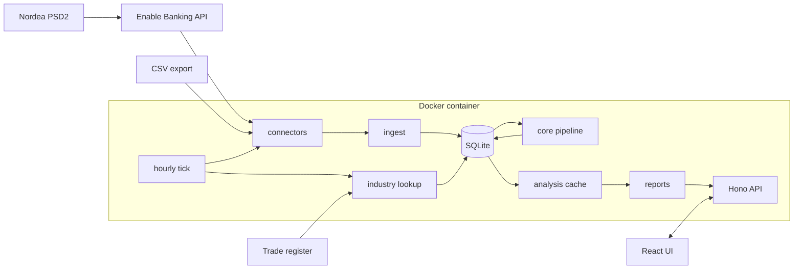

# Architecture

Omatalous fetches a household's Nordea transactions through PSD2, sorts them into money flows and builds an
overview and reports from them. Each member has their own login and views; accounts can be shared.

## Decisions

### Own Linux machine with Docker, not Cloudflare Workers

| | Linux + Docker (chosen) | Cloudflare Workers |
|---|---|---|
| Cost | free | the free plan is not enough, Workers Paid is $5/month |
| CPU limit | none | 10 ms per request on the free plan |
| Bank data | on your own disk | in Cloudflare's database |
| Upkeep | keep the VM on, backups are scripted | none |

With about 3 700 transactions (two years for a household), building the overview takes about 11 ms of CPU,
so the free Workers plan would run out as data grows. Omatalous runs only in Docker on Linux. The Workers
version was removed in 0.3.0.

### One container for the whole household

| | One container, many users (chosen) | One container per person |
|---|---|---|
| Upkeep | one install, update and backup | everything twice |
| Shared view | shared accounts and a household view | not possible |
| Isolation | `user_id` on every row, enforced by the repository, tested | by process |

Isolation does not rely on every query being written correctly. Financial data is reached only through
`FinanceRepo`, which is bound to one user. Another member's account is reached only through
`HouseholdRepo`, and only if the owner shared it, read-only.

### Enable Banking for bank data

| Option | Status |
|---|---|
| Enable Banking (Finnish) | chosen: free for your own accounts in restricted mode, supports Nordea FI |
| Nordea Open Banking directly | needs a PSD2 licence |
| GoCardless Bank Account Data | no new sign-ups |
| Tink, Plaid, Yapily | business pricing |
| CSV from Nordea's online bank | fallback and older history |

PSD2 limits: consent for at most 180 days, banks may limit automatic fetches to four a day per account,
the bank decides how much history it gives (the first fetch asks for up to two years).

## Structure

- Domain logic in `@banking/core` is pure, so the server and the browser share it and tests need no mocks.
- A place transactions come from is a connector (`apps/server/src/connectors/`, listed in `registry.ts`). It owns its
  link flow and settings and answers a pull with rows and a balance. `connectors/sync.ts` is the one loop around
  it: the lock, the run record, the ten day overlap, balances, reprocessing and the register lookup. The stored
  ids `enablebanking` and `csv` are connector ids, `demo` marks the demo data, and none of them ever changes.
- A file format is an import parser in core (`packages/core/src/sources/`, listed in `registry.ts`). It turns text into
  raw rows and says with `sniff` how well it recognises a file. `connectors/csv-import/service.ts` stores what it finds.
- All SQL is in `db/` (`*-repo.ts`, and `db/finance/` for the modules behind `FinanceRepo`) and goes through a small `Db`
  interface over node:sqlite.
- Bank data is stored as received. Categories and transfers are derived from it again whenever something
  changes, so a new rule applies to all history at once, and a category set by hand stays.
- A category comes from the first that applies: the user's rules, built-in rules, the card's merchant code
  (MCC), the category most of the same merchant's other rows got, the merchant's industry from the trade
  register. Otherwise a default.
- Industry lookup (`services/industry.ts`, `providers/prh`): merchants nothing recognises, from business
  rows only, are searched by name in the Finnish trade register. Core `industry.ts` picks the matching
  company. Answers are kept per merchant name in `merchant_industry`, so a name is looked up once, and
  `merchant_industry_users` records which names each user's lookups asked about. A user gets answers only
  for those names. The category is worked out from the stored TOL code at every reprocess, so a change to
  the mapping needs no new lookup. What is sent: [SECURITY.md](SECURITY.md#trade-register-lookup).
- Lookups also start without waiting for the tick: `startLookup` in `services/industry.ts` works through
  everything due in batches of 30 names in the background (`drainLookups`; a tick does at most ten
  batches), after a CSV import, after a fetch that brought new rows
  and when an admin turns the lookup on. A failure is only logged.
- One hourly tick (`services/schedule.ts`, run by croner): the daily database copy, bank fetches in the
  chosen hours, register lookups, removal of expired sessions and abandoned bank authorisations.
- The daily copy is `VACUUM INTO` (`dailyBackup` in `db/open.ts`) to `<data>/backups/auto-YYYY-MM-DD.db`.
  The first tick of a local day writes it, a failed one is tried again at the next tick, and the seven
  newest stay. The copy made before a migration is separate (`pre-*.db`, five kept). Every copy counts only
  after the file and its folder are flushed to disk (`platform/durable.ts`) and the copy has been opened and checked.
- The analysis context is built once per user data version; a request only filters and adds up.
- Alerts (`analysis/alerts.ts`, shown above the insights on the overview) are cost traps found in the
  selected period: double charges, late fees, overlapping services, spending spikes, services to review,
  bank fees and small habits. At most six are shown, one of each kind first. What the user sees:
  [MONEY_FLOWS.md](MONEY_FLOWS.md#alerts).
- Reports are a registry (`reports/index.ts`): one file per report, a pure function of the context and
  the range. The registry has `summary`, `cashflow`, `categories`, `pivot`, `fixedVariable`, `priceChanges`,
  `dataQuality`, `yearOverYear`, `balances`, `upcoming`, `drift`, `buffer`, `spendingChange`, `income` and `insights`.
- Merchants (`routes/merchants.ts`): `GET /api/merchants` lists the user's merchants with their category,
  row count, total spent and the merchant's own rule if any. `PUT /api/merchants/category` sets a rule
  for one merchant name and `DELETE /api/merchants/rule` removes it, after which the other rules and the
  register decide again. Both reprocess the user's data. `GET /api/merchants/uncategorised` feeds
  *Luokittelematta*. Rule limits live in `services/rules.ts` (at most 300 per user).

## Settings and secrets

Environment variables (`.env`) describe infrastructure only: how the app is reached and whether a proxy
is in front. Everything else is set in the browser and stored in the database (`services/instance.ts`,
`connectors/enable-banking/app-setup.ts`); the environment only gives defaults. The only file the app writes is
`app_secret`, created on first start in its own volume.

## Upgrades

On start the app checks its migrations against the database. Each applied file is checksummed, a
database from a newer version is refused unless every migration this build lacks declared a compatibility
floor (`-- migrate: compat <version>`, stored in `_migrations.compat`) that this build meets, and a copy
is taken before anything changes. After a version
change the derived data (merchant names, categories, transfers) is computed again for every member.
`scripts/update.sh` adds a backup, a health check and a rollback around this. Releases are signed images from
`ghcr.io` ([RELEASING.md](RELEASING.md)).

`node dist/node.js migrate-check <database file>` (`db/migrate-check.ts`) tries the pending migrations on a copy of
any database file. It opens the file read-only, copies it with `VACUUM INTO` (so a live WAL is included), applies the
migrations to the copy, runs `integrity_check` and `foreign_key_check`, compares the row count of every table and
prints one JSON line with the time it took. A table that loses rows or a failing check gives exit code 1. The
original is never written. The copy goes into a dot-named folder next to the file (the compose service has only a
16 MB tmpfs on `/tmp`, and the copy with its WAL needs about twice the database size on that disk). The folder is
removed on every way out, also on SIGINT and SIGTERM; a run killed with SIGKILL leaves it and the next run removes
folders older than a day. A script can run it with the new image before it stops the old version.

## Maintenance from the browser

*Asetukset > Ylläpito* writes a request row (`services/ops.ts`, `db/ops-repo.ts`, migrations 0006 and 0007). A host
helper (`scripts/ops-helper.sh`) polls it through `cli-ops.ts`, runs one of nine fixed actions (check-update, update,
rollback, backup, restart, doctor, logs, prune, helper-renew) and reports the result. Requests only name an allowlisted action, and the helper never
runs text from the database. Requests and results are audited as `ops_*` events in `security_events`. See
[ADVANCED.md](ADVANCED.md#the-maintenance-helper).

## Money flows

Every transaction is spending, debt, savings, income or borrowing, or a neutral transfer between own
accounts. Details and cases: [MONEY_FLOWS.md](MONEY_FLOWS.md).

## Fetching and importing

A fetch reads the days since the newest booked bank row, less ten, so late bookings and pending rows that got
booked are covered. The answer is stored only when it is complete: a failed page, or a list that does not end
after 200 pages, fails that account's fetch, leaves its stored rows as they were and is retried by the next
fetch from the same day. The other accounts go on.

- A row with a bank id keeps its id through overlapping fetches. A row without one gets an id from its day,
  amount and text, plus a number for each identical copy, so two identical purchases on a day stay two rows.
- Pending rows are replaced on every fetch. A booked row that arrives with another id, text or date takes the
  place of the pending row it replaces, and the category you set on the pending row. If the bank lists both, or
  a CSV brings the booked row, the pending row goes. A booked row is matched only to a pending row dated on or
  up to a week before it, so a new pending purchase is not taken for yesterday's.
- A CSV row is a duplicate of a bank row when the day and amount are the same and the merchants agree on
  their first word or one text names the other. Two shops with the same amount on one day are both kept.
  Each stored row absorbs one new row.
- Amounts are read from the digits as integer cents. The bank's debit or credit flag gives the sign, and the
  sign of the amount only when the flag is missing. A date with a time is converted to the household's time
  zone; a plain date is the bank's own day.

## Data model

| Table | Holds |
|---|---|
| `users` | user name, display name, PBKDF2 hash, role, forced password change |
| `sessions` | SHA-256 of the session token, expiry |
| `bank_credentials` | a member's own Enable Banking app, key encrypted |
| `connections` | bank consents per user, validity, status |
| `accounts` | type, IBAN, `identity` (the same real account seen by two users), balance |
| `account_shares` | which account is shared with whom (read-only) |
| `transactions` | bank fields plus `merchant`, `category`, `category_source`, `is_transfer`, `search_text` (folded text for search, migration 0003), raw payload |
| `category_rules` | users' own rules, including the per-merchant rules from *Kategoriat > Kauppiaat* |
| `merchant_industry` | trade register answers per merchant name: business id, company, industry code and label. No user id |
| `merchant_industry_users` | which merchant names each user's register lookups asked about |
| `sync_runs` | fetch history per user |
| `settings` | data version, locks, consent states, server settings, the household's Enable Banking app (key encrypted) |
| `_migrations` | applied migrations with checksums and compatibility floors |

Migration 0004 adds two partial indexes, for pending rows and for rows nothing categorised.

Every user row has `user_id` with `ON DELETE CASCADE`, so deleting a user deletes their data.

Security details: [SECURITY.md](SECURITY.md).
