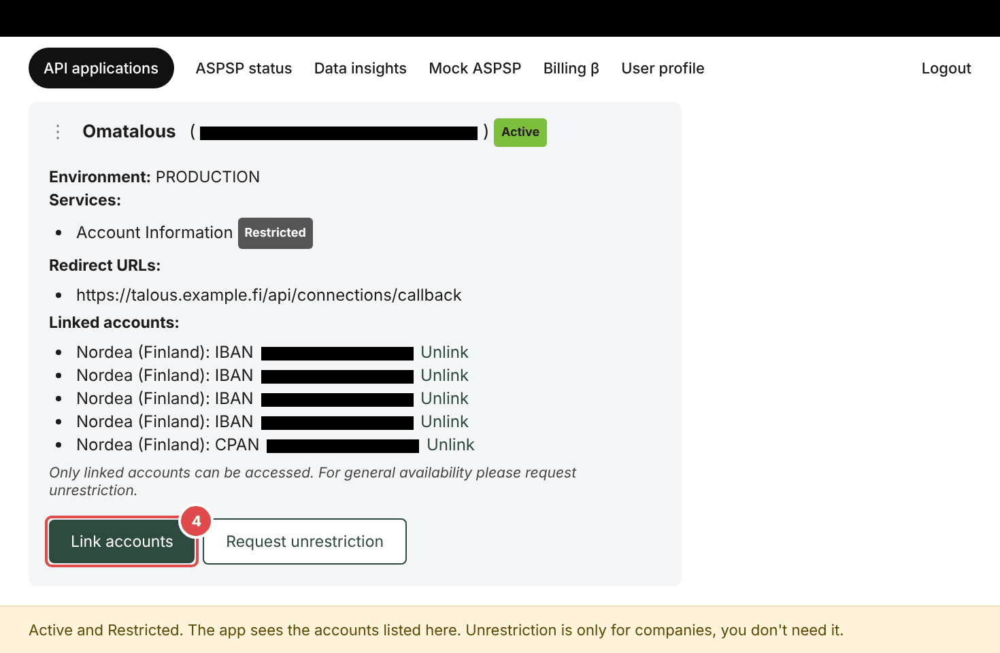
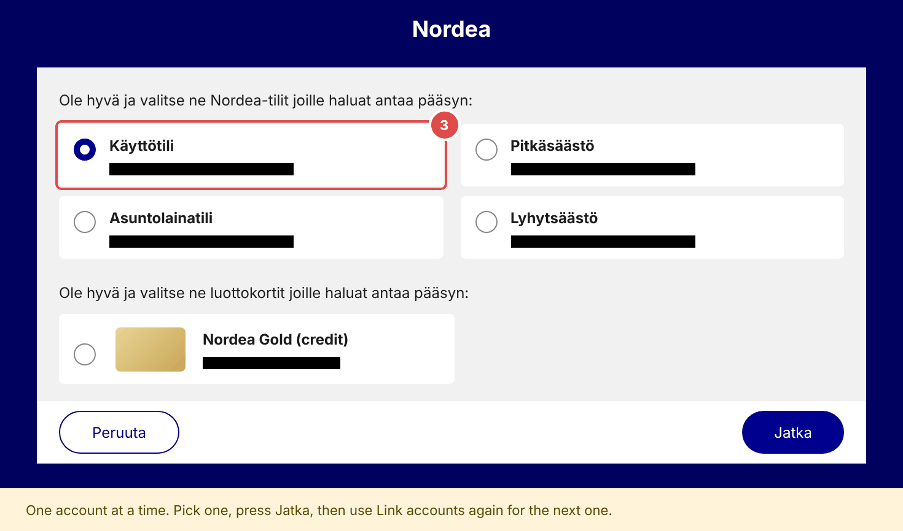

# Connecting a bank (Enable Banking)

Enable Banking is the service that lets Omatalous read your bank accounts. It is free when you read only your own
accounts. You register one Enable Banking app for the household, which takes about 15 minutes.

Omatalous walks you through it in the first-run setup, and later under *Asetukset > Pankit ja tilit > Pankkisovellus*. It makes the key, lists
the fields of Enable Banking's registration form with a *Kopioi* button for each value, and tests the Application ID.
This page has what the setup does not show.

## Choosing a bank

*Asetukset > Pankit ja tilit > Pankkiyhteydet > Yhdistä pankki* opens the bank picker. It lists the banks by name, with the logo where there is
one and the name on a plain plate where there is none. Nordea's logo comes with the app. The server fetches the others
from Enable Banking's website and serves them from its own address. The bank you connected last is first.
With more than eight banks there is a search field.

<!-- language-allow: comma-density the list is the banks the picker knows, one item each -->
The picker offers a bank when your Enable Banking app lists it. Omatalous asks Enable Banking once a day and keeps the
last list while Enable Banking does not answer. Until an app is set up and active the picker offers Nordea alone. An
empty picker means the app lists none of these banks: Nordea, OP, Danske Bank, S-Pankki, Säästöpankki, Oma Säästöpankki,
POP Pankki, Aktia, Ålandsbanken, Bank Norwegian, Resurs Bank, Morrow Bank, Eurocard, Finnair Plus Mastercard, SAS
EuroBonus Mastercard, Holvi and Revolut.

Check the app under *Asetukset > Pankit ja tilit > Pankkisovellus*.

Omatalous knows Nordea's transaction wording best. The rows of any other bank are sorted by that bank's own codes, so
check the categories of the first month under *Tapahtumat* and change what is wrong.

## Why there are two links

You log in with your bank's own login twice (for Nordea, Nordea ID). That is expected: each login makes a different
link. You always log in on your bank's own page, and Omatalous can only read transactions and balances.

- The account link in Enable Banking's Control Panel (*Activate by linking accounts*, later *Link accounts*) is the list
  a restricted app may read. Enable Banking lets you use your own accounts with an app you registered yourself, without
  a contract, and only in restricted mode: the API returns the linked accounts and strips every other account from the
  answer.
- The connection in Omatalous (*Asetukset > Pankit ja tilit > Pankkiyhteydet > Yhdistä pankki*) is the consent that Omatalous fetches
  with. You give it with your bank's login. It lasts 180 days or the bank's own maximum when that is shorter, and you
  renew it before it ends.

Enable Banking's documentation does not say whether a link in the Control Panel expires. It says only that the app stays
active in restricted mode until an agreement is signed. If an account does not show up, check *Linked accounts* first.

## Linking accounts at Enable Banking

In the Control Panel choose Finland, your bank and *Personal*, then log in. Link the accounts of one bank at a time, and
repeat for each bank you use.

The app is *Active* after the first account. Press *Link accounts* again for each other account and credit card you want
in Omatalous, and link all of them before you connect in Omatalous. A connection made earlier does not bring an account
that was linked afterwards.

Where a bank's steps differ, it has a section below. Enable Banking's documentation for Finland gives no consent length
and no account rules for the other banks.

### Nordea

Nordea's page lets you pick one account at a time. Pick one and press *Jatka*.

### Aktia

Enable Banking's page for Finland says that data of the Aktia Finnair Visa credit card cannot be read through the bank's
interface yet (checked 2026-10-12). That card does not show up under *Linked accounts*.

## What the setup leaves out

- The private key stays in Omatalous, encrypted. Enable Banking gets only the certificate.
- Do the setup on one computer, so the certificate you download is at hand when you register the app.
- The Application ID is the long code next to the app's name in the Control Panel, for example `12345678-abcd-...`.
- The privacy URL and the terms URL are pages on the same site as the redirect URL. They say that Omatalous runs on your
  own machine, that bank data goes only there and that the developer receives nothing. The form asks for them,
  though Enable Banking does not check them or the email for an app you activate by linking your own accounts.
- *Luo avain* and *Luo uusi* download the certificate by themselves. *Lataa varmenne (.crt)* downloads it again.
- When the test passes and no app is saved yet, the Application ID saves itself and the page says "Application ID
  tallennettu. Yhteys toimii." A saved app still needs *Tallenna ja testaa* after a change.
- Omatalous reads the app's status from Enable Banking. While the app is *Inactive* it says so, but the bank buttons
  stay on: choosing a bank tests the app again and says what is wrong. Link your accounts, then press *Testaa yhteys*.

## After you connect

- Use a phone or computer on your home Wi-Fi. After the bank login the browser shows a page on `github.io` for a
  moment and comes back to Omatalous. If the browser stays on that page, or the bank ends on an error page, copy the
  whole address from the address bar and paste it under *Asetukset > Pankit ja tilit > Pankkiyhteydet*, in the line *Viimeistele yhteys
  osoitteella*. Then press *Viimeistele*. An install that still ends on the bank's error page has that line as *Liitä
  pankin viimeisen sivun osoite*.
- The first fetch brings up to two years of history in the background, as much as the bank gives (a card often gives less, see [How far back a card goes](#how-far-back-a-card-goes)). Omatalous reads no
  files on the server, so there is no import for older history. A card the bank gives no rows for can be read from
  its statement file under *Asetukset > Pankit ja tilit > Korttien tiliotteet*; the file is read in your browser. The same goes for an account's CSV export under *Pankin CSV-tiedosto*, where you match the columns once, or its camt.053 statement, whose closing balance is checked against the rows. An account that an earlier version took in from a CSV file stays with
  its rows. When you link the same account (the same IBAN) at the bank, its rows move into the bank's account and are
  not counted twice.
- Check under *Asetukset > Pankit ja tilit > Tilit* that each credit card has the type *Luottokortti*. Then paying the card bill from your current
  account counts as a transfer, because the purchases are already counted on the card. The type also puts the card
  under *Luottokortit* in the *Varat ja velat* card on the first page, with its last four digits and, when the bank gives a limit, how much of it is used.
- Omatalous reads these fields of each account. The bank's `product` (Käyttötili, ASP-tili, Nordea Gold) becomes the account's name, and
  `name`, which holds the holders ("A;B"), a line under it. `cash_account_type` gives the type; Nordea sends `CACC` for every
  account, so a product with a savings word (säästö, ASP, tuotto, sijoitus) reads as *Säästötili*. With no code the product and
  description decide, never the holders' names, and an account with an IBAN and no word for its kind is a current account.
  Every new consent works the type out again, unless you changed it under *Asetukset > Pankit ja tilit > Tilit*, which no consent undoes.
  The code and the product show under the account's name there, so a wrong guess can be seen. A card's masked number
  (`CPAN`) shows as its last four digits and `credit_limit` as its limit. You can give any account a name of your own
  under *Asetukset > Pankit ja tilit > Tilit*: a new consent never replaces it. An account linked before these fields were read asks the bank for
  them once at the next fetch; a refusal is tried again at the one after.
- *Asetukset > Pankit ja tilit > Pankkiyhteydet* says when each consent ends ("voimassa 14.1.2027 asti"; with fewer than 30 days left it adds ", vielä 12 päivää"). Omatalous reminds
  you 14 days before.
- Renew a consent with *Yhdistä uudelleen* on its row. The button is there before the consent ends too, so you can renew
  on a quiet day. It starts the same bank at once, with no picker. Only a bank the picker no longer offers, or an
  instance where no Enable Banking application can start a bank yet, opens the picker, which says what is missing.
  The history stays. When the new consent has its accounts, the old one is no longer in the list. A consent that has
  ended and still has accounts stays in the list, with *Yhdistä uudelleen*.
  Nordea gives one account per consent, so renew each consent you have.
- When two or more consents end within 14 days or have ended, *Pankkiyhteydet* shows them by name with *Uusi kaikki
  yhteydet*. The press starts a round: it takes you to the first consent's bank (ended consents first, then the soonest
  to end), the bank sends you back, and the page lists each consent as *uusittu* or *odottaa* with the next press
  (*Uusi OP*). A bank with several consents (Nordea gives one account per consent) has a line for each, named by its
  accounts. Each bank is started by its id from the bank list, as with *Yhdistä uudelleen*, and the bank's own consent
  page asks for the login and the accounts. A consent is done when it is no longer due: a newer consent took its
  accounts, so choose at the bank the accounts of the consent you are renewing. The round says *Kaikki yhteydet on
  uusittu* only when every consent is done. One that stays left (you cancelled at the bank, or the return failed)
  stays in the list: press it again, or end the round with *Lopeta kierros*. The round is kept per user for seven
  days, and *Sulje* removes it once it is finished. A bank the list no longer offers is not in the round; renew it from
  its row.
- *Muistutus kalenteriin* under the end date downloads a calendar file (`.ics`) with one all-day event seven days before
  the consent ends, "Omatalous: pankkiyhteys vanhenee 14.1.2027". The browser makes the file. It holds the bank's name, the end date
  and the address of Omatalous as you opened it, and no account detail. Open it with the calendar of your phone or computer.
- After a link the page lists the accounts the bank handed over that your Enable Banking app may not read, by the bank's
  name for the account and the last four digits. After the link the page looks again for a minute, so the list appears
  when the first fetch has run; a slower fetch shows at the next load of the page. Each account leaves the list when a
  fetch reads it. The step is in the list: link the accounts
  under *Link accounts* in the Control Panel (a member who uses the household's app asks the administrator), then
  press *Hae nyt*. No new connection is needed.
- After a link the button *Yhdistä pankki* reads *Yhdistä toinen pankki*, so a household with two banks, or
  with Nordea and one account at a time, goes on without starting over. The wizard ends on the same page.
- *Tyhjennä kaikki tiedot* under *Asetukset > Palvelin > Ylläpito* ends every bank consent at the bank. A restore of the copy it
  made first brings the rows back and not the consents, so connect each bank again with *Yhdistä pankki*.
- After a link the server log has one line per account: `bank link <bank id>: cash_account_type=... credit_limit=...
  balance_types=...`. It holds codes and yes or no only, no account number, name or amount. It shows what a bank sends.

## How far back a card goes

A card can show far fewer rows than the current account of the same bank. The case that raised this: a Nordea Gold card
whose rows began about 30 days before the link, while 72 card bills older than that were in the current account. The
app's window was not the cause. These are the steps of the first fetch, in `connectors/enable-banking/connector.ts`:

1. The longest history (`strategy=longest`) from `HISTORY_DAYS` ago, 730 days unless the stored
   history setting says otherwise. *Asetukset > Palvelin* no longer offers it, and `HISTORY_DAYS` in `.env` seeds it on a new install.
2. If the bank answers 400 or 422, the same account from 360 days ago, then from 89 days ago. Nordea refused a card's
   first request of two years with 400 when the cards were first linked (2026-10-11), so the app takes 12 months as
   the most one card request may span. 89 days is the most a bank may give without a fresh consent, as the public API describes it.

No step starts later than 89 days back, and later fetches start ten days before the newest row. So rows that begin 30
days back are what the bank sent, not a window the app cut short. What the instance's own record shows for that card
(read from its database, read-only, no call to the bank):

- The card was created at the first link (2026-10-11 13:46Z). The six fetches that followed, over the next hour and a
  half (connect, manual and scheduled), each ended `partial` with "pankki ei vastannut oikein" for the card and no
  row stored. The card had no row, so each asked the longest history, which is the request the bank refused. The other
  accounts of the same consent were fetched without trouble.
- The fetch after a new consent at 15:45Z was the first to succeed (123 rows fetched, 100 stored), and the card's rows
  since then begin 2026-09-10 (125 rows to 2026-10-23). That fetch asked for a window of at least 89 days, since no
  step asks for less than that for a card with no rows, so the bank left out the days before 2026-09-10 in an answer that
  reached back past them. It was not a window the app shortened.

So the cause is the bank's side: Nordea refused the long request on the first consent and, after a new consent, gave a
card's rows only from about a month before the link. Public documentation does not say how many days a Nordea card keeps
(Nordea's card documentation describes what a token may read, and Enable Banking's `longest` strategy is a search
that returns the rows from the earliest day it found), so the number is the bank's answer, not a limit this page can
quote. Earlier versions asked for nothing more after the first fetch, and the record of the account said the longest
history had been asked from two years back, which the card-bill signal under *Asetukset > Pankit ja tilit >
Tietojen laatu* reads as "the bank gives no older rows" (`before_history`). For this card that reading is right
for the answers the bank has given so far.

The record `account_history` of such a card shows only the first day of its rows. It was first written on 2026-10-16
by the version that added it, so it holds nothing of the fetches of 2026-10-11, and its `asked_from` is the earlier of
the window and the oldest row stored. The sync runs (`sync_runs`) and the `account_fetch` notes are the trace of a
refusal; the container log is not, since it is gone when the container is recreated.

The backfill. A fetch the member starts (*Hae nyt*, or the fetch after a link) with the member's headers asks again for
the days before the oldest booked row (before today, when the account has booked none yet), in windows of at most
12 months with an end day, back to five years (`BACKFILL_REACH_DAYS`), which is further than the 730 days of the first
fetch. A window with no row does not end the walk, since a card unused for a year still has older purchases; the reach
and at most six windows do. The days asked for are recorded, so the next walk starts where this one ended and the
empty windows past a bank's edge are asked once. When the bank refuses a window, it asks for the part of it within
360 days, then within 89 days, and stops there. It runs once a month for an account, and a refusal is not an error. The fetch right after a new
consent always runs it, since that is when the bank gives the most. A fetch in the background never runs it. An
account that already exists is covered the same way: its record holds the first day it was asked for, so the next
*Hae nyt* after the update asks for the years before its first row.

On the home network. An install opened at a home network address (`http://192.168.x.x:8080`, the normal case) sees the
member's address as a private one, and Omatalous never sends a private address as `Psu-Ip-Address` (`psu.ts`). With
no Psu headers, Enable Banking and the bank treat the fetch as one made in the background, which a bank may limit to
four a day for an account. So *Hae nyt* there is noted `manual-bare`, and the backfill follows the rules of an
unattended call:

- Only *Hae nyt* walks. Each window is a call to the bank, noted `backfill-bare` in `account_fetch` and counted with the
  other unattended calls of the account (`bank-limit.ts`). A window is made only while the account has room by the rule
  of an open without headers: fewer than four calls in the last 24 hours, and fewer than four less the sync hours made
  by hand, which leaves the scheduled fetches of the day their share. With the default sync hours (6 and 18, chosen as *Hakuja päivässä* in *Asetukset > Palvelin > Palvelin*) that is
  one window a day for each account, after the fetch of the press itself.
- The walk is not given up when the day is full. The days asked for are recorded, so the next *Hae nyt* goes on from
  where the last stopped, and the month's rest is noted only when the walk is over (the reach of five years, a bank's
  refusal, or a failure). Five years takes up to six windows, so up to six days of pressing *Hae nyt* on a bank that
  holds that much; a bank that refuses an older window ends the walk at once.
- The fetch right after a link does not walk without the headers: it has just used the day's calls of the new
  accounts, and the first *Hae nyt* after it starts the walk.
- A scheduled fetch is left out when the day's four calls are used, as before. A window never takes an account over four.

Why not a `Psu-Ip-Address` for the home network? Enable Banking asks for the address of the person who triggered the
fetch, and a private address is none the bank can see. The member's address as the bank sees it is the home's public
one, but Omatalous has no way to learn it that is not a guess: it would have to ask an outside service what its own
address is, and that can differ from the member's (IPv6 on the phone, IPv4 on the server, a VPN). A header that misstates
the user is worse than none, since the bank takes it for its own security checks. An address that cannot be given
honestly is left out, and the fetch is counted as the unattended call it is. A member who opens the install from a
public address (a tunnel or a domain with `TRUST_PROXY`) still sends the headers, and then the backfill is not counted.

The backfill is a safeguard for a bank that gives more later, or after a new consent. The bank has so far sent no row
older than 2026-09-10 for the card above, so the backfill brings older purchases only if a later answer does. Nothing
here promises a number of days: that depends on the bank and the consent.

- Older purchases may need a new consent: *Yhdistä uudelleen* on *Asetukset > Pankit ja tilit > Pankkiyhteydet*. Its first fetch asks for
  the longest history and then for the days before the first row, back to the history limit.
- If every window right after a new consent comes back empty, the bank gave no older rows of the card then, and the
  months before the first row stay missing from the card's purchases.

What an install records of this:

- The longest history the app has seen a bank give is kept for each bank and read at `GET /api/admin/bank-app/capabilities`.
  No page draws it. It is one figure per bank, so a current account's two years hide a card's one month.
- `account_history` holds for each account the first day that was asked for (`asked_from`), whether it was the longest
  history or a plain window (`source`) and the first row the bank sent (`first_row_day`). A refused window is now
  recorded as the shorter one it was answered for. A record of the longest history keeps its first day even when the
  rows begin much later.
- `account_fetch` notes each call with its trigger; a backfill window is noted `backfill`, or `backfill-bare` when no Psu headers went with it (counted against the day's four).

## Where each bank's history ends

What one instance showed when the first fetch of every account is compared with the bank. It is the evidence of that
instance, not a rule of the banks; the backfill above asks for more where a bank gives more.

- Nordea, current and savings accounts. The first request of 730 days was answered. The oldest row of the busiest
  account lay about 540 days (18 months) before the link, the same distance that Nordea's open banking support names as
  the longest history of a consent. Two accounts opened a year after that edge start on the day their balance was zero,
  so they are whole. A savings account whose balance was not zero at its first row lost the days before the edge.
  Nothing older exists to fetch there, and the backfill finds nothing on those accounts.
- Nordea, card. The first request of 730 days was refused (400) every time on the first consent. After a new consent a
  window of at least 89 days was answered with rows from a month before the link only (see the section above).
- S-Pankki. The first request of 730 days was answered and the oldest row lies five days after its first day, which is
  the edge of the app's window, and the balance was not zero at that row. So the app's own limit may have cut it, and
  the backfill now asks the five years. What S-Pankki holds beyond two years is not known.
- The history figure of `GET /api/admin/bank-app/capabilities` is the oldest row any fetch brought since the figure
  was kept, not the bank's limit: an instance updated after its first fetches shows only what later, shorter fetches
  reached (75 days for Nordea on the instance above, whose accounts hold 18 months).

## Errors

| What you see | What it means |
|---|---|
| "Enable Banking ei tunnistanut sovellusta" or "Enable Banking hylkäsi avaimen" | The Application ID is not copied in full, or the certificate in Enable Banking is not the one Omatalous made. A new key (*Luo uusi*) makes the old certificate useless. Check both and press *Tallenna ja testaa* again. *Testaa yhteys* under *Asetukset > Pankit ja tilit > Pankkisovellus* shows which of the two it is. |
| "Enable Banking ei vielä päästä sovellusta pankkeihin" | The app is still *Inactive*, or no account is linked. Press *Activate by linking accounts* in the Control Panel, choose your bank, then press *Testaa yhteys* under *Asetukset > Pankit ja tilit > Pankkisovellus*. |
| "Enable Banking ei hyväksy paluuosoitetta" | The address the message names is missing from your app's Redirect URLs. Add it in the Control Panel. |
| An account or a card is missing | It is not under *Linked accounts*. Link it with *Link accounts*, then connect again with *Yhdistä pankki*. |
| "N tiliä ei ole lisätty Enable Bankingissa" ("Yksi tili ei ole lisätty Enable Bankingissa" for one) with a list under *Pankkiyhteydet*, "&lt;account&gt;: tiliä ei ole lisätty Enable Bankingissa", also on the account's row under *Asetukset > Pankit ja tilit > Tilit* | The app is restricted and reads only the accounts under *Linked accounts*. The list names each such account by the bank's name for it and its last four digits. Open *API applications*, your app, *Link accounts*, and link those accounts or cards. Then press *Hae nyt*. The other accounts are fetched meanwhile. |
| "&lt;account&gt; ei tullut mukaan uuteen yhteyteen" | The new connection did not bring that account, so it stays on the old one and is not fetched. Link it under *Link accounts* in the Control Panel, then press *Yhdistä uudelleen*. |
| "Pankki ei antanut tilejä" | The connection finished with no accounts, because none was linked at Enable Banking. Link them in the Control Panel and connect again. |
| "Pankki keskeytti yhdistämisen", or "Enable Banking hylkäsi yhdistämisen" | The app's request log in the Control Panel has the reason. The server log has a line `bank link refused` with the status and code. |
| "Yhdistäminen keskeytyi", or "Yhdistäminen vanheni" | The login was cancelled at the bank, or the link was used already or is more than an hour old. Start again with *Yhdistä pankki*. |
| "Enable Banking ei vastaa juuri nyt", "Enable Banking ei hyväksynyt pyyntöä", or "Enable Bankingiin ei saatu yhteyttä" | The problem is at Enable Banking or in the machine's connection. Try again later. |
| The picker is empty, or lacks a bank you expect | The app's bank list at Enable Banking has none of the banks Omatalous knows, or not that one. The server log has a line `bank list:` when Enable Banking answered with an error. Check the app under *Asetukset > Pankit ja tilit > Pankkisovellus*. |

If the browser stays on the `github.io` page or shows an error after the bank login, see
[TROUBLESHOOTING.md](TROUBLESHOOTING.md#connecting-the-bank).

## A member's own app

A member can use an Enable Banking app of their own for their own connections.
*Asetukset > Pankit ja tilit > Pankkisovellus* has the choice *Talouden sovellus* or *Oma sovellus*. A member of a household with no shared app has the own app only.
The member registers it like the household's app, with their own Enable Banking account, with these differences:

- Omatalous makes no key for a member. Choose *Generate in the browser* for the private key. Enable Banking then
  downloads a `.pem` file.
- *Oma sovellus* shows the redirect URL, the privacy URL and the terms URL, each with a copy
  button.
- Link the member's accounts in their app as above.

Save the Application ID and the `.pem` file under *Pankkisovellus* > *Oma sovellus* with *Tallenna ja testaa*,
then delete the file from the downloads folder. The save tests the pair with Enable Banking first. A pair Enable Banking
refuses is not saved, and the key saved before stays. Any other answer, *Inactive* included, saves the key and shows
what the test said. The key is stored encrypted. *Poista oma avain* returns the member to the household's app.

A bank consent belongs to the app that made it, and only that app can end it. While the member has an active
connection, *Poista oma avain* and a save with another Application ID are refused, and the message names the
connections. Remove the connections first, then change the app. A new key for the same Application ID, and a
member whose connections are all `revoked` or `expired`, are not held back.

More about Enable Banking options: [ADVANCED.md](ADVANCED.md#enable-banking-options).

## Result: private return names

Tested 31 Oct 2026 in the Enable Banking Control Panel, with the owner confirming the bank login on a phone.

- A new SANDBOX app and a new PRODUCTION app (restricted, activated by linking one Nordea account) were registered with the redirect URLs `https://koti.home.arpa/`, a `.lan` name (changed here from the one tried) and `https://192.168.1.10/` (sandbox also `https://localhost:8443/`). The Control Panel accepted all of them in both environments.
- `POST /auth` with `redirect_url` `https://koti.home.arpa/` returned 200 with an authorisation link, in sandbox (Mock ASPSP, FI) and in production (Nordea, FI, personal). A `redirect_url` not in the list returned 400 `REDIRECT_URI_NOT_ALLOWED`. In sandbox `https://192.168.1.10/` also returned 200.
- After the bank login (production: Nordea ID app, one account chosen) the browser was sent to `https://koti.home.arpa/?state=p1&code=...`. The name did not resolve on that machine, so the page itself did not load, but the code and state arrived in the address. Enable Banking never fetched the URL.
- Not tested: S-Pankki or other banks; `POST /auth` and a bank login in production with a plain IP. Only the root path `/` was registered, not `/api/connections/callback`.
- 31 Oct 2026, end to end through the app: a new restricted PRODUCTION app with only `https://koti.home.arpa/api/connections/callback`, its key made with openssl and saved under *Oma Enable Banking -sovellus*. Omatalous 0.70.0 ran with `APP_BASE_URL=https://koti.home.arpa` behind an https proxy with its own certificate, in a browser that resolved the name to that machine and accepted the certificate. *Testaa paluuosoite* said it works. *Yhdistä Nordea*, the Nordea ID app on the owner's phone, and the browser came back through `/api/connections/callback` to *Pankki yhdistetty, 1 tili*. The connection was removed afterwards and the test data deleted.

### Earlier sources

- Production accepts only https; sandbox samples use http: [letehaha/moneymatter#773](https://github.com/letehaha/moneymatter/issues/773), [Adriangar99/cheles-backend#31](https://github.com/Adriangar99/cheles-backend/issues/31), [autoditac/Penge#224](https://github.com/autoditac/Penge/issues/224), Enable Banking's [config.json](https://github.com/enablebanking/enablebanking-api-samples/blob/master/config.json).
- The return is a browser redirect (kind PSU in the Control Panel log, "Returning to auth callback", `https://enablebanking.com/js/app.957d223a.js`), the standard authorisation code redirect ([RFC 6749, section 3.1.2](https://www.rfc-editor.org/rfc/rfc6749#section-3.1.2)).
- The match is exact: [picsou-finance](https://github.com/Cloeille/picsou-finance) README, [Sure](https://github.com/we-promise/sure) on `REDIRECT_URI_NOT_ALLOWED`.
- Public pages say only "URLs whitelisted for redirecting of end users": [Control Panel](https://enablebanking.com/docs/api/control-panel/), [API reference](https://enablebanking.com/docs/api/reference/), [FAQ](https://enablebanking.com/docs/faq/).

## Payment rules watch

Last reviewed: 2026-10-30

A rule that applies to the app gets a step in [ROADMAP.md](ROADMAP.md); a rule only proposed gets a line here. The review
is repeated at least every 6 months, and `pnpm check` fails when the date above is older (repo rule 44).
Sources opened for this review: the European Parliament's Legislative Observatory pages of the three files, the
Commission's texts through the Publications Office (EUR-Lex), and the EBA's page on payment services. The Council's own
pages refused the request, so the Council's position is not confirmed here.

| Act | Status on 2026-10-30 | Dates | In force |
|---|---|---|---|
| PSD2, [Directive (EU) 2015/2366](https://eur-lex.europa.eu/eli/dir/2015/2366/oj) | Law today | Applies since 13 January 2018 | Yes |
| [Delegated Regulation (EU) 2022/2360](https://eur-lex.europa.eu/eli/reg_del/2022/2360/oj), amending the SCA technical standards | Law today | Adopted 3 August 2022, applies from 25 July 2023 | Yes |
| PSR, [COM(2023)0367](https://eur-lex.europa.eu/legal-content/EN/TXT/?uri=CELEX:52023PC0367), file [2023/0210(COD)](https://oeil.secure.europarl.europa.eu/oeil/en/procedure-file?reference=2023/0210(COD)) | Text agreed in early second reading negotiations; the Observatory still says "Awaiting Council's 1st reading position" | Proposed 28 June 2023; Parliament first reading 23 April 2024; ECON approved the agreed text 5 May 2026; plenary indicative 14 December 2026 | No |
| PSD3, [COM(2023)0366](https://eur-lex.europa.eu/legal-content/EN/TXT/?uri=CELEX:52023PC0366), file [2023/0209(COD)](https://oeil.secure.europarl.europa.eu/oeil/en/procedure-file?reference=2023/0209(COD)) | Same stage as the PSR | Same dates as the PSR | No |
| FiDA, [COM(2023)0360](https://eur-lex.europa.eu/legal-content/EN/TXT/?uri=CELEX:52023PC0360), file [2023/0205(COD)](https://oeil.secure.europarl.europa.eu/oeil/en/procedure-file?reference=2023/0205(COD)) | Parliament's committee mandate only; the Observatory says "Awaiting Parliament's position in 1st reading" | Proposed 28 June 2023; ECON report 30 April 2024; negotiations confirmed by plenary 18 December 2024 | No |

The EBA's page on [payment services](https://www.eba.europa.eu/regulation-and-policy/payment-services-and-electronic-money)
treats the PSD2 rules as the ones that hold until PSD3 and the PSR apply.

What each means for Omatalous (the PSR and FiDA points are from the Commission's proposals, not the agreed text, which was
not opened):

- Consent length. Today Regulation 2022/2360 raised the repeat of strong customer authentication (SCA) for account
  information from 90 to 180 days. A consent of 180 days or the bank's own maximum (see
  [Why there are two links](#why-there-are-two-links)) fits it, so the app needs no change. Under the PSR proposal the bank asks
  for SCA only at the first access, and the account information provider applies its own SCA when the household reads data it holds
  180 days or more after the last SCA. That could move the renewal from the bank's login to the provider's own step, via Enable Banking.
- SCA. The bank's login stays the SCA step on a new or renewed consent, and Omatalous never sees the credentials.
- Account information interfaces. The PSR proposal requires each bank to offer a dedicated interface for open banking
  data access, drops the duty to keep a fallback interface, and sets quarterly availability statistics and a test
  facility. That is the banks' and Enable Banking's work; the app meets the interface only through Enable Banking's API.
- Permission dashboards. The PSR proposal makes each bank show the household the access permissions it has granted. The
  consent list of *Asetukset > Pankit ja tilit > Pankkiyhteydet* stays the app's own view of its consents.
- FiDA. The proposal opens customer data beyond payment accounts (savings, loans, insurance and similar) to
  permission-based sharing, with data sharing schemes and permission dashboards. It reaches the app only if Enable
  Banking offers that data. Application is 24 months after entry into force in the proposal (18 for some articles).
- Enable Banking's role. It is the account information service provider the app connects through, so a change in the
  rules for such providers (interface, dashboard, SCA) reaches the app as a change in Enable Banking's API or terms.
- Timing. The PSR proposal applies 18 months after entry into force, which follows publication in the Official Journal.
  That has not happened. Final dates and any change to the points above are open.

No rule of the three new acts is in force, and the two that are (PSD2 and 2022/2360) need no change in the app, so
this review adds no step. When the PSR or PSD3 is published in the Official Journal, or the FiDA is agreed, the next
review adds a step to the Later list of the roadmap for each rule that needs a change.
