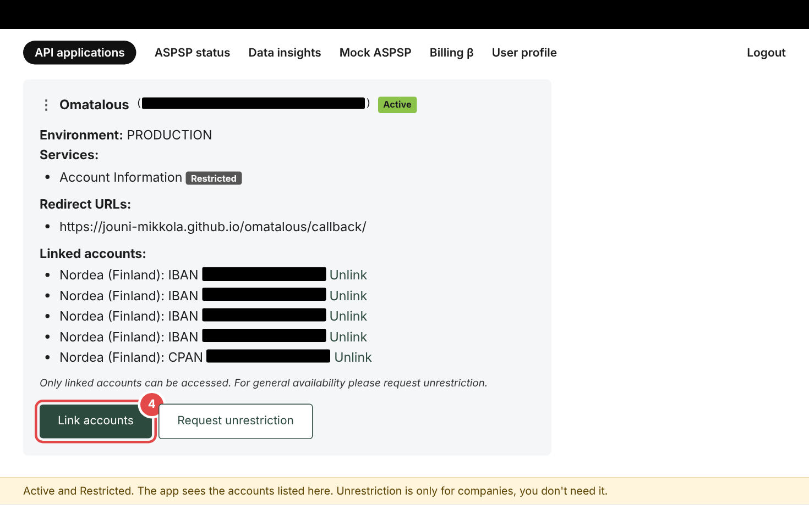
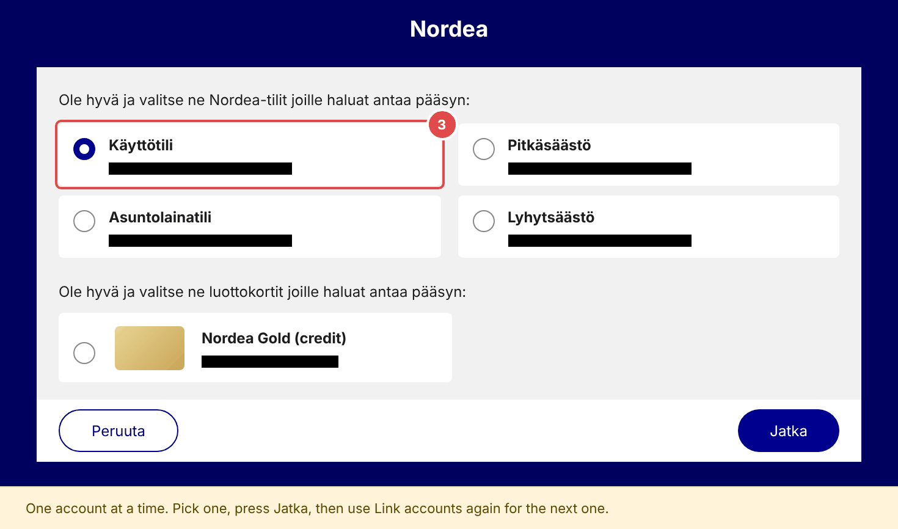

# Connecting a bank (Enable Banking)

Enable Banking is the service that lets Omatalous read your bank accounts. It is free when you read only your own
accounts. You register one Enable Banking app for the household, which takes about 15 minutes.

Omatalous walks you through it in the first-run setup, and later under *Asetukset > Tekniset asetukset > Palvelin*. It makes the key, lists
the fields of Enable Banking's registration form with a *Kopioi* button for each value, and tests the Application ID.
This page has what the setup does not show.

## Choosing a bank

*Asetukset > Pankkiyhteydet > Yhdistä pankki* opens the bank picker. It lists the banks by name, with the logo where there is
one and the name on a plain plate where there is none. Nordea's logo comes with the app. The server fetches the others
from Enable Banking's website and serves them from its own address. The bank you connected last is first.
With more than eight banks there is a search field.

The picker offers a bank when your Enable Banking app lists it. Omatalous asks Enable Banking once a day and keeps the
last list while Enable Banking does not answer. Until an app is set up and active the picker offers Nordea alone. An
empty picker means the app lists none of these banks: Nordea, OP, Danske Bank, S-Pankki, Säästöpankki, Oma Säästöpankki,
POP Pankki, Aktia, Ålandsbanken, Bank Norwegian, Resurs Bank, Morrow Bank, Eurocard, Finnair Plus Mastercard, SAS
EuroBonus Mastercard, Holvi and Revolut. Check the app under *Asetukset > Tekniset asetukset > Palvelin*.

Omatalous knows Nordea's transaction wording best. The rows of any other bank are sorted by that bank's own codes, so
check the categories of the first month under *Tapahtumat* and change what is wrong.

## Why there are two links

You log in with your bank's own login twice (for Nordea, Nordea ID). That is expected: each login makes a different
link. You always log in on your bank's own page, and Omatalous can only read transactions and balances.

- The account link in Enable Banking's Control Panel (*Activate by linking accounts*, later *Link accounts*) is the list
  a restricted app may read. Enable Banking lets you use your own accounts with an app you registered yourself, without
  a contract, and only in restricted mode: the API returns the linked accounts and strips every other account from the
  answer.
- The connection in Omatalous (*Asetukset > Pankkiyhteydet > Yhdistä pankki*) is the consent that Omatalous fetches
  with. You give it with your bank's login. It lasts 180 days or the bank's own maximum when that is shorter, and you
  renew it before it ends.

Enable Banking's documentation does not say whether a link in the Control Panel expires. It says only that the app stays
active in restricted mode until an agreement is signed. If an account does not show up, check *Linked accounts* first.

## Linking accounts at Enable Banking

In the Control Panel choose Finland, your bank and *Personal*, then log in. Link the accounts of one bank at a time, and
repeat for each bank you use.

The app is *Active* after the first account. Press *Link accounts* again for each other account and credit card you want
in Omatalous, and link all of them before you connect in Omatalous. A connection made earlier does not bring an account
that was linked afterwards.

Where a bank's steps differ, it has a section below. Enable Banking's documentation for Finland gives no consent length
and no account rules for the other banks.

### Nordea

Nordea's page lets you pick one account at a time. Pick one and press *Jatka*.

### Aktia

Enable Banking's page for Finland says that data of the Aktia Finnair Visa credit card cannot be read through the bank's
interface yet (checked 2026-10-12). That card does not show up under *Linked accounts*.

## What the setup leaves out

- The private key stays in Omatalous, encrypted. Enable Banking gets only the certificate.
- Do the setup on one computer, so the certificate you download is at hand when you register the app.
- The Application ID is the long code next to the app's name in the Control Panel, for example `12345678-abcd-...`.
- The privacy URL and the terms URL are pages on the same site as the redirect URL. They say that Omatalous runs on your
  own machine, that bank data goes only there and that the developer receives nothing. The form asks for them,
  though Enable Banking does not check them or the email for an app you activate by linking your own accounts.
- *Luo avain* and *Luo uusi* download the certificate by themselves. *Lataa varmenne (.crt)* downloads it again.
- When the test passes and no app is saved yet, the Application ID saves itself and the page says "Application ID
  tallennettu. Yhteys toimii." A saved app still needs *Tallenna ja testaa* after a change.
- Omatalous reads the app's status from Enable Banking. While the app is *Inactive* it says so, but the bank buttons
  stay on: choosing a bank tests the app again and says what is wrong. Link your accounts, then press *Testaa yhteys*.

## After you connect

- Use a phone or computer on your home Wi-Fi. After the bank login the browser shows a page on `github.io` for a
  moment and comes back to Omatalous. If the browser stays on that page, or the bank ends on an error page, copy the
  whole address from the address bar and paste it under *Asetukset > Pankkiyhteydet*, in the line *Viimeistele yhteys
  osoitteella*. Then press *Viimeistele*. An install that still ends on the bank's error page has that line as *Liitä
  pankin viimeisen sivun osoite*.
- The first fetch brings up to two years of history in the background, as much as the bank gives. Omatalous reads no
  files, so there is no import for older history. An account that an earlier version took in from a CSV file stays with
  its rows. When you link the same account (the same IBAN) at the bank, its rows move into the bank's account and are
  not counted twice.
- Check under *Asetukset > Tilit* that each credit card has the type *Luottokortti*. Then paying the card bill from your current
  account counts as a transfer, because the purchases are already counted on the card. The type also puts the card
  under *Luottokortit* in the *Varallisuus* card on the first page, with its last four digits and, when the bank gives a limit, how much of it is used.
- Omatalous reads these fields of each account. The bank's `product` (Käyttötili, ASP-tili, Nordea Gold) becomes the account's name, and
  `name`, which holds the holders ("A;B"), a line under it. `cash_account_type` gives the type; Nordea sends `CACC` for every
  account, so a product with a savings word (säästö, ASP, tuotto, sijoitus) reads as *Säästötili*. With no code the product and
  description decide, never the holders' names, and an account with an IBAN and no word for its kind is a current account.
  Every new consent works the type out again, unless you changed it under *Asetukset > Tilit*, which no consent undoes.
  The code and the product show under the account's name there, so a wrong guess can be seen. A card's masked number
  (`CPAN`) shows as its last four digits and `credit_limit` as its limit. You can give any account a name of your own
  under *Asetukset > Tilit*: a new consent never replaces it. An account linked before these fields were read asks the bank for
  them once at the next fetch; a refusal is tried again at the one after.
- *Asetukset > Pankkiyhteydet* says when each consent ends ("voimassa 14.1.2027 asti"; with fewer than 30 days left it adds ", vielä 12 päivää"). Omatalous reminds
  you 14 days before.
- Renew a consent with *Yhdistä uudelleen* on its row. The button is there before the consent ends too, so you can renew
  on a quiet day. It starts the same bank at once, with no picker. Only a bank the picker no longer offers, or an
  instance where no Enable Banking application can start a bank yet, opens the picker, which says what is missing.
  The history stays. When the new consent has its accounts, the old one is no longer in the list. A consent that has
  ended and still has accounts stays in the list, with *Yhdistä uudelleen*.
  Nordea gives one account per consent, so renew each consent you have.
- *Muistutus kalenteriin* under the end date downloads a calendar file (`.ics`) with one all-day event seven days before
  the consent ends, "Omatalous: pankkiyhteys vanhenee 14.1.2027". The browser makes the file. It holds the bank's name, the end date
  and the address of Omatalous as you opened it, and no account detail. Open it with the calendar of your phone or computer.
- After a link the page lists the accounts the bank handed over that your Enable Banking app may not read, by the bank's
  name for the account and the last four digits. After the link the page looks again for a minute, so the list appears
  when the first fetch has run; a slower fetch shows at the next load of the page. Each account leaves the list when a
  fetch reads it. The step is in the list: link the accounts
  under *Link accounts* in the Control Panel (a member who uses the household's app asks the administrator), then
  press *Hae nyt*. No new connection is needed.
- After a link the button *Yhdistä pankki* reads *Yhdistä toinen pankki*, so a household with two banks, or
  with Nordea and one account at a time, goes on without starting over. The wizard ends on the same page.
- *Tyhjennä kaikki tiedot* under *Asetukset > Tekniset asetukset > Ylläpito* ends every bank consent at the bank. A restore of the copy it
  made first brings the rows back and not the consents, so connect each bank again with *Yhdistä pankki*.
- After a link the server log has one line per account: `bank link <bank id>: cash_account_type=... credit_limit=...
  balance_types=...`. It holds codes and yes or no only, no account number, name or amount. It shows what a bank sends.

## Errors

| What you see | What it means |
|---|---|
| "Enable Banking ei tunnistanut sovellusta" (also with 401), or "Enable Banking hylkäsi avaimen (401)" | The Application ID is not copied in full, or the certificate in Enable Banking is not the one Omatalous made. A new key (*Luo uusi*) makes the old certificate useless. Check both and press *Tallenna ja testaa* again. *Testaa yhteys* under *Asetukset > Palvelin* shows which of the two it is. |
| "Enable Banking ei vielä päästä sovellusta pankkeihin", or "Enable Banking hylkäsi avaimen (403)" | The app is still *Inactive*, or no account is linked. Press *Activate by linking accounts* in the Control Panel, choose your bank, then press *Testaa yhteys* under *Asetukset > Palvelin*. |
| "Enable Banking ei hyväksy paluuosoitetta" | The address the message names is missing from your app's Redirect URLs. Add it in the Control Panel. |
| An account or a card is missing | It is not under *Linked accounts*. Link it with *Link accounts*, then connect again with *Yhdistä pankki*. |
| "N tiliä ei ole linkitetty Enable Bankingissa" ("Yksi tili ei ole linkitetty Enable Bankingissa" for one) with a list under *Pankkiyhteydet*, "&lt;account&gt;: tiliä ei ole linkitetty Enable Bankingissa", also on the account's row under *Asetukset > Tilit* | The app is restricted and reads only the accounts under *Linked accounts*. The list names each such account by the bank's name for it and its last four digits. Open *API applications*, your app, *Link accounts*, and link those accounts or cards. Then press *Hae nyt*. The other accounts are fetched meanwhile. |
| "&lt;account&gt; ei tullut mukaan uuteen yhteyteen" | The new connection did not bring that account, so it stays on the old one and is not fetched. Link it under *Link accounts* in the Control Panel, then press *Yhdistä uudelleen*. |
| "Pankki ei antanut tilejä" | The connection finished with no accounts, because none was linked at Enable Banking. Link them in the Control Panel and connect again. |
| "Pankki keskeytti yhdistämisen", or "Enable Banking hylkäsi yhdistämisen" | The app's request log in the Control Panel has the reason. The server log has a line `bank link refused` with the status and code. |
| "Yhdistäminen keskeytyi", or "Yhdistäminen vanheni" | The login was cancelled at the bank, or the link was used already or is more than an hour old. Start again with *Yhdistä pankki*. |
| "Enable Banking vastasi virheellä ...", or "Enable Bankingiin ei saatu yhteyttä" | The problem is at Enable Banking or in the machine's connection. Try again later. |
| The picker is empty, or lacks a bank you expect | The app's bank list at Enable Banking has none of the banks Omatalous knows, or not that one. The server log has a line `bank list:` when Enable Banking answered with an error. Check the app under *Asetukset > Palvelin*. |

If the browser stays on the `github.io` page or shows an error after the bank login, see
[TROUBLESHOOTING.md](TROUBLESHOOTING.md#connecting-the-bank).

## A member's own app

A member can use an Enable Banking app of their own for their own connections.
*Asetukset > Oma Enable Banking -sovellus* shows when the household has no shared app, or when the member already uses
an own key.
The member registers it like the household's app, with their own Enable Banking account, with these differences:

- Omatalous makes no key for a member. Choose *Generate in the browser* for the private key. Enable Banking then
  downloads a `.pem` file.
- *Asetukset > Oma Enable Banking -sovellus* shows the redirect URL, the privacy URL and the terms URL, each with a copy
  button.
- Link the member's accounts in their app as above.

Save the Application ID and the `.pem` file under *Asetukset > Oma Enable Banking -sovellus* with *Tallenna ja testaa*,
then delete the file from the downloads folder. The save tests the pair with Enable Banking first. A pair Enable Banking
refuses is not saved, and the key saved before stays. Any other answer, *Inactive* included, saves the key and shows
what the test said. The key is stored encrypted. *Poista oma avain* returns the member to the household's app.

More about Enable Banking options: [ADVANCED.md](ADVANCED.md#enable-banking-options).
