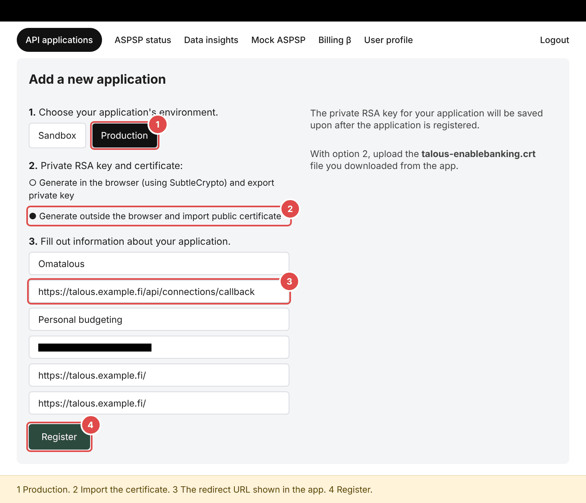
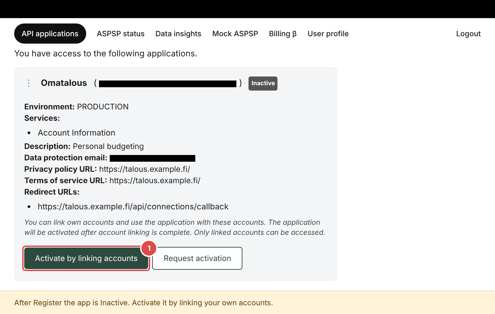
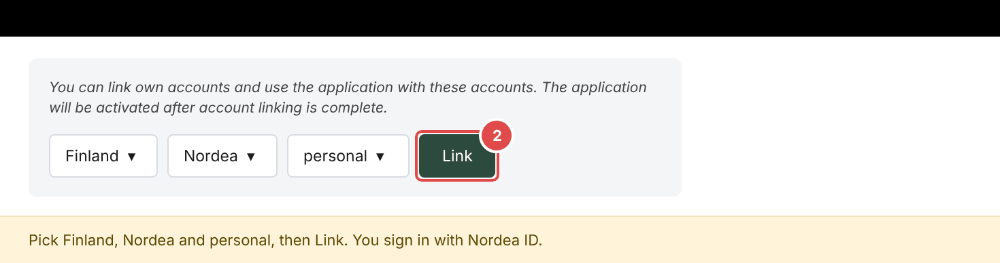
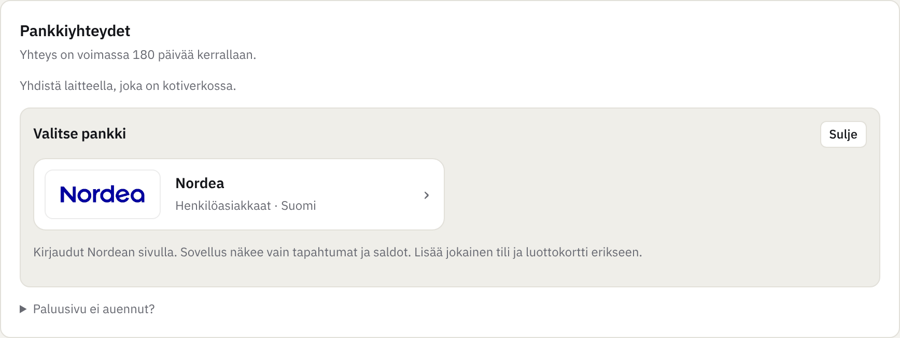

# Connecting Nordea (Enable Banking)

Enable Banking is a Finnish PSD2 service. Reading your own accounts is free in its "restricted
production" mode, where the API returns only the accounts you link yourself. You always log in on Nordea's own
page, and the app gets read access to transactions and balances for at most 180 days at a time.

You do this once for the household. Each member then connects their own accounts in the app with their
own Nordea ID.

## 1. Create the key in the app

In the setup (or later *Asetukset > Palvelin*), press *Luo avain* and then *Lataa varmenne (.crt)*. The private key
stays on the server, encrypted. You get only the public certificate `talous-enablebanking.crt`.

Copy the redirect URL the app shows. It depends on how the app is reached:

| | Redirect URL |
|---|---|
| Home network address (the default) | `https://jouni-mikkola.github.io/omatalous/paluu/`, the project's return page. It forwards your browser to your own address. |
| Own https address | `https://<address>/api/connections/callback` |
| Without the return page | `https://localhost/api/connections/callback`. The bank then shows an error page, and you paste its address into the app. |

## 2. Register the application

Sign up at <https://enablebanking.com> and open the Control Panel, *API applications*.

1. Environment: **Production**.
2. Private key: **Generate outside the browser and import public certificate**, and choose the `.crt` file.
3. Redirect URLs: the URL from step 1, exactly.
4. Application name: `Omatalous`. The description `Personal budgeting` is fine. Email, privacy URL and terms URL are not
   checked in restricted mode; your own address will do.

Press **Register**.

## 3. Link your accounts

The new application is *Inactive*. Press **Activate by linking accounts**:

Choose Finland, Nordea and personal, and press **Link**. Log in with Nordea ID.

Nordea lets you pick one account at a time. Pick one and press *Jatka*.

Back in the Control Panel the app is now *Active* and *Restricted*. Press **Link accounts** again for each
account you want in Omatalous: current and savings accounts and each credit card (cards show up as CPAN).
The app can read only the accounts listed under *Linked accounts*.

You don't need *Request unrestriction*. It is for companies.

## 4. Save the Application ID

Copy the Application ID (the UUID next to the app's name) into the app and press
*Tallenna ja testaa*. The app signs a test request and tells you right away whether Enable Banking accepts
the key. A 401 or 403 means the ID belongs to another app, or no account is linked yet.

## 5. Connect in the app

*Asetukset > Pankkiyhteydet > Lisää pankkiyhteys > Nordea*. Log in at Nordea and choose the account. After the
login the bank sends your browser back through the return page to your own address. Do this on a device in the home
network. If the page does not open, paste the address of the page the bank shows under *Paluusivu ei auennut?*. Add the
other accounts and cards with *Lisää seuraava tili*. The first fetch starts in the background
and asks for up to two years of history.

Check under *Tilit* that the card's type is *Luottokortti*. Then paying the card bill from the current
account counts as a transfer, because the purchases are already counted on the card.

## Good to know

- The consent lasts 180 days. The app warns 14 days before; renew it with the same button. History stays.
- Banks may limit automatic fetches to four a day per account. The default is 6.15 and 18.15.
- A missing account is almost always a missing link in the Control Panel (step 3).
- Older history: export a CSV from Nordea's online bank and import it into the same account under
  *Tuo CSV*. Rows already fetched (same day and amount) are skipped.
- To let Enable Banking create the key in the browser instead, choose *Generate in the browser* in step 2
  and upload the downloaded `.pem` under *Muut vaihtoehdot > Minulla on .pem-tiedosto*. Delete the file afterwards.
- A member can use their own Enable Banking app under *Asetukset > Oma Enable Banking -sovellus*. Usually
  the shared one is enough.
