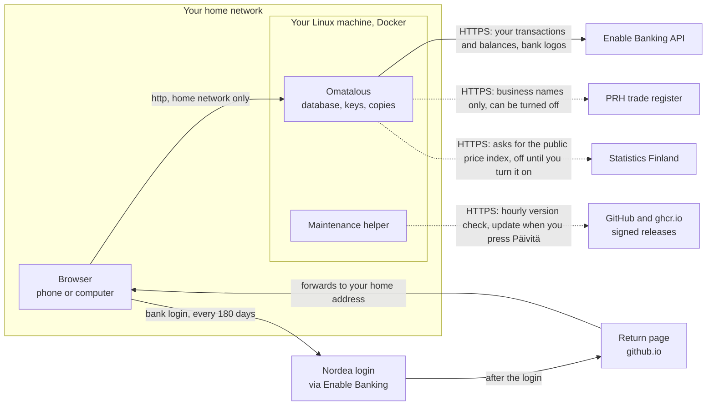

# Security

What the app protects and how. The limits are listed at the end.

## What the app holds

- No bank credentials. You log in on Nordea's page. The PSD2 consent gives read access to transactions and
  balances for at most 180 days. The app cannot make payments.
- In the database: transactions, accounts, rules, users (password hashes only) and sessions (token hashes
  only). Bank keys are stored encrypted.
- The key that encrypts them (`app_secret`) lives in its own Docker volume, `banking-secrets`, outside the
  database. A copy of the database does not reveal the bank keys.

## Network

What connects where, with the default install:



- By default the installer binds the port (`HOST_PORT`, default 8080) to the machine's home network address, when that is
  a private one (10/8, 172.16/12, 192.168/16), and otherwise to `127.0.0.1`. The traffic is plain HTTP, so keep guests
  and smart devices on a guest network. Do not forward that port in the router. Docker publishes the port past `ufw`, so
  the firewall does not limit it. Other networks reach the app through Caddy, see [A copy on the internet](#a-copy-on-the-internet).
- Bank linking from an http address goes through the project's return page on GitHub Pages
  (`https://jouni-mikkola.github.io/omatalous/callback/`). The bank sends the browser there with the authorisation `code`
  and a `state`. The state carries the app's own address, and the page forwards the browser only to a private, loopback or
  `.local` address with the fixed path `/api/connections/callback`, so it is no open redirect. It is one static file with no
  third-party scripts and no analytics. GitHub, which hosts it, sees the request and your IP address. The code is single
  use and needs the household's private key to exchange. Anyone who could change the page could send browsers to a wrong
  private address when you expect your app, which is why it is published only by the public repository's workflow, from release tags and from `main`. A household that wants
  none of it uses the paste flow or its own https address.
- With several instances each one has its own database, app secret, session cookie (`talous_<instance>`) and
  port.
- Outbound, the app talks to Enable Banking and, unless turned off, the trade register (see below). It fetches the logos of the banks on
  your list from Enable Banking's website (`enablebanking.com` and its subdomains, https only, no redirect followed) and
  serves them from its own address, so your browser calls no third party for a logo. That request carries no key and
  none of your data. A logo is at most 300 kB and of a known picture type. The name is accepted as written: the app does
  not check which IP address it resolves to, and relies on Enable Banking's DNS and its https certificate.
- When a member opens the app from outside the home network, the fetch that follows passes that member's public IP
  address and browser name to Enable Banking and the bank, as a fetch made with the user present must; on the home
  network they are not sent.
- Strict headers on every response: a Content-Security-Policy that allows only the app's own files,
  `frame-ancestors 'none'`, `Referrer-Policy: no-referrer`, HSTS, and `Cache-Control: no-store` on the API.
  Its `script-src` is `'self'` and `'wasm-unsafe-eval'`, which allows no `eval` and no inline script. Its `style-src` is `'self'` alone: the web app carries no style attribute
  (repo rule 45), and a value computed at run time is set through the CSSOM, which the policy does not block. The policy is
  what stops injected markup from styling the page (a style attribute or a style element in HTML); rule 45 keeps the app's own code
  inside it. One known gap: on iOS Safari react-aria's scroll lock adds a style element when a menu opens, the policy blocks it, and the
  page behind the menu may scroll. A served bank logo
  has a stricter policy of its own (`default-src 'none'`, no framing and a sandbox, so opened on its own it can load
  and run nothing) and is the one API answer a browser may keep, for a day. It is passed on as fetched, an SVG
  included, and the headers are what make a browser only draw it.
- The app installs as a web app (`/manifest.webmanifest`, `/sw.js`; the policy above is unchanged: a worker and a
  manifest from the app's own address need no new source). The service worker keeps the app's own files and never an
  `/api/` answer, so its cache holds nothing of a household. It does not touch the session cookie either. The figures
  kept for offline use are the page's own, listed under "Copies and how long they live".

## Outside parties

The only hosts the app and your browser call are the bank connection, the return page after the bank login and the
services you turn on yourself. There is no analytics, no font or script from a CDN and no telemetry. This table is the
list: `pnpm e2e` writes down every host the server and the browser call and fails on a host that is not here. `host`
names that host only, `*.host` the host and its subdomains. The run allows the machine itself (`127.0.0.1`, `localhost`,
`::1`) and the host of its fake bank by name, and no other. The sign-in hosts of the banks are those of
`connectors/enable-banking/banks.ts` (a test holds the two together). The maintenance helper's calls to GitHub and
`ghcr.io` run on the host, outside the app, and are under [Third parties](#third-parties).

<!-- outside-hosts -->
| Host | Called by | Why |
|---|---|---|
| `api.enablebanking.com` | server | The bank connection: token, accounts, balances, transactions. Always. |
| `*.enablebanking.com` | server | Bank logos, fetched once per bank (https only, no redirect). |
| `jouni-mikkola.github.io` | browser | The return page after a bank login from an http address. Static, no scripts of others. |
| `avoindata.prh.fi` | server | Trade register lookup of business names. Can be turned off. |
| `reports.suomenpankki.fi` | server | The published euribor fixings, once a day. Can be turned off. |
| `*.aktia.fi` | browser | Sign-in page of the bank, during the bank login. |
| `*.alandsbanken.fi` | browser | Sign-in page of the bank, during the bank login. |
| `*.banknorwegian.fi` | browser | Sign-in page of the bank, during the bank login. |
| `*.danskebank.com` | browser | Sign-in page of the bank, during the bank login. |
| `*.danskebank.fi` | browser | Sign-in page of the bank, during the bank login. |
| `*.eurocard.com` | browser | Sign-in page of the bank, during the bank login. |
| `*.holvi.com` | browser | Sign-in page of the bank, during the bank login. |
| `*.morrowbank.fi` | browser | Sign-in page of the bank, during the bank login. |
| `*.my.spendwise.fi` | browser | Sign-in page of the bank, during the bank login. |
| `*.nordea.com` | browser | Sign-in page of the bank, during the bank login. |
| `*.nordea.fi` | browser | Sign-in page of the bank, during the bank login. |
| `*.omasp.fi` | browser | Sign-in page of the bank, during the bank login. |
| `*.op.fi` | browser | Sign-in page of the bank, during the bank login. |
| `*.poppankki.fi` | browser | Sign-in page of the bank, during the bank login. |
| `*.resursbank.fi` | browser | Sign-in page of the bank, during the bank login. |
| `*.s-pankki.fi` | browser | Sign-in page of the bank, during the bank login. |
| `*.saastopankki.fi` | browser | Sign-in page of the bank, during the bank login. |
<!-- /outside-hosts -->

## A copy on the internet

The way to put a copy on the internet is Caddy with your own domain (the installer's third choice). Caddy gets a Let's
Encrypt certificate and passes requests to the app, whose port listens on `127.0.0.1` only. The app has its own login,
its login limits and its second factor, and nothing in front of it.

Behind a proxy (`TRUST_PROXY=true`) the app takes the visitor's address from `CF-Connecting-IP` or the last
`X-Forwarded-For` entry, for the login limits and the security events. Caddy removes a `CF-Connecting-IP` sent by the
client. This is safe only while nothing but the proxy can reach the app's port, which is why a copy behind Caddy
listens on `127.0.0.1` only.

## Login

- Passwords: Argon2id (19 MiB, 2 passes, 1 lane, random salt; the cost is set in `Asetukset`, `docs/ADVANCED.md`). A PBKDF2 hash from an earlier version still signs in and is rewritten as Argon2id at that sign-in. At least 12 characters.
- Sessions: a random 256-bit token in an HttpOnly, SameSite=Lax cookie (Secure over https). The database
  stores its SHA-256 only. Sessions expire after 30 days without use.
- Logins are counted before the password hash runs, so parallel guesses cannot slip past the limit. The limits per 15
  minutes are 50 attempts per address, 10 per user name from one address and 30 per user name from all addresses
  together. An IPv6 address counts as its /64, because one client can use any address in it. A stranger at one
  address cannot lock a user out; one who guesses from several networks can, while the guessing goes on. Each limit
  keeps at most 10 000 addresses or names and never forgets a locked one early. When every entry of a limit is locked
  it refuses each new address or name, so a flood of made-up names from thousands of addresses could keep the household
  from signing in. For that case the app remembers the addresses a login succeeded from in the last 30 days: at most
  100, an IPv6 address as its /64, in memory only, so a restart forgets them. An attempt from a remembered address is
  then counted in a spare of 1 000 entries with the same limits. An address or name has one count, in the limit or in
  its spare, so the spare allows no extra guesses and ends no lockout. Only a correct password gets an address
  remembered. Unknown user names take the same time to check as real ones, and only a few hashes run at once.
- Second factor: a member can turn on an authenticator app code (TOTP, RFC 6238; the seed is sealed with the user id as
  AAD and never returned). Recovery codes are stored as hashes. Every try is counted by the limiters before it is
  checked. Turning on, removal, use and failure of each are security events (`factor_on`, `factor_off`,
  `recovery_codes_made`, `recovery_code_used` and `login_fail`). Passkeys are gone: a browser allows them only on https
  and the app runs over http on the home network. Rows of kind `passkey` an earlier version made stay in `user_factor`,
  nothing reads them and `removeAll` deletes them. The log still shows their old events (`passkey_added`,
  `passkey_removed`, `passkey_used`) for their 90 days as one generic name.
- Failed logins, lockouts, logins from a new device, password changes and resets, signed-out sessions and member
  changes are recorded as security events with the time, IP address and browser of the request. The admin sees them
  under *Asetukset*. Events are kept 90 days, at most 2 000. A member sees a notice after a login from a new device
  or an admin password reset. `sessions revoke-all` signs everyone out.
- Behind a proxy (`TRUST_PROXY=true`) the client address comes from `CF-Connecting-IP` or the last
  `X-Forwarded-For` entry, the parts the proxy wrote itself. Caddy removes a `CF-Connecting-IP` sent by the
  client.
- The first admin is created in the browser with a one-time setup code that only the server can show. A generated code
  works for 24 hours, and the page then says *Asennuskoodi on vanhentunut.* A new one comes from the command
  `setup-code` in the app container. A fixed `SETUP_CODE` from `.env` does not expire and must have at least 16
  characters; a shorter one is not used and a generated code works instead.
- New members get a temporary password that must be changed before anything else. The change asks only the new password and is taken only in the session of that sign-in, within 10 minutes of it (`POST /api/auth/first-password`); a later try ends the session. It is a `password_changed` event with the detail *ensimmäinen salasana*.
- Service tokens (`Authorization: Bearer omt_…`, ADVANCED.md#service-tokens) give a script or an agent read access to one
  user's data. They are made only on the command line, stored as SHA-256, end within 90 days, carry a member's rights
  whatever the user's role, and reach only an allowlist of GET routes; anything else is 403. Use is logged once an hour
  with the address, and 20 unknown tokens from an address in 15 minutes stop it.

## Who sees what

- Every financial row has a `user_id`. Financial data is reached only through `FinanceRepo`, which adds
  `WHERE user_id = ?` to every query.
- A member sees another member's account only if the owner shares it, and then read-only.
- What a member sees of another member besides that: the display names of the users of an account the member can see
  (a joint account's users and their weights, which `GET /api/meta` gives and which the member who linked the account
  says), and the loans another member typed in that are paid from an account in the member's view, with the typist's
  display name. The member can read such a loan's name, lender, balance, rate, plan and payments, and cannot list,
  change, link or remove it. Nothing of an account that was not shared reaches a member: a use names users and
  widens no access. Which loans a view holds is in MONEY_FLOWS.md (*Joint accounts*).
- The bank's `state` value is tied to the user who started the consent and works once.
- User management and server settings are admin only.
- CSRF: requests that change something need the `X-Requested-With: fetch` header. When the browser sends an `Origin`, it
  must be the app's configured address or the host the request was sent to. A request without an `Origin` is let
  through on the header alone.

## Keys and secrets

| | Where | How |
|---|---|---|
| `app_secret` | volume `banking-secrets`, `/secrets/app_secret`, mode 600 | 384 random bits, created on first start. An existing file is never replaced and a symlink is never followed. |
| Household bank key | database | Created on the server with WebCrypto, or uploaded. Encrypted at once with AES-256-GCM (key derived from `app_secret` with HKDF). Only the public certificate ever leaves the server. |
| Members' own bank keys | database | Same, with the user id as additional data, so a copied value does not decrypt on another row. |
| `.env` | disk, mode 600 | Holds no bank keys. |

Secrets never appear in `docker inspect`, in logs or in API responses. Raw bank payloads stay on the server.

The address of the bank's API is fixed in the code. A developer setting, `EB_API_URL`, moves it to a stand-in on the same
machine for browser tests. It takes only a loopback address (`127.0.0.1`, `localhost` or `[::1]`), and the app stops at
start with any other, so the requests that the bank key signs never go anywhere else. It is read from the environment
only, not from the database and not from the browser.

## Settings entered in the browser

Nothing entered in the setup or under *Asetukset > Palvelin ja ylläpito > Palvelin* can end up executed:

- Input goes to the database only. The one file the app writes is `app_secret`, and its name comes from the code. The
  app runs no external programs; the key and certificate are made with WebCrypto.
- Every value is checked against what is allowed. The address must be `http(s)://host[:port]` with no
  path, query, credentials or control characters. The time zone must be one the runtime knows. Fetch
  hours are 0 to 4 whole numbers between 0 and 23. History is 30 to 730 days. Banks are chosen by id from
  the app's own list.
- Unknown fields are refused.
- An uploaded key must be at most 16 KB of printable text with exactly one `BEGIN PRIVATE KEY` block and
  nothing else, and WebCrypto must accept it as an RSA key of at least 2048 bits. The app stores its own
  re-encoding, never the uploaded file. Executables, scripts, certificates and encrypted keys are refused
  with a clear message.
- A test of a key or an Application ID signs a request and sends it to Enable Banking, so tests are limited. A member
  can test their own key eight times in ten minutes, counted from the member's first test, and the first refusal of a
  window is a security event. The admin's checks of an Application ID share one count of eight in ten minutes for the
  whole copy. A refused test sends nothing.
- User rules are plain words. They are escaped before matching, so a rule cannot run for a long time.
  Regular expressions are no longer accepted. A simple one saved by an older version, such as
  `/^kahvila\s/`, still works as plain words; any other never matches. A user can have at most 300 rules,
  rules made from the transaction list included.
- Stored settings are checked again when read. A broken row falls back to the defaults.

## Trade register lookup

Merchants that nothing else categorises are searched in the Finnish trade register's open data API (PRH /
YTJ, `https://avoindata.prh.fi/opendata-ytj-api/v3/companies?name=...`). The industry code of the company
found gives the category. An unclear match is left alone.

- Only the merchant name is sent. Amounts, dates, account numbers, reference numbers, messages and any row of money
  coming in are never sent.
- Only for rows that show they are a business (core `isBusinessRow`): a card purchase (a merchant code, a card account
  or the text a card terminal leaves, on a row with no payee account number), a shop that was paid at least twice
  without a payee account and not by MobilePay (the rows of the removed CSV import, which old accounts still hold,
  carry no card text), an e-invoice, direct payment or card text in the description, a payee name that starts or
  ends with a company form such as Oy or ry, or an invoice: a payee account, a reference number and a payee field
  whose name passes the guard below. A plain transfer is never enough, and neither is a reference number alone,
  since a private landlord gives one too. A MobilePay or PayPal payment to a name with no company form and no business
  word is a payment to a person. A name that is also used on a row that is not a business row is not sent.
- A name is refused at the first of these that applies, in the order the code takes them (core `industryCandidates`,
  then `askRegister` in `services/industry.ts`):
  1. The name itself (`isLookupName`): fewer than three letters besides a company form, longer than 60 characters, a placeholder, the name of a
     way to pay such as Siirto, or the shape of a person's: two to four words of letters with no company form and no
     business word.
  2. The rows: every row of money out that nothing else categorised and that is no transfer must show a business as
     above, and one that shows none rules its merchant out.
  3. The guard (`mayBePerson` in `payee-guard.ts`), which refuses a payee that may be a person. Any one of three
     refuses it: the name has the shape of a person's, read in the merchant and in the bank's own text; the name holds a
     word of a name the household has; or nothing but an invoice speaks for a business and the name does not say it
     is one, which a company form does, or a business word with no person's two names beside it. A bare word, a name
     with a sign in a word (*A&B Esimerkki*) and an e-mail address say nothing, so an invoice alone sends none of
     them. Another row of the same merchant that shows a business in another way (a card payment, a merchant code, a
     company form or a business word) is what vouches for them.
  4. The one door to the register, `askRegister`, which every request passes, the shorter query below included. It
     checks `isLookupName` and the household's names once more, so a caller that skips the steps above cannot send a name
     they refuse.
- The household's names are the holders of its accounts as the bank gives them, for every member's accounts, and its
  members' display names. They are read on the server only and never leave it. A word of them counts when the name
  holds it whole, at either end of a longer word when it has five letters or more (two names written together), and
  from its first four letters on as the last word of a name, where a bank cut the name. An initial and a company form
  are no word of a name.
- The guard reads spelling, not meaning, and it has gaps. The register is public and the alternative is to look up fewer
  shops, so these are accepted. It does not catch a household name written in another form, such as the genitive
  (*Meikäläisen Huolto* is still looked up) or a misspelling, and a word of a household name of under five letters is
  matched only as a word of its own (*Annan Kukka* for a holder Anna). A sole trader's own name written with its form
  (*Tmi First Last*) and a company named after a person (*Pekka Esimerkki Oy*) are asked about, since a company form
  says business. A person paid by invoice under one word that is also the name of a shop the household pays by card is
  asked about, and takes the shop's category. It also errs the other way: a name whose last word is the first four
  letters or more of a household word is never asked about, so a member shown as *Marketta* keeps every shop named
  *Market* out of the lookup.
- The request goes to one fixed address. Redirects are not followed, so the name cannot end up at
  another host. The answer is read up to 2 MB and refused if it is longer.
- It runs at the hourly tick, never at start, and right after a fetch that brought new
  rows. A batch sends at most 30 names, one second apart, and stops after 3 errors. A name of three or
  more words that finds nothing is searched once more without its last word, and then only a company with
  exactly that name counts.
- The answer is untrusted outside data. It is size-limited, and only the business id, the names in use and
  the industry code and label are kept, each checked for type and length.
- Answers are stored per merchant name in `merchant_industry`: business id, company name and industry,
  with no user id, so a name is looked up once. `merchant_industry_users` records which names each user's
  lookups asked about. A user sees answers only for merchants in their own rows that their own lookups
  asked about, so an answer never reveals another member's purchases. On an account shared with them,
  the owner's lookups count too. A found company is checked again after a year, no match or an unclear
  one after 60 days, an error after a day. After every version change the app removes the stored answers of names
  that `isLookupName` refuses, so an earlier version's answer for a name shaped like a person's does not stay. An
  answer stored for a name that holds a word of the household's names stays and is shown, but the name is never asked
  about again.
- An admin turns it off under *Asetukset > Palvelin ja ylläpito > Palvelin*. `INDUSTRY_LOOKUP=false` in `.env` sets the default
  to off. A value saved in the browser takes precedence.

## Loans

- A loan is a short form the household types or fills by pasting text or choosing a PDF or a picture. The browser reads
  the text, PDF or picture (pdf.js and Tesseract, served from the app's own address) and sends nothing but the fields
  the household saves. The server takes no file. Tesseract's worker, cores and language data are files under
  `/assets/ocr-<hash>/`, and the worker starts from that address, so the policy needs no blob address and no
  `unsafe-eval`; the `'wasm-unsafe-eval'` it already carries for pdf.js is enough for the WebAssembly cores. A picture
  over 40 million pixels is refused from its header before it is decoded.
- Loans belong to the user who saved them: the list of loans and every change read the typist's own rows. A member sees
  another member's loan only as *Who sees what* says, when it is paid from an account in the member's view. A loan's
  series key is not checked against the typist's accounts when it is saved, so a member who is named a user of an
  account can put a loan of their own into the views of that account's other users. Nothing of the others goes back.
- A loan that follows a euribor rate counts from the published fixings (the Bank of Finland's report pages, the rates of
  3, 6 and 12 months). The request is a fixed https address with no key, follows no redirect, reads at most 2 MB and
  carries nothing of the household. The fixings are public market data of the whole install and are stored once, in
  `reference_rates`, not per member. The report is read by its known shape only: a report with another shape, or a
  rate that is no number or outside −5 to 20 %, is refused whole, and the loans keep the fixings stored before, or their
  typed rate. The app's repository, image, tests and pictures hold no real fixing. `REFERENCE_RATES=false` in `.env`
  turns the fetch off.

## Container

- Runs as user `node` (uid 1000), not root.
- Read-only root filesystem, `/tmp` in memory with `noexec`, all Linux capabilities dropped,
  `no-new-privileges`, memory and process limits.
- The runtime image holds one JavaScript file, the migrations and the web files. No `node_modules`, no
  compilers.

## Data

- CSV export: cells starting with `= + - @` are written as text, so spreadsheets do not run them.
- Request size limit: 256 KB for every request.
- The app makes no backup of your data. Back up the data folder yourself, and keep that copy as safe as the database: it holds your transactions in plain text.
- The app's own copies are plain SQLite files, see [Copies and how long they live](#copies-and-how-long-they-live).

## A damaged database and reset

- At every server start the app checks the database with SQLite's own check before it opens it. A damaged file is left
  as it is: the server logs the damage, answers every request with a plain notice and writes nothing, and it never moves
  or deletes the file. A healthy file, a locked one or one the check could not look at is not treated as damaged. There is
  no restore in the app. Put back your own copy of the data folder and start again.
- *Tyhjennä kaikki tiedot* in *Asetukset > Palvelin ja ylläpito* changes the database itself. It asks for the admin's
  password again and a typed word (`TYHJENNÄ`), and is recorded as a security event with the asker's name. It does not go
  through the host helper.
- A reset deletes every member but the asker, and all accounts, transactions, rules, marks, loans, expected bills,
  saving tips, bank keys and bank connections. It keeps the asker's account and password, the server's settings, the
  shared bank application and the trade register's answers about companies. A checked copy `pre-reset-<time>.db` comes
  first. The bank consents are ended at the bank, and one that cannot be ended expires there on its own. The reset is
  refused while another action or a bank fetch runs and for a session that has ended, and a wrong word is recorded as
  *Ylläpitopyyntö estetty*.
- The reset does not remove the copies. Older `pre-` copies and copies you made yourself keep the data until they are
  pruned or deleted by hand, see [Copies and how long they live](#copies-and-how-long-they-live). What a member saves
  between the reset's copy and its delete is in neither, so a reset is done when nobody else uses the app. The steps are in
  [ADVANCED.md](ADVANCED.md#empty-the-data-and-keep-the-install).

## Updates and the maintenance helper

*Asetukset > Palvelin ja ylläpito > Ylläpito* can update, roll back, restart and check the install, read the logs, free disk space and renew the helper itself. The app does not run
anything itself. It writes a request row, and a helper on the host (`scripts/ops-helper.sh`) takes it. Update and rollback need the admin's password again, rollback also a typed word. Every request is recorded as a security event (`Ylläpito: ...`), and the other admins get a notice.

- The update path is root-equivalent. The helper's user is in the `docker` group, so what the helper installs
  decides who owns the machine. The root of trust is the project's GitHub account and its release workflow. Releases are
  signed there, see [RELEASING.md](RELEASING.md).
- The helper runs ten fixed actions, none with a parameter. It picks them from a fixed list, so text in the database
  never reaches a shell. Port changes are not among the actions. The last two, `prerelease-on` and `prerelease-off`,
  are the two positions of the switch *Tarjoa uudet versiot heti* under *Asetukset > Palvelin ja ylläpito > Ylläpito*. They are two names so
  that no value travels from the app to the host: the helper writes `yes` or `no`, words of its own script, on the one
  line `TALOUS_PRERELEASE` of `.env`. It writes only after it checked the file, holds the installer's lock, refuses a
  source install and keeps every other byte, the mode and the owner. An administrator's session queues them without the
  password, as it does a restart: the switch chooses only how early a release is offered. A pre-release passes the
  same signature checks, and nothing installs before *Päivitä* and the password.
- The timer runs a launcher that lives outside the clone, `~/.local/share/omatalous/<name>/launcher.sh`, so that no
  update replaces the file the timer runs. It refuses to run as root, takes one argument (the clone) and nothing from a
  request or the database, uses a fixed `PATH`, and runs no file, of the clone or of its last good copy of the helper,
  that someone else owns or that group or others can write to. It checks owner and mode before `bash -n` and before
  running, and a symbolic link never passes. The helper accepts `--root` only from the launcher's copy, and its own
  permission check then covers the copy and its folder. It keeps a copy as the last good one only after a tick that
  ended well and the helper's self-test passed. The copy holds scripts and no data.
- Three things happen without a request, each on fixed input. The watchdog takes an update back once, within an hour, when
  the app stays unhealthy for ten minutes. The self-test takes an update back at once when the helper it brought fails.
  The address step follows the machine to a new home network address: it takes nothing from the app, reads `.env` and
  this machine's interfaces, refuses every address outside RFC 1918 and every mode but the plain home network one,
  never follows a tunnel or a point-to-point link, and holds the installer's lock. The disk step removes only untagged
  images that carry this app's label and never touches a volume.
- A release install takes a version the GitHub Releases API names, only a semver step up from the running one. The answer
  chooses only a tag: the latest full release, or the newest, a pre-release too, when the switch *Tarjoa uudet versiot
  heti* is on (`TALOUS_PRERELEASE=yes` in `.env`, which the helper writes or, on an install without it, a person). The tag
  must be `vX.Y.Z`, exist in the folder, be an ancestor of the branch the clone follows and pass the helper's signer and
  compose checks, and its image must pass the cosign check for the commit the tag names. The address of the API is
  fixed and no environment variable replaces it. A release is a pre-release for its first 48 hours, until a workflow of
  the public repository promotes it after it verified the image with the check installs run, and the project holds a
  release back by making it a draft or pulls it by deleting it. The image
  comes from `ghcr.io`, and `update.sh` checks its cosign signature against the release workflow's identity (a run for a version tag, or a run on `main`
  started by a push of a new version or by hand) and the commit the run built, plus the
  image's labels against the compose file. A source install uses the remote and branch pinned in `ops/policy`, moves only
  forward, needs a clean tree, checks the new `docker-compose.yml` against a policy and, when `ops/allowed_signers`
  exists, requires a signed commit. The installer does not create that file, so source updates are unsigned until you add one:
  whoever can push to the followed branch can then run code on the host. A release install also requires the tagged commit to be on that branch.
  The helper alone picks the commit and hands it to `update.sh` (`TALOUS_TARGET`), which fetches and chooses nothing.
- To check a released image by hand, with `cosign` installed (`X.Y.Z` is the version, or use `@sha256:...` for a
  digest):

  ```bash
  cosign verify \
    --certificate-identity-regexp '^https://github\.com/jouni-mikkola/omatalous/\.github/workflows/release\.yml@refs/(tags/v[0-9]+\.[0-9]+\.[0-9]+|heads/main)$' \
    --certificate-oidc-issuer https://token.actions.githubusercontent.com \
    ghcr.io/jouni-mikkola/omatalous:X.Y.Z
  ```
- Before the switch, `update.sh` starts the new, verified image twice in one-off containers: once with no network and
  no volume to see whether it has the migration check, then on the copy taken before the update to run it. Neither
  reads the app secret. A failed check leaves the old version running.
- It refuses to run as root or when its files are writable by others, rebuilds its environment from scratch, runs one
  request at a time with timeouts, and keeps a journal in `ops/` that an older copy of the database cannot rewind. Output is scrubbed.
- What the helper may tell the app is `ops poll`, `ops report`, `ops state` and `ops progress`. (`ops access` stays for helpers of older releases and always answers that there is no change.) The last one
  gives a step's number and text while an action runs, the helper's own fixed strings and nothing read from the container,
  and the app stores it only on the request that is running, at most 20 steps, 100 characters each. One call at a time,
  cut after 10 seconds, and not again in that request after the first one that fails.
- The systemd unit leaves out `ProtectSystem`, because the helper has to write the clone and run Docker.

What remains:

- Someone with the admin password and a session can start an update to a signed version, a rollback or a restart, and
  with the typed word empty all data (the reset leaves a copy). A
  rollback loses data written since the update only when the previous version refuses the updated database, and the
  database is copied first. To ask, the previous image runs its `migrate-check` on the data volume, with no network and
  no secrets volume.
- A compromised container can ask for those same fixed actions, nothing more. It gains no key and no command.
- A compromised container can make the helper look for work up to six times a minute and run two requests in a minute, the
  second only after a version check. The actions it can ask for are the same fixed ones.
- Whoever controls the GitHub account or the release workflow can ship code to every install. Protect the account with a
  hardware key.
- Local users in the `docker` group own the host regardless of this feature.

## Copies and how long they live

| Copy | Where | Lifetime |
|---|---|---|
| The database and its `-wal` file | volume `banking-data` | until reset. Deleted rows can stay in free pages until overwritten. |
| `pre-*` copies before a migration, update, reset or secret rotation | same, mode 700 | the five newest before a migration or an update stay; the copy before a reset or a secret rotation stays 14 days, whatever else is taken. Nothing is deleted while the live database fails its check. |
| `.reserve` (64 MB of zeros) | same volume, mode 600 | until the disk runs low |
| `app_secret`, and `app_secret.prev-<time>` after a rotation | volume `banking-secrets` | the old one until deleted by hand |
| `.env` | the clone's folder, mode 600 | holds the setup code |
| `ops/` journal and run logs | the clone's folder, mode 700 | 30 days |
| `~/.local/share/omatalous/<name>/`: the launcher, `last-good/` (the helper and `scripts/lib`), `.note` and `launcher.log` | the helper user's home, mode 700 | until `--ops-helper-off` or `reset.sh`. Scripts and log lines, no data. |
| Docker logs | the host | until the container is removed. They hold counts and short errors, no amounts. |
| The figures of Yhteenveto kept for offline use (the last answers of `/api/meta`, `/api/review`, `/api/dashboard` and `/api/reports`, and who is signed in), in a cache of the browser named `omatalous-figures` | the member's device | for one user at a time. A logout, a lost session (the server says nobody is signed in) and another user's sign-in delete it. Every write and wipe of every tab runs under one Web Lock and writes only if the cache's stored owner is the user who asked, so an answer that reaches an old tab late, after a logout or another user's sign-in in another tab, is dropped. The same holds for a late answer to "who is signed in": it carries a number taken before the request (a counter in `localStorage`, no figures, that each change of owner and each wipe raises), and an answer older than the counter cannot make its user the owner again. A browser that is not https or `localhost` keeps nothing. Unencrypted: anyone who opens the installed app on that device sees them until the member logs out. |
| Cookie, scope choice, exported CSV files | the member's device | the session lasts 30 days. Exported CSV files are unencrypted. |

All of them except the secret, the reserve and the launcher folder hold transactions in plain text. Disk
encryption covers them.

Removing a member deletes their accounts, transactions, rules, shares and sessions at once, and ends their bank consents at
Enable Banking first. Their rows leave the app's own copies when newer copies push them out (the five newest stay) or, for the copy before a reset or a secret rotation, after 14 days. Copies you made
elsewhere keep them until you delete those. Free pages in the database file are overwritten over time.

## Third parties

- Enable Banking and Nordea hold the consent and their own logs, for up to 180 days.
- The Finnish trade register (PRH) sees the names of businesses you pay and your IP address, unless the lookup is off.
- The Bank of Finland (reports.suomenpankki.fi) sees your IP address once a day after 18:00 Finnish time, and asks for
  the report of all the fixings since 2021 instead of the report of the last day on the first fetch and after a gap. After a
  failure, or while the day's fixing is not published yet, the app asks again at each hourly check. The request names the
  public report and carries no data of the household. Turn it off with `REFERENCE_RATES=false`.
- Statistics Finland sees your IP address once a day, if you turn on the price index under Asetukset > Palvelin ja ylläpito > Palvelin. The
  request names the public series (table 11xs) and carries no data of the household.
- GitHub sees your IP address when the helper checks for a release once an hour (an install that follows its source
  branch runs a `git fetch` against its remote at the same hourly check, and that remote sees the address instead), and
  `ghcr.io` and Sigstore when an image is pulled and checked. GitHub Pages sees the request for the return page.
- Enable Banking's website sees your server's IP address and which bank's logo is asked for. The app asks once per bank
  for as long as the bank list is kept (a day, and again after a restart and when the admin tests the application), and
  no sooner than ten minutes after a failure.
- Let's Encrypt publishes your domain name in public certificate logs when you use Caddy.
- The project receives no data from your install and has no telemetry.

## Privacy for household members

Running Omatalous for your own household falls under the household exemption in the GDPR (Article 2(2)(c)). It stops
applying if you use it for a business or for people outside the household. This is a general reading, not legal advice.
The project publishes software and is not the controller of the data in anyone's install.

- The admin can reset a member's password, and after that can read what the member's login shows. The member gets a notice
  about a reset.
- The admin sees the security events: login times, IP addresses and browsers, for 90 days.
- A member sees another member's account only when its owner shares it, read-only.
- A member can export their own transactions as CSV and can ask the admin to delete them. The app's own copies lose them
  as newer ones are made, see [Copies](#copies-and-how-long-they-live).
- Merchant names can reveal health care, union fees, church tax or donations. Treat the database and its copies as
  sensitive.

## If something leaks

1. A password or session of a member: the admin resets the password, which ends that member's sessions. Check the
   security events.
2. The admin account or the machine: `docker compose stop`, run `sessions revoke-all`, change every admin password and
   check the member list for unknown users.
3. A copy of the database without `app_secret`: the bank keys stay sealed, but the transactions are exposed. Tell the
   household.
4. A copy of the database with `app_secret`, or the Enable Banking key: delete the application in the Enable Banking
   Control Panel first, then end the consents in Nordea's online bank, then register a new application. Afterwards run
   `secret rotate`.
5. A malicious release suspected: disable the helper (`systemctl --user disable --now talous-ops-<name>.timer`), do not
   update and report it, see [SECURITY.md](../SECURITY.md).
7. A stolen machine: do step 4 and assume the disk is readable unless it is encrypted.

## Audit

The Version 1.0 audit was made on 30 October 2026 and covered the code, the host scripts, the compose file, the image
build and the workflows, as listed in `docs/audit/security-audit-2026-10.md`. It found no critical issue; the major and
minor ones are fixed with tests, or have a written reason in the report. A scan of the image is not part of it. The
next audit is due before the next major version, or after a change to sign-in, the sealed keys or the host helper.

## Checked by tests

`apps/server/test/contract.qa.test.ts` goes through every route of the app on each test run. Without a session
every route except the public ones answers 401. Every state-changing route answers 403 without the
`X-Requested-With` header. A member asking for another member's account, transaction or rule gets a 404 or
an empty list. No response body contains a raw bank payload, a private key, the app secret or a password hash.

## Limits

- The database file is not encrypted on disk. Someone with the VM's disk sees the transactions. Use disk
  encryption in the VM or the hypervisor, and encrypt swap or turn it off. On an existing machine, encrypt the Docker
  data folder and `backups/`.
- Root on the server can read everything, `app_secret` included. Keep the system updated, use SSH keys and
  keep ports closed.
- A shared account is visible in full to the member it is shared with.
- The installed app opens Yhteenveto without a session check when the server cannot be reached, so a lost phone that is not
  locked shows the last figures until its member logs out. Revoking the session does not delete them from the device;
  the lock screen and disk encryption of the device do.
- Only a few password hashes run at once. Many addresses that keep sending wrong logins can keep them busy, and a login
  then answers "Palvelin on kiireinen" until the flood stops. Signed-in sessions are not affected. Before the first
  admin exists, the same flood can block the setup form for up to 15 minutes.
- The trade register rules above read spelling, not meaning. They let a few names of people through and keep some shops
  out; the gaps are listed under *Trade register lookup*.

## Habits

1. Keep the app inside the home network. Away from home, use a VPN to it. Use HTTPS (Caddy) only if you need the app on the internet.
2. Long, unique passwords from a password manager.
3. Keep `app_secret` in the password manager, not next to unencrypted copies of the data.
4. Back up the data folder yourself, encrypted, and keep a copy elsewhere.
5. Remove Enable Banking apps and links you no longer use.
