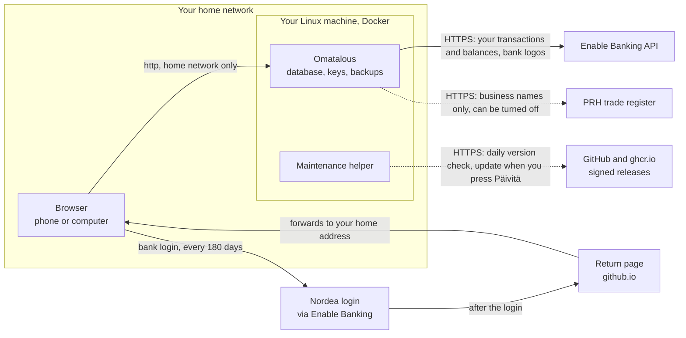

# Security

What the app protects and how. The limits are listed at the end.

## What the app holds

- No bank credentials. You log in on Nordea's page. The PSD2 consent gives read access to transactions and
  balances for at most 180 days. The app cannot make payments.
- In the database: transactions, accounts, rules, users (password hashes only) and sessions (token hashes
  only). Bank keys are stored encrypted.
- The key that encrypts them (`app_secret`) lives in its own Docker volume, `banking-secrets`, outside the
  database. A copy of the database or a backup of it does not reveal the bank keys.

## Network

What connects where, with the default install:



- By default the installer binds the port (`HOST_PORT`, default 8080) to the machine's home network address, when that is
  a private one (10/8, 172.16/12, 192.168/16), and otherwise to `127.0.0.1`. The traffic is plain HTTP, so keep guests
  and smart devices on a guest network. Do not forward that port in the router. Docker publishes the port past `ufw`, so
  the firewall does not limit it. Other networks reach the app through Caddy or a Cloudflare Tunnel.
- When the app is on the internet, the intended setup is a Cloudflare Tunnel with Cloudflare Access in front. The
  tunnel opens no port: cloudflared connects out to Cloudflare, and the app's port listens on `127.0.0.1` only. Access
  lets through only the email addresses you allow, after a one-time PIN, and only then does a visitor see Omatalous's
  own login. Access is the outer gate, the login limits and the password the inner one. What the app itself checks
  behind Access is under [A copy on the internet](#a-copy-on-the-internet).
- Bank linking from an http address goes through the project's return page on GitHub Pages
  (`https://jouni-mikkola.github.io/omatalous/callback/`). The bank sends the browser there with the authorisation `code`
  and a `state`. The state carries the app's own address, and the page forwards the browser only to a private, loopback or
  `.local` address with the fixed path `/api/connections/callback`, so it is no open redirect. It is one static file with no
  third-party scripts and no analytics. GitHub, which hosts it, sees the request and your IP address. The code is single
  use and needs the household's private key to exchange. Anyone who could change the page could send browsers to a wrong
  private address when you expect your app, which is why it is published only by the public repository's workflow, from release tags and from `main`. A household that wants
  none of it uses the paste flow or its own https address.
- With several instances each one has its own database, app secret, session cookie (`talous_<instance>`) and
  port.
- Outbound, the app talks to Enable Banking and, unless turned off, the trade register (see below). When you use the
  Etäkäyttö page it also talks to Cloudflare's API with the token you saved there. It fetches the logos of the banks on
  your list from Enable Banking's website (`enablebanking.com` and its subdomains, https only, no redirect followed) and
  serves them from its own address, so your browser calls no third party for a logo. That request carries no key and
  none of your data. A logo is at most 300 kB and of a known picture type. The name is accepted as written: the app does
  not check which IP address it resolves to, and relies on Enable Banking's DNS and its https certificate.
- Strict headers on every response: a Content-Security-Policy that allows only the app's own files,
  `frame-ancestors 'none'`, `Referrer-Policy: no-referrer`, HSTS, and `Cache-Control: no-store` on the API.
  Its `script-src` has `'wasm-unsafe-eval'` so that the picture reader of Asetukset > Lainat, a WebAssembly module
  the app serves itself, can run in the browser; the token allows no `eval` and no inline script. A served bank logo
  has a stricter policy of its own (`default-src 'none'`, no framing and a sandbox, so opened on its own it can load
  and run nothing) and is the one API answer a browser may keep, for a day. It is passed on as fetched, an SVG
  included, and the headers are what make a browser only draw it.

## A copy on the internet

The app's own check of Cloudflare Access. Access signs a token for each request it lets through. With the check on, the
copy refuses a request without a valid token, so a deleted Access application, a Bypass policy or a second host name on
the tunnel does not show the login page to the world. The check is on when `.env` has both `CF_ACCESS_AUD` (the Access
application's audience tag) and `CF_ACCESS_TEAM_DOMAIN` (`<team>.cloudflareaccess.com`). The installer and the
Etäkäyttö page write them. With neither set nothing is checked, and the app does not start with only one of them or
with a value of the wrong form.

- Every request except `GET /api/health` must carry the header `Cf-Access-Jwt-Assertion`. The app accepts RS256 only and
  takes the algorithm from its own code, never from the token. It checks the signature against the team's keys, which it
  fetches from `https://<team domain>/cdn-cgi/access/certs` (the only host keys come from, redirects refused), and then
  the issuer, the audience tag, the expiry and the not-before time, with 60 seconds of skew. Anything else gets 403,
  the text `Pääsy estetty.` and no reason.
- The keys are held in memory and fetched again when a token names a key the app does not hold, at most once a minute.
  A failed fetch keeps the keys held. With none held, every request is refused.
- Ten failed checks from one address within 15 minutes lock that address out for the rest of the window, a good token
  included. The first refusal after that is a security event (*Kirjautuminen estetty hetkeksi*, detail Cloudflare
  Access). Requests that pass are never counted.
- With the check on, `http://localhost:<port>` on the machine answers 403 too. Only the Cloudflare address works.
- A key that Cloudflare withdraws stays trusted until the app fetches the keys again, which happens when a token names a
  new key or the app restarts. `/api/health` answers without a token, because Docker's health check and the maintenance
  scripts ask it from inside the container, where no Access is in front.

Behind the tunnel the app takes the visitor's address from `CF-Connecting-IP`, which Cloudflare writes, for the login
limits, the Access limit above and the security events. The installer and the Etäkäyttö page set `TRUST_PROXY=true` for
this. It is safe only while nothing but the proxy can reach the app's port, which is why a copy behind the tunnel
listens on `127.0.0.1` only. When remote access is turned on from the page, the helper binds the port there and keeps
the earlier address in `.env`; turning remote access off puts it back.

### Remote access from the page

An admin can set up the tunnel, the address and the Access rule under *Asetukset > Palvelin > Etäkäyttö*, on a copy whose
maintenance helper is current. The installer's script path does the same and stays for installs without the helper.

- The page needs a Cloudflare API token (*Cloudflaren API-tunniste*) with the five permissions that
  [ADVANCED.md](ADVANCED.md#cloudflare-tunnel) lists. The app saves it sealed in the database, see
  [Keys and secrets](#keys-and-secrets), and never shows or returns it again.
- The app makes the tunnel, the DNS record and the Access rule itself, by calling Cloudflare's API with that token. It
  runs no program on the host. It writes a request and the maintenance helper changes `.env` (`access`, one of the
  helper's fixed actions, see below). The tunnel token that cloudflared needs waits for the helper in the file
  `ops/access-request.json` of the data volume (mode 600, folder mode 700). Only `ops access` reads it. It is deleted
  when the helper has reported, when the change is withdrawn and when it expires, at the latest at the hourly tick.
- Saving the token, removing it, turning remote access on, changing who may sign in and turning it off each ask for the
  admin's password again. Removing the token is refused (409) while remote access is on, and saving a new one is not.
  A wrong password is counted by the same limiter as the *Ylläpito* page and recorded as an event.
  Only one change runs at a time, and a changing request can be made once a minute.
- A change of who may sign in, made through the tunnel, must keep the address the admin is signed in with through
  Access. The app refuses a list without it and names the address, since such a change has no trial. A request that
  carries no such address, from the home network before remote access is on or with an Access service token, is not
  checked this way. The list holds up to 50 addresses, as in the installer.
- The address is the one value typed in a browser that ends up in `.env`. It is a host name of lower-case letters,
  digits and hyphens with at least two labels, under a zone that the token sees and that is active in Cloudflare, with
  one label before the zone at most. Every value is checked by form in the app when the file is written and again by
  the helper, which prints none of them.
- A new address is on trial for 15 minutes. From the moment the helper has applied it, the home address answers 403, so
  the admin opens the new address and signs in through Cloudflare. The first request that passes the app's Access check
  makes the address permanent. If nobody has got in after 15 minutes, the server takes the address off by itself (the
  helper's return to the home network, then Cloudflare's side), so a mistyped email or a host Cloudflare does not serve
  cannot lock the household out until someone has a shell. That return is the one change that asks for no password. One
  internal function does it, which a timer and the hourly tick call and no route reaches, and all it can queue is the
  return. It is recorded as a security event, *Etäkäyttö poistettu, koska kukaan ei päässyt sisään*. When the helper is
  off or busy at the 15 minute mark, the server tries again at its next look. A server that starts again during the 15
  minutes reads from its record how much is left and still takes an unproven address off on time.
- Once remote access is on, the home address stays closed. Without the page, the way back is the installer on the
  server (`./scripts/install.sh --reconfigure`).
- Turning it off asks the helper to take the copy out of the tunnel first. Cloudflare's tunnel, DNS record and Access
  application are removed after that, at the next visit to the page or within the hour. Access is kept while something
  else in Cloudflare still leads to the host, such as a second host name on the tunnel or a DNS record that points
  elsewhere, and the page names what is left. The same holds for `./scripts/install.sh --cloudflare-down`. An address
  that the installer made is not removed from the page. Turned off through the tunnel, the app waits for a helper
  report that says the copy is on the tunnel before it touches Cloudflare, so Cloudflare's side is never removed from
  under a copy that still depends on it.
- What the helper reports about an `access` request is shown without the app secret, the tunnel token, the audience tag
  and the host name of the Access team. A report that comes after the 30 minute timeout, when the request file with
  these values is gone, is cleaned by form instead and hides any run of 20 or more token characters. The page shows the
  result of the last change for 24 hours.

## Login

- Passwords: PBKDF2-HMAC-SHA256 with 600 000 iterations and a random salt. At least 12 characters.
- Sessions: a random 256-bit token in an HttpOnly, SameSite=Lax cookie (Secure over https). The database
  stores its SHA-256 only. Sessions expire after 30 days without use.
- Logins are counted before the password hash runs, so parallel guesses cannot slip past the limit. The limits per 15
  minutes are 50 attempts per address, 10 per user name from one address and 30 per user name from all addresses
  together. An IPv6 address counts as its /64, because one client can use any address in it. A stranger at one
  address cannot lock a user out; one who guesses from several networks can, while the guessing goes on. Each limit
  keeps at most 10 000 addresses or names and never forgets a locked one early. When every entry of a limit is locked
  it refuses each new address or name, so a flood of made-up names from thousands of addresses could keep the household
  from signing in. For that case the app remembers the addresses a login succeeded from in the last 30 days: at most
  100, an IPv6 address as its /64, in memory only, so a restart forgets them. An attempt from a remembered address is
  then counted in a spare of 1 000 entries with the same limits. An address or name has one count, in the limit or in
  its spare, so the spare allows no extra guesses and ends no lockout. Only a correct password gets an address
  remembered. Unknown user names take the same time to check as real ones, and only a few hashes run at once.
- Failed logins, lockouts, logins from a new device, password changes and resets, signed-out sessions and member
  changes are recorded as security events with the time, IP address and browser of the request. The admin sees them
  under *Asetukset*. Events are kept 90 days, at most 2 000. A member sees a notice after a login from a new device
  or an admin password reset. `sessions revoke-all` signs everyone out.
- Behind a proxy (`TRUST_PROXY=true`) the client address comes from `CF-Connecting-IP` or the last
  `X-Forwarded-For` entry, the parts the proxy wrote itself. Caddy removes a `CF-Connecting-IP` sent by the
  client.
- The first admin is created in the browser with a one-time setup code that only the server can show. A generated code
  works for 24 hours, and the page then says *Asennuskoodi on vanhentunut.* A new one comes from the command
  `setup-code` in the app container. A fixed `SETUP_CODE` from `.env` does not expire and must have at least 16
  characters; a shorter one is not used and a generated code works instead.
- New members get a temporary password that must be changed before anything else.

## Who sees what

- Every financial row has a `user_id`. Financial data is reached only through `FinanceRepo`, which adds
  `WHERE user_id = ?` to every query.
- A member sees another member's account only if the owner shares it, and then read-only.
- What a member sees of another member besides that: the display names of the users of an account the member can see
  (a joint account's users and their weights, which `GET /api/meta` gives and which the member who linked the account
  says), and the loans another member typed in that are paid from an account in the member's view, with the typist's
  display name. The member can read such a loan's name, lender, balance, rate, plan and payments, and cannot list,
  change, link or remove it. Nothing of an account that was not shared reaches a member: a use names users and
  widens no access. Which loans a view holds is in MONEY_FLOWS.md (*Joint accounts*).
- The bank's `state` value is tied to the user who started the consent and works once.
- User management and server settings are admin only.
- CSRF: requests that change something need the `X-Requested-With: fetch` header. When the browser sends an `Origin`, it
  must be the app's configured address or the host the request was sent to. A request without an `Origin` is let
  through on the header alone.

## Keys and secrets

| | Where | How |
|---|---|---|
| `app_secret` | volume `banking-secrets`, `/secrets/app_secret`, mode 600 | 384 random bits, created on first start. An existing file is never replaced and a symlink is never followed. |
| Household bank key | database | Created on the server with WebCrypto, or uploaded. Encrypted at once with AES-256-GCM (key derived from `app_secret` with HKDF). Only the public certificate ever leaves the server. |
| Members' own bank keys | database | Same, with the user id as additional data, so a copied value does not decrypt on another row. |
| Cloudflare API token saved on the Etäkäyttö page | database (`settings`, key `instance_cloudflare`) | Encrypted at once with AES-256-GCM and the context `instance:cloudflare`. Never returned. `secret rotate` seals it again, and it sits in database backups in sealed form. |
| `.env` | disk, mode 600 | Holds no bank keys. The Cloudflare tunnel token is here because cloudflared reads it; the app container does not get it. It also holds the Access pair (`CF_ACCESS_AUD`, `CF_ACCESS_TEAM_DOMAIN`), which are not secrets. |

Secrets never appear in `docker inspect`, in logs or in API responses. Raw bank payloads stay on the server.

The address of the bank's API is fixed in the code. A developer setting, `EB_API_URL`, moves it to a stand-in on the same
machine for browser tests. It takes only a loopback address (`127.0.0.1`, `localhost` or `[::1]`), and the app stops at
start with any other, so the requests that the bank key signs never go anywhere else. It is read from the environment
only, not from the database and not from the browser.

The Cloudflare API token that lets the installer make a tunnel (`~/.config/omatalous/cloudflare.env`, mode 600, outside
the clone) can create and remove tunnels, change DNS records of your domain and change who Cloudflare Access lets in. It
cannot read the app's data. The installer refuses the file when others can read it or when it belongs to someone else. It
reaches the short-lived container of the app image that talks to Cloudflare through the environment, so it is not in the
process list or in the logs; it is visible to a user of Docker for the few seconds that container runs. The installer
keeps it nowhere else: not in the app, in `.env` or in a backup. To revoke it, delete or roll the token in the Cloudflare
dashboard (*My Profile > API Tokens*) and put a new one in the file. Tunnels and Access rules that exist keep working
without it.

A token saved on the Etäkäyttö page has the same reach and is a second sealed secret of the app, beside the bank keys.
Anyone who holds a database copy and `app_secret` can open it. Remove it on the page, and in the Cloudflare dashboard to
revoke it. A token that no longer opens, because `app_secret` was replaced, is saved again on the page before `secret
rotate`, which otherwise stops and names the token. With remote access off it can be removed instead. With a token
saved and remote access on, Cloudflare's side can be removed only while the token is there.

## Settings entered in the browser

Nothing entered in the setup or under *Asetukset > Palvelin* can end up executed:

- Input goes to the database only, with one exception: the address of remote access (below). The files the app writes
  are `app_secret` and that request file, and their names come from the code. The app runs no external programs; the
  key and certificate are made with WebCrypto.
- Every value is checked against what is allowed. The address must be `http(s)://host[:port]` with no
  path, query, credentials or control characters. The time zone must be one the runtime knows. Fetch
  hours are 0 to 4 whole numbers between 0 and 23. History is 30 to 730 days. Banks are chosen by id from
  the app's own list.
- Unknown fields are refused.
- An uploaded key must be at most 16 KB of printable text with exactly one `BEGIN PRIVATE KEY` block and
  nothing else, and WebCrypto must accept it as an RSA key of at least 2048 bits. The app stores its own
  re-encoding, never the uploaded file. Executables, scripts, certificates and encrypted keys are refused
  with a clear message.
- A test of a key or an Application ID signs a request and sends it to Enable Banking, so tests are limited. A member
  can test their own key eight times in ten minutes, counted from the member's first test, and the first refusal of a
  window is a security event. The admin's checks of an Application ID share one count of eight in ten minutes for the
  whole copy. A refused test sends nothing.
- User rules are plain words. They are escaped before matching, so a rule cannot run for a long time.
  Regular expressions are no longer accepted. A simple one saved by an older version, such as
  `/^kahvila\s/`, still works as plain words; any other never matches. A user can have at most 300 rules,
  rules made from the transaction list included.
- Stored settings are checked again when read. A broken row falls back to the defaults.
- The exception is the address typed on the Etäkäyttö page, which the helper writes to `.env` together with the Access
  pair and the tunnel token. It passes a form check in the app, is stored in a file that only the helper reads, and
  passes the helper's own form check, which admits no space, quote, `$`, backtick, `#` or backslash, so it is one value
  on one line. The helper never runs it or puts it on a command line.

## Trade register lookup

Merchants that nothing else categorises are searched in the Finnish trade register's open data API (PRH /
YTJ, `https://avoindata.prh.fi/opendata-ytj-api/v3/companies?name=...`). The industry code of the company
found gives the category. An unclear match is left alone.

- Only the merchant name is sent. Amounts, dates, account numbers, reference numbers, messages and any row of money
  coming in are never sent.
- Only for rows that show they are a business (core `isBusinessRow`): a card purchase (a merchant code, a card account
  or the text a card terminal leaves, on a row with no payee account number), a shop that was paid at least twice
  without a payee account and not by MobilePay (the rows of the removed CSV import, which old accounts still hold,
  carry no card text), an e-invoice, direct payment or card text in the description, a payee name that starts or
  ends with a company form such as Oy or ry, or an invoice: a payee account, a reference number and a payee field
  whose name passes the guard below. A plain transfer is never enough, and neither is a reference number alone,
  since a private landlord gives one too. A MobilePay or PayPal payment to a name with no company form and no business
  word is a payment to a person. A name that is also used on a row that is not a business row is not sent.
- A name is refused at the first of these that applies, in the order the code takes them (core `industryCandidates`,
  then `askRegister` in `services/industry.ts`):
  1. The name itself (`isLookupName`): fewer than three letters besides a company form, longer than 60 characters, a placeholder, the name of a
     way to pay such as Siirto, or the shape of a person's: two to four words of letters with no company form and no
     business word.
  2. The rows: every row of money out that nothing else categorised and that is no transfer must show a business as
     above, and one that shows none rules its merchant out.
  3. The guard (`mayBePerson` in `payee-guard.ts`), which refuses a payee that may be a person. Any one of three
     refuses it: the name has the shape of a person's, read in the merchant and in the bank's own text; the name holds a
     word of a name the household has; or nothing but an invoice speaks for a business and the name does not say it
     is one, which a company form does, or a business word with no person's two names beside it. A bare word, a name
     with a sign in a word (*A&B Esimerkki*) and an e-mail address say nothing, so an invoice alone sends none of
     them. Another row of the same merchant that shows a business in another way (a card payment, a merchant code, a
     company form or a business word) is what vouches for them.
  4. The one door to the register, `askRegister`, which every request passes, the shorter query below included. It
     checks `isLookupName` and the household's names once more, so a caller that skips the steps above cannot send a name
     they refuse.
- The household's names are the holders of its accounts as the bank gives them, for every member's accounts, and its
  members' display names. They are read on the server only and never leave it. A word of them counts when the name
  holds it whole, at either end of a longer word when it has five letters or more (two names written together), and
  from its first four letters on as the last word of a name, where a bank cut the name. An initial and a company form
  are no word of a name.
- The guard reads spelling, not meaning, and it has gaps. The register is public and the alternative is to look up fewer
  shops, so these are accepted. It does not catch a household name written in another form, such as the genitive
  (*Meikäläisen Huolto* is still looked up) or a misspelling, and a word of a household name of under five letters is
  matched only as a word of its own (*Annan Kukka* for a holder Anna). A sole trader's own name written with its form
  (*Tmi First Last*) and a company named after a person (*Pekka Esimerkki Oy*) are asked about, since a company form
  says business. A person paid by invoice under one word that is also the name of a shop the household pays by card is
  asked about, and takes the shop's category. It also errs the other way: a name whose last word is the first four
  letters or more of a household word is never asked about, so a member shown as *Marketta* keeps every shop named
  *Market* out of the lookup.
- The request goes to one fixed address. Redirects are not followed, so the name cannot end up at
  another host. The answer is read up to 2 MB and refused if it is longer.
- It runs at the hourly tick, never at start, and right after a fetch that brought new
  rows. A batch sends at most 30 names, one second apart, and stops after 3 errors. A name of three or
  more words that finds nothing is searched once more without its last word, and then only a company with
  exactly that name counts.
- The answer is untrusted outside data. It is size-limited, and only the business id, the names in use and
  the industry code and label are kept, each checked for type and length.
- Answers are stored per merchant name in `merchant_industry`: business id, company name and industry,
  with no user id, so a name is looked up once. `merchant_industry_users` records which names each user's
  lookups asked about. A user sees answers only for merchants in their own rows that their own lookups
  asked about, so an answer never reveals another member's purchases. On an account shared with them,
  the owner's lookups count too. A found company is checked again after a year, no match or an unclear
  one after 60 days, an error after a day. After every version change the app removes the stored answers of names
  that `isLookupName` refuses, so an earlier version's answer for a name shaped like a person's does not stay. An
  answer stored for a name that holds a word of the household's names stays and is shown, but the name is never asked
  about again.
- An admin turns it off under *Asetukset > Palvelin*. `INDUSTRY_LOOKUP=false` in `.env` sets the default
  to off. A value saved in the browser takes precedence.

## Loans

- A picture, a PDF or a text of a loan is read in the browser and never sent. Nothing leaves the page before
  *Tallenna*, and then only the fields of the form that the household has seen and ticked. The lines the figures were
  read from stay in the page.
- The reader is Tesseract and pdf.js, both run as WebAssembly and JavaScript the app serves itself from `/assets`. No
  file of it comes from a CDN, and the Content-Security-Policy would block one. Both parse files the household gives
  them, and both are pinned to exact versions, so a security release of either needs a bump by hand.
- Loans belong to the user who saved them: the list of loans and every change read the typist's own rows. A member sees
  another member's loan only as *Who sees what* says, when it is paid from an account in the member's view. A loan's
  series key is not checked against the typist's accounts when it is saved, so a member who is named a user of an
  account can put a loan of their own into the views of that account's other users. Nothing of the others goes back.

## Container

- Runs as user `node` (uid 1000), not root.
- Read-only root filesystem, `/tmp` in memory with `noexec`, all Linux capabilities dropped,
  `no-new-privileges`, memory and process limits.
- The runtime image holds one JavaScript file, the migrations and the web files. No `node_modules`, no
  compilers.
- The tunnel container (cloudflared) runs as an unprivileged user with a read-only root filesystem, no Linux
  capabilities and `no-new-privileges`. Its image is `cloudflare/cloudflared:latest`, pulled again on each update.

## Data

- CSV export: cells starting with `= + - @` are written as text, so spreadsheets do not run them.
- Request size limit: 256 KB for every request.
- Backups can be encrypted with `age` (`BACKUP_AGE_RECIPIENT`). Backup files are mode 600.
- The copy to a NAS (`BACKUP_COPY_TO`) never writes through a link on the share. Each file goes in under a hidden
  temporary name and gets its final name only after it matches the original. A link at the temporary name is replaced,
  and a link at a file's final name stops that copy with a warning. The local backup stays.
- `restore.sh --secret` tries the given secret file on the restored database before it replaces the app secret. A file
  that does not open the stored bank keys is refused and the current secret stays.
- The app's own copies are plain SQLite files, see [Copies and how long they live](#copies-and-how-long-they-live).

## A damaged database, restore and reset

- At every server start the app checks the database with SQLite's own check before it opens it. A damaged file moves
  with its `-wal` and `-shm` files to `/data/damaged`, and the newest intact copy takes its place. Nothing is deleted. A
  healthy file, a locked one or one the check could not look at is never moved. With no intact copy the app starts on the
  damaged file, because a stop at start would loop. Both cases are security events (*Tietokanta palautettu
  varmuuskopiosta*, *Tietokanta vaurioitunut*) and a notice to every admin. The app never empties `/data/damaged`, and
  the files in it hold transactions in plain text.
- *Palauta uusin varmuuskopio* and *Tyhjennä kaikki tiedot* in *Asetukset > Ylläpito* change the database itself.
  Each asks for the admin's password again and a typed word (`PALAUTA`, `TYHJENNÄ`), and is recorded as a security event
  with the asker's name. Neither goes through the host helper. A restore writes a marker, `/data/.restore-request`, which
  holds the file name of a copy in `/data/backups` and the asker's id. The app then ends itself as `docker stop` does,
  Docker's restart policy starts it, and the start puts the copy in place. A marker older than 15 minutes is dropped with
  a notice, so a start days later does not bring back a copy chosen long before. The database it replaced is kept as
  `pre-restore-<time>.db`.
- A reset deletes every member but the asker, and all accounts, transactions, rules, marks, loans, expected bills,
  saving tips, bank keys and bank connections. It keeps the asker's account and password, the server's settings, the
  shared bank application and the trade register's answers about companies. A checked copy `pre-reset-<time>.db` comes
  first. The bank consents are ended at the bank, and one that cannot be ended expires there on its own. The reset is
  refused while another action or a bank fetch runs and for a session that has ended, and a wrong word is recorded as
  *Ylläpitopyyntö estetty*.
- Neither removes the copies. Older copies, `/data/damaged` and the host's archives keep the data until they are pruned
  or deleted by hand, see [Copies and how long they live](#copies-and-how-long-they-live). What a member saves between
  the reset's copy and its delete is in neither, so a reset is done when nobody else uses the app. The steps are in
  [ADVANCED.md](ADVANCED.md#empty-the-data-and-keep-the-install).

## Updates and the maintenance helper

*Asetukset > Ylläpito* can update, roll back, back up, restart and check the install, read the logs, free disk space and renew the helper itself. The app does not run
anything itself. It writes a request row, and a helper on the host (`scripts/ops-helper.sh`) takes it. Update, rollback and
the download of a backup need the admin's password again, rollback also a typed word. Every request is recorded as a security event (`Ylläpito: ...`), and the other admins get a notice.
Remote access is changed on its own page, with the password for every change, see
[Remote access from the page](#remote-access-from-the-page).

- The update path is root-equivalent. The helper's user is in the `docker` group, so what the helper installs
  decides who owns the machine. The root of trust is the project's GitHub account and its release workflow. Releases are
  signed there, see [RELEASING.md](RELEASING.md).
- The helper runs twelve fixed actions, none with a parameter. It picks them from a fixed list, so text in the database
  never reaches a shell. The tenth, `access`, applies the way of reaching the copy that the app has prepared: Cloudflare
  Tunnel with Access, or the home network again. It takes four values from the request file described above, never from
  the request row: the host name, the tunnel token, the Access audience tag and the team domain. It checks each by
  form, rewrites `.env` once with mode 600 and keeps the earlier `.env` as `ops/env.prev` in the clone folder (mode
  600, one generation, the earlier tunnel token included). If the app does not answer with the new `.env`, the helper
  puts the earlier one back. To put it back by hand, copy `ops/env.prev` over `.env`, keep its mode 600, and run
  `docker compose up -d`. The maintenance route refuses `access`, so only the remote access routes, behind the
  password, can queue it. Port changes are not among the actions. The last two, `prerelease-on` and `prerelease-off`,
  are the two positions of the switch *Tarjoa uudet versiot heti* under *Asetukset > Ylläpito*. They are two names so
  that no value travels from the app to the host: the helper writes `yes` or `no`, words of its own script, on the one
  line `TALOUS_PRERELEASE` of `.env`. It writes only after it checked the file, holds the installer's lock, refuses a
  source install and keeps every other byte, the mode and the owner. An administrator's session queues them without the
  password, as it does a restart: the switch chooses only how early a release is offered. A pre-release passes the
  same signature checks, and nothing installs before *Päivitä* and the password.
- The timer runs a launcher that lives outside the clone, `~/.local/share/omatalous/<name>/launcher.sh`, so that no
  update replaces the file the timer runs. It refuses to run as root, takes one argument (the clone) and nothing from a
  request or the database, uses a fixed `PATH`, and runs no file, of the clone or of its last good copy of the helper,
  that someone else owns or that group or others can write to. It checks owner and mode before `bash -n` and before
  running, and a symbolic link never passes. The helper accepts `--root` only from the launcher's copy, and its own
  permission check then covers the copy and its folder. It keeps a copy as the last good one only after a tick that
  ended well and the helper's self-test passed. The copy holds scripts and no data.
- Three things happen without a request, each on fixed input. The watchdog takes an update back once, within an hour, when
  the app stays unhealthy for ten minutes. The self-test takes an update back at once when the helper it brought fails.
  The address step follows the machine to a new home network address: it takes nothing from the app, reads `.env` and
  this machine's interfaces, refuses every address outside RFC 1918 and every mode but the plain home network one,
  never follows a tunnel or a point-to-point link, and holds the installer's lock. The disk step removes only untagged
  images that carry this app's label and never touches a volume.
- A release install takes a version the GitHub Releases API names, only a semver step up from the running one. The answer
  chooses only a tag: the latest full release, or the newest, a pre-release too, when the switch *Tarjoa uudet versiot
  heti* is on (`TALOUS_PRERELEASE=yes` in `.env`, which the helper writes or, on an install without it, a person). The tag
  must be `vX.Y.Z`, exist in the folder, be an ancestor of the branch the clone follows and pass the helper's signer and
  compose checks, and its image must pass the cosign check for the commit the tag names. The address of the API is
  fixed and no environment variable replaces it. A release is a pre-release for its first 48 hours, until a workflow of
  the public repository promotes it after it verified the image with the check installs run, and the project holds a
  release back by making it a draft or pulls it by deleting it. The image
  comes from `ghcr.io`, and `update.sh` checks its cosign signature against the release workflow's identity (a run for a version tag, or a run on `main`
  started by a push of a new version or by hand) and the commit the run built, plus the
  image's labels against the compose file. A source install uses the remote and branch pinned in `ops/policy`, moves only
  forward, needs a clean tree, checks the new `docker-compose.yml` against a policy and, when `ops/allowed_signers`
  exists, requires a signed commit. The installer does not create that file, so source updates are unsigned until you add one:
  whoever can push to the followed branch can then run code on the host. A release install also requires the tagged commit to be on that branch.
  The helper alone picks the commit and hands it to `update.sh` (`TALOUS_TARGET`), which fetches and chooses nothing.
- To check a released image by hand, with `cosign` installed (`X.Y.Z` is the version, or use `@sha256:...` for a
  digest):

  ```bash
  cosign verify \
    --certificate-identity-regexp '^https://github\.com/jouni-mikkola/omatalous/\.github/workflows/release\.yml@refs/(tags/v[0-9]+\.[0-9]+\.[0-9]+|heads/main)$' \
    --certificate-oidc-issuer https://token.actions.githubusercontent.com \
    ghcr.io/jouni-mikkola/omatalous:X.Y.Z
  ```
- Before the switch, `update.sh` starts the new, verified image twice in one-off containers: once with no network and
  no volume to see whether it has the migration check, then on the copy taken before the update to run it. Neither
  reads the app secret. A failed check leaves the old version running.
- It refuses to run as root or when its files are writable by others, rebuilds its environment from scratch, runs one
  request at a time with timeouts, and keeps a journal in `ops/` that a restored database cannot rewind. Output is scrubbed.
- The systemd unit leaves out `ProtectSystem`, because the helper has to write the clone and run Docker.

What remains:

- Someone with the admin password and a session can start an update to a signed version, a rollback or a restart, and
  with the typed word restore the newest copy or empty all data (the reset leaves a copy to undo it). A
  rollback loses data written since the update only when the previous version refuses the updated database, and the
  database is copied first. To ask, the previous image runs its `migrate-check` on the data volume, with no network and
  no secrets volume.
- A compromised container can ask for those same fixed actions, nothing more. For `access` it also chooses the values:
  it can write its own request file and queue the action with no password, so it can point the copy at a tunnel and
  an Access team of a Cloudflare account of its own, turn the Access check off and replace an address set by hand. It
  gains no other key and no command.
- Whoever controls the GitHub account or the release workflow can ship code to every install. Protect the account with a
  hardware key.
- Local users in the `docker` group own the host regardless of this feature.

## Copies and how long they live

| Copy | Where | Lifetime |
|---|---|---|
| The database and its `-wal` file | volume `banking-data` | until reset. Deleted rows can stay in free pages until overwritten. |
| Daily copy `auto-YYYY-MM-DD.db` | same volume, mode 700 | 7 newest, none older than 14 days |
| `pre-*` copies before a migration, update, rollback, restore, reset or secret rotation | same | none older than 14 days except the newest one. A `pre-reset-` copy is also kept for 14 days. |
| The three newest intact copies a restore would take, of any kind | same | never deleted, whatever their age. Nothing is deleted while the live database fails its check. |
| `damaged/banking-<time>.db` with its `-wal` and `-shm`, a database the app moved aside at start | same volume | until you delete it. The app never empties the folder. |
| `<name>.damaged`, a copy that failed the weekly check | same, in `backups/` | until you delete it |
| `.reserve` (64 MB of zeros) and `.restore-request` (a copy's file name and an admin's id) | same volume, mode 600 | the reserve until the disk runs low, the marker until the next start |
| `backups/talous-*.db.gz` from `backup.sh` | the clone's folder, mode 600 | 30 days. Not touched by the pruning above. Encrypted only with `BACKUP_AGE_RECIPIENT`. The copies on a NAS (`BACKUP_COPY_TO`) stay until you delete them. |
| The file from *Lataa uusin* | the admin's device | until the admin deletes it. Unencrypted. |
| `app_secret`, and `app_secret.prev-<time>` after a rotation | volume `banking-secrets` | the old one until deleted by hand |
| `.env` | the clone's folder, mode 600 | holds the tunnel token and the setup code |
| `ops/` journal and run logs | the clone's folder, mode 700 | 30 days |
| `ops/env.prev`, the `.env` from before the last remote access change | the clone's folder, mode 600 | until the next change. Holds the earlier tunnel token. |
| `~/.local/share/omatalous/<name>/`: the launcher, `last-good/` (the helper and `scripts/lib`), `.note` and `launcher.log` | the helper user's home, mode 700 | until `--ops-helper-off` or `reset.sh`. Scripts and log lines, no data. |
| `ops/access-request.json` | the data volume, mode 600 | from the request until the helper has reported, the change is withdrawn or it expires. Holds the tunnel token. |
| Docker logs | the host | until the container is removed. They hold counts and short errors, no amounts. |
| Cookie, scope choice, exported CSV files | the member's device | the session lasts 30 days. Exported CSV files are unencrypted. |

All of them except the secret, the reserve, the marker and the launcher folder hold transactions in plain text. Disk
encryption covers them.

Removing a member deletes their accounts, transactions, rules, shares and sessions at once, and ends their bank consents at
Enable Banking first. Their rows leave the app's own copies within 14 days, as long as new copies are made, since the
three newest intact copies stay whatever their age. Files in `damaged/`, copies in `backups/` and copies you made
elsewhere keep them until you delete those. Free pages in the database file are overwritten over time.

## Third parties

- Enable Banking and Nordea hold the consent and their own logs, for up to 180 days.
- The Finnish trade register (PRH) sees the names of businesses you pay and your IP address, unless the lookup is off.
- GitHub sees your IP address when the helper checks for a release once a day, and `ghcr.io` and Sigstore when an image is
  pulled and checked. GitHub Pages sees the request for the return page.
- Enable Banking's website sees your server's IP address and which bank's logo is asked for. The app asks once per bank
  for as long as the bank list is kept (a day, and again after a restart and when the admin tests the application), and
  no sooner than ten minutes after a failure.
- Cloudflare, if you use a tunnel, sees all traffic in clear text. If you use the Etäkäyttö page, it also receives the
  app's calls with your API token. Let's Encrypt publishes your domain name in public
  certificate logs when you use Caddy.
- The project receives no data from your install and has no telemetry.

## Privacy for household members

Running Omatalous for your own household falls under the household exemption in the GDPR (Article 2(2)(c)). It stops
applying if you use it for a business or for people outside the household. This is a general reading, not legal advice.
The project publishes software and is not the controller of the data in anyone's install.

- The admin can reset a member's password, and after that can read what the member's login shows. The member gets a notice
  about a reset.
- The admin sees the security events: login times, IP addresses and browsers, for 90 days.
- A member sees another member's account only when its owner shares it, read-only.
- A member can export their own transactions as CSV and can ask the admin to delete them. Backups lose them within 14
  days, see [Copies](#copies-and-how-long-they-live).
- Merchant names can reveal health care, union fees, church tax or donations. Treat the database and its copies as
  sensitive.

## If something leaks

1. A password or session of a member: the admin resets the password, which ends that member's sessions. Check the
   security events.
2. The admin account or the machine: `docker compose stop`, run `sessions revoke-all`, change every admin password and
   check the member list for unknown users.
3. A copy of the database without `app_secret`: the bank keys stay sealed, but the transactions are exposed. Tell the
   household.
4. A copy of the database with `app_secret`, or the Enable Banking key: delete the application in the Enable Banking
   Control Panel first, then end the consents in Nordea's online bank, then register a new application. Afterwards run
   `secret rotate`.
5. A tunnel token: delete the tunnel in Cloudflare, make a new one and put its token in `.env`. After a remote access
   change from the page the earlier token also sits in `ops/env.prev`. A Cloudflare API token, the installer's or the
   one saved in the app: revoke it in the Cloudflare dashboard.
6. A malicious release suspected: disable the helper (`systemctl --user disable --now talous-ops-<name>.timer`), do not
   update and report it, see [SECURITY.md](../SECURITY.md).
7. A stolen machine: do step 4 and assume the disk is readable unless it is encrypted.

## Checked by tests

`apps/server/test/contract.qa.test.ts` goes through every route of the app on each test run. Without a session
every route except the public ones answers 401. Every state-changing route answers 403 without the
`X-Requested-With` header. A member asking for another member's account, transaction or rule gets a 404 or
an empty list. No response body contains a raw bank payload, a private key, the app secret or a password hash.

## Limits

- The database file is not encrypted on disk. Someone with the VM's disk sees the transactions. Use disk
  encryption in the VM or the hypervisor, and encrypt swap or turn it off. On an existing machine, encrypt the Docker
  data folder and `backups/`.
- Root on the server can read everything, `app_secret` included. Keep the system updated, use SSH keys and
  keep ports closed.
- A shared account is visible in full to the member it is shared with.
- Only a few password hashes run at once. Many addresses that keep sending wrong logins can keep them busy, and a login
  then answers "Palvelin on kiireinen" until the flood stops. Signed-in sessions are not affected. Before the first
  admin exists, the same flood can block the setup form for up to 15 minutes.
- The trade register rules above read spelling, not meaning. They let a few names of people through and keep some shops
  out; the gaps are listed under *Trade register lookup*.

## Habits

1. Keep the app inside the home network. Away from home, use a VPN to it. Use HTTPS (Caddy or a Cloudflare Tunnel) only if you need the app on the internet.
2. Long, unique passwords from a password manager.
3. Keep `app_secret` in the password manager, not next to unencrypted backups.
4. Encrypt backups and keep a copy elsewhere.
5. Remove Enable Banking apps and links you no longer use.
